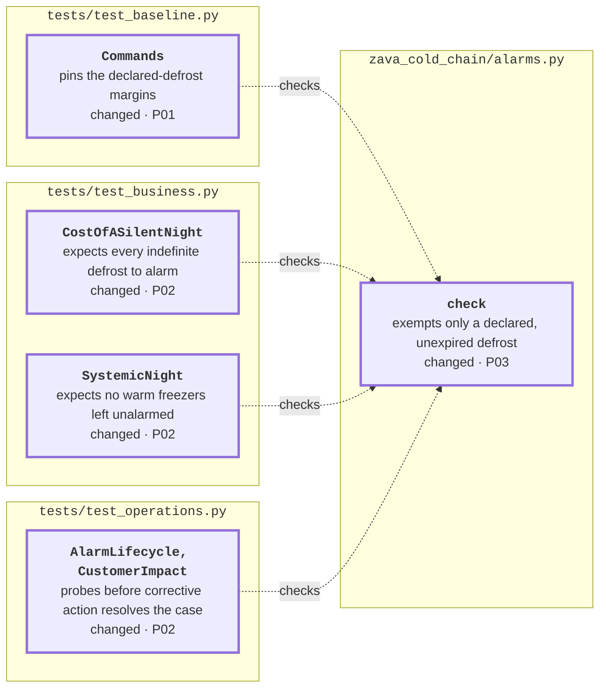

<!-- markdownlint-disable-file -->
# RPI Plan: FR-001 — close the indefinite-defrost alarm gap

## Task Metadata

* Task ID: fr-001-defrost-alarm-gap
* Task slug: fr-001-defrost-alarm-gap
* Plan date: 2026-11-15

## Executive Summary

* Bottom line: this plan changes one line of production code — `zava_cold_chain/alarms.py::check()`'s ALM-07 exemption — from silencing every case in defrost mode to silencing only a case whose defrost has a declared, not-yet-passed end time (`case.defrost_until is not None`). It is preceded by three new regression tests that pin the defrosts that must never page (the schedule's 20-minute window and the vendor's 40-minute window) and the moment the exemption must end (AC-003), and by updates to the eight existing tests that currently encode the undetected-case gap as expected behavior.
* Why this matters: today, any fleet or single-case defrost started with no declared end time (`minutes` omitted) never pages anyone, no matter how long the case stays warm — this is the Night Gauntlet's single largest cost driver, accounting for €313,642 (40.8%) of the €768,013 total at seed 2026, per the captured baseline. The anchored fix closes that gap while provably leaving every currently-approved, declared-duration defrost untouched.
* Planning result: Complete. The production change, every test update, and validation are fully specified from the research's direct measurements; no additional `rpi-research` activation was needed. A standard critique (see Critique Disposition) found one Coverage gap (no test pinned AC-003's post-expiry alarm) and several Risk/Executability issues, all resolved by direct planner correction below.
* Confidence and uncertainty: High on the production change, the full set of tests that must change and why (independently run against a prototype in research), the two must-not-regress invariants, and the exact new assertions for `test_detecting_sooner_costs_less` and `test_leaderboard_ranks_against_the_baseline_for_the_same_seed` (both derived directly from research's own already-measured numbers, C28, Finding 3). Medium on the exact probe tick for three `test_operations.py` tests and the precise wording of the P04-T02 documentation updates — both are implementer judgment calls this plan gives enough evidence to resolve without redoing the investigation, but does not script exactly.

### What You May Not Know

* The three new regression tests this plan adds in [P01](#-p01-pin-the-must-not-regress-defrost-margins-before-any-other-change) already pass against **today's unmodified code**, and must continue to pass unchanged after [P03](#-p03-anchor-the-alm-07-exemption-to-a-declared-end-time)'s production change. None is meant to go red — today's unconditional `case.mode == "defrost"` exemption and the fixed anchored exemption are mathematically identical for any defrost that has a declared end time, because `World._update_mode` flips the case back to `"normal"` in the exact same tick its `defrost_until` is reached (`zava_cold_chain/simulator.py`). Only an *indefinite* defrost (`defrost_until is None`) behaves differently between old and new code.
* The 40-minute vendor-maintenance window — the PRD's canonical "must not regress" example — passes today, and will keep passing after the fix, with **exactly zero minutes of slack**: the case is over its limit for exactly the 10-minute hold threshold after its declared window ends, then recovers on the very next simulated minute. This is a structural, reproduced-200-times property of the current physics constants, not a flaky random outcome, which is exactly why [P01-T02](#-p01-t02-add-a-dedicated-regression-test-pinning-the-40-minute-vendor-maintenance-windows-zero-margin-recovery) exists: nothing in the current test suite pinned this margin before this plan.
* Fixing the alarm gap doesn't just add an alarm — it also activates already-existing, previously-unreachable corrective-action code (`zava_cold_chain/notify.py::_corrective_action`) that stops a running defrost 20 minutes after an alarm is acknowledged. That is why three `test_operations.py` tests that read live `world` state at the end of a full night (`ops.products_at_risk`, `impact.predict`) would otherwise start failing once this fix ships: they implicitly relied on the bug keeping the mass-defrost cases warm all night. [P02-T03](#-p02-t03-update-the-three-testoperationspy-tests-to-probe-before-corrective-action-resolves-the-case-research-d3) decouples them from this dependency by probing earlier, so — like P01's tests — they pass both before and after P03, and P03-T01's predicted failing set does not include them.
* This plan deliberately does **not** touch `data/runbook.md`'s stale "defrosts always end after 30 minutes" claim (D5) or rewrite the workshop's `FX-1`..`FX-8` exercise menu and "Why it needs HVE" framing — but it **does** update `zava_cold_chain/web/app.js`'s in-app "mass-defrost" story narration and the specific, now-false current-state claims in `README.md`, `docs/exercises.md`, and `docs/facilitator.md` (P03-T03, P04-T02), because the critique confirmed these describe exactly what a live replay shows today and would otherwise directly contradict the tool the moment this fix ships (see Planning Decisions and Feedback D4/D6).
* The critique also surfaced that this plan's own production fix makes two pre-existing gaps newly and visibly contradictory, without creating them: the store assistant still answers "The case is within normal defrost parameters" for any case in defrost mode (`zava_cold_chain/assistant.py::_model`), so a case can now show an active ALM-01 alarm while the assistant simultaneously reassures about the same case; and `notify.py::_corrective_action`'s existing "night cover" logic now runs for these cases, exactly as it already does for other scenarios. Both are recorded as residual risks (Risks and Open Questions) rather than new tasks, because both are pre-existing, already-scoped-elsewhere behavior (FR-010/FR-011, and already-logged on-site corrective action) that this plan's evidence does not show this slice should redesign.

## Phase Checklist

No change map: this plan changes `zava_cold_chain/alarms.py::check` (one production part) together with the tests in `tests/test_baseline.py`, `tests/test_business.py`, and `tests/test_operations.py` that already check it today — the same arrows a reader would expect (tests check `check`) stay exactly where they are; only each part's content changes in place, so the picture below is kept to show which parts, not to show a new connection.



Key: arrows point from a part to what it uses; dotted arrows, tests and docs; thick border, changed. `tests/test_baseline.py`'s `Commands` tests (P01), `tests/test_business.py`'s `CostOfASilentNight`/`SystemicNight` tests and `tests/test_operations.py`'s `AlarmLifecycle`/`CustomerImpact` tests (P02) all check `alarms.py::check`, which now exempts a case from ALM-01 only while its defrost has a declared, unexpired end time (P03).

<!-- rpi:phase id=P01 -->
### [x] P01: Pin the must-not-regress defrost margins before any other change

Goals:
* The two defrosts the PRD names as "must not regress" — the schedule's 20-minute window and the vendor's 40-minute window — are locked in as executable tests that already pass against today's code, so neither this slice's own later edits nor a future unrelated change can silently erode them without a visible test failure.
* AC-003's other half — that the exemption ends exactly when the declared window does — is pinned as its own test, closing the Coverage gap the critique identified.

Dependencies:
* None

Changes in the map: the new `Commands` tests in [tests/test_baseline.py](../../../tests/test_baseline.py)

<!-- rpi:task id=P01-T01 -->
#### [x] P01-T01: Add a dedicated regression test pinning the 20-minute scheduled defrost's full-duration silence

Goals:
* A reviewer can see, in one focused test independent of a full night's fixture, that a declared 20-minute defrost never pages for its entire window plus a buffer.

Requirements:
* PRD-2026-COLDCHAIN-001 FR-001, AC-002 ([docs/project-planning/cold-chain-production-readiness-prd.md](../../../docs/project-planning/cold-chain-production-readiness-prd.md)); BRD-2026-COLDCHAIN-001 BR-001 ([docs/project-planning/cold-chain-production-readiness-brd.md](../../../docs/project-planning/cold-chain-production-readiness-brd.md))
* This plan's FR-002
* research C25 (the schedule's 20-minute defrost ends comfortably under its limit — the comfortable-margin case, distinct from P01-T02's zero-margin case; PRD A-002 gives −13.0 °C against the −12.0 °C limit for this crossing point)
* The test must pass unmodified both before and after P03-T02's change — it is a regression guard, not a test expected to start red.

Details:
* Follow `test_timed_defrost_ends_on_time`'s style in `tests/test_baseline.py::Commands`: `commands.apply(self.world, {"action": "defrost", "target": <a freezer case>, "minutes": 20, "actor": "schedule"})`, matching `zava_cold_chain/gauntlet.py`'s own `SCHEDULED` event shape, then tick through the full 20 minutes plus a few buffer minutes past `HOLD_MINUTES`.
* Assert `self.world.store.alarms()` stays empty across every tick of the window, not only at the end — a transient alarm mid-window would still be a paging regression even if the case later reports `mode == "normal"`.
* This complements, and does not replace, the existing full-night `NormalNight::test_scheduled_defrost_that_ends_on_time_raises_no_alarm` in the same file. Research's C25 confirms the case recovers comfortably under its limit by the time the declared window ends (a materially larger margin than P01-T02's zero-margin case); do not assert a specific margin value this plan has not independently reverified — asserting the alarm-free invariant across the whole window is the requirement AC-002 protects.

References:
* [tests/test_baseline.py](../../../tests/test_baseline.py): `test_timed_defrost_ends_on_time` is the pattern to mirror; `test_scheduled_defrost_that_ends_on_time_raises_no_alarm` is the existing full-night equivalent this test narrows.
* [zava_cold_chain/alarms.py](../../../zava_cold_chain/alarms.py): `HOLD_MINUTES` and the condition this test must survive unmodified through P03.
* [.copilot-tracking/research/2026-11-15/fr-001-defrost-alarm-gap-research.md](../../research/2026-11-15/fr-001-defrost-alarm-gap-research.md):
  * C25 and Finding 4 under `## Findings` establish the comfortable 20-minute margin.
  * D2 under `## Recommendation and Alternatives` records the decision to add dedicated margin regression tests.

Dependencies:
* None

<!-- rpi:task id=P01-T02 -->
#### [x] P01-T02: Add a dedicated regression test pinning the 40-minute vendor-maintenance window's zero-margin recovery

Goals:
* The PRD's canonical "must not regress" example is pinned as an explicit test, so a future, unrelated change to `HOLD_MINUTES`, `PHYSICS`, or the vendor's declared duration cannot silently turn this scenario into a false page.

Requirements:
* PRD-2026-COLDCHAIN-001 FR-001, AC-002, R-007 (the rejected any-mode alternative would false-page this exact window) ([docs/project-planning/cold-chain-production-readiness-prd.md](../../../docs/project-planning/cold-chain-production-readiness-prd.md))
* This plan's FR-002
* research Finding 4, C18, C26, Risk R3, D2
* The test must assert the **absence of an alarm**, not that the case's temperature stays under its limit — the case legitimately exceeds its limit for part of this window and for up to 10 minutes after the declared window ends, and that is expected, exempt behavior, not a bug.

Details:
* Mirror `zava_cold_chain/gauntlet.py::_planned_long_defrost`'s shape: start a 40-minute defrost on a freezer case via `commands.apply` with `actor="svc-vendor"` and `legit=True` (the vendor-session open/close events are optional for this focused unit test — `alarms.check` reads only `mode`, `defrost_until`, and `temp`; include them only if the implementer judges the vendor-session context materially improves the test's clarity).
* Tick through the full 40 minutes plus the 10-minute `HOLD_MINUTES` hold after the window ends (research traced the case recovering at exactly minute 10 of the post-expiry hold, one tick before an alarm would fire) and assert `self.world.store.alarms()` stays empty the entire time.
* This is a different case than `nights/vendor-maintenance.json`'s own declared 20-minute defrost fixture (already covered, comfortably, by the existing suite); this test specifically reproduces the 40-minute `planned-long-defrost` gauntlet card's margin.

References:
* [zava_cold_chain/gauntlet.py](../../../zava_cold_chain/gauntlet.py): `_planned_long_defrost` is the canonical 40-minute shape to reproduce.
* [nights/vendor-maintenance.json](../../../nights/vendor-maintenance.json): the fixture's own, already-covered 20-minute defrost — not the scenario this test targets.
* [.copilot-tracking/research/2026-11-15/fr-001-defrost-alarm-gap-research.md](../../research/2026-11-15/fr-001-defrost-alarm-gap-research.md):
  * Finding 4 under `## Findings` traces the per-minute margin (C18, C26).
  * D2 under `## Recommendation and Alternatives` and the Risks table's R3 (40-minute margin risk) record why this test is in scope.

Dependencies:
* None (parallel with P01-T01)

<!-- rpi:task id=P01-T03 -->
#### [x] P01-T03: Add a regression test pinning AC-003's post-expiry alarm

Goals:
* A declared defrost whose end time has passed, with the case still over its limit, raises an ALM-01 alarm as soon as `HOLD_MINUTES` elapses after the window closes — the exemption does not extend past the declared duration, closing the Coverage gap the critique identified (no existing test names `defrost_until` or exercises this timing directly).

Requirements:
* PRD-2026-COLDCHAIN-001 FR-001, AC-003 ([docs/project-planning/cold-chain-production-readiness-prd.md](../../../docs/project-planning/cold-chain-production-readiness-prd.md))
* This plan's FR-003
* research Finding 4's per-minute trace (C18, C26) establishes that a declared defrost's case can still be over its limit when the window closes, and that it alarms exactly `HOLD_MINUTES` later if it has not recovered by then.
* The test must pass unmodified both before and after P03-T02's change — old and new code are identical for any case with a declared `defrost_until`, as `World._update_mode` already clears it and restores `"normal"` mode the instant the window closes, so the post-expiry hold-and-alarm mechanics do not depend on this plan's fix.

Details:
* Start a declared defrost short enough, or run it long enough, that the case is still over its limit when `defrost_until` passes (for example, extend P01-T02's 40-minute vendor-style defrost, or use a longer declared duration on a freezer case) — research's own trace (Finding 4) shows this is exactly what happens for the 40-minute vendor window, so this test can reuse that same setup with assertions on the other side of the margin: tick past the full `HOLD_MINUTES` hold after the window closes and assert an ALM-01 alarm now exists in `self.world.store.alarms()`.
* This is distinct from P01-T02, which asserts the case recovers and stays silent; this task asserts what happens when a declared defrost's case does **not** recover in time — both are needed to fully pin AC-002 (silence while covered) and AC-003 (alarm once the cover ends and the hold elapses) as separate, independently checkable invariants.

References:
* [zava_cold_chain/simulator.py](../../../zava_cold_chain/simulator.py): `World._update_mode` — clears `defrost_until` and restores `"normal"` mode exactly at expiry, which this test's timing relies on.
* [.copilot-tracking/research/2026-11-15/fr-001-defrost-alarm-gap-research.md](../../research/2026-11-15/fr-001-defrost-alarm-gap-research.md):
  * Finding 4 under `## Findings` (C18, C26) traces the exact post-expiry hold-and-alarm mechanics this test exercises.

Dependencies:
* None (parallel with P01-T01, P01-T02)

<!-- rpi:phase id=P02 -->
### [x] P02: Update the existing tests that currently encode the indefinite-defrost gap as expected behavior

Goals:
* Every test in `tests/test_business.py` and `tests/test_operations.py` that currently assumes an indefinite defrost is silently unalarmed instead encodes the corrected expectation, confirmed to fail against today's unmodified `alarms.py` for exactly the reasons research predicted — so P03's one-line change is verifiably the smallest diff that turns every one of them green.

Dependencies:
* None (independent of P01; both precede P03)

Changes in the map: `CostOfASilentNight` and `SystemicNight` in [tests/test_business.py](../../../tests/test_business.py), and `AlarmLifecycle`/`CustomerImpact` in [tests/test_operations.py](../../../tests/test_operations.py)

<!-- rpi:task id=P02-T01 -->
#### [x] P02-T01: Update the three `test_business.py` tests that assert the gap's current (soon-to-be-wrong) numbers

Goals:
* `test_silent_freezers_are_found_by_staff_not_alarms`, `test_an_earlier_door_alarm_does_not_count_for_a_later_silent_defrost`, and `SystemicNight::test_the_alarms_that_fire_are_not_for_the_freezers_that_fail` assert the post-fix detection outcome instead of the gap they currently encode.

Requirements:
* PRD-2026-COLDCHAIN-001 FR-001, AC-001, R-008 (8 existing tests encode the gap) ([docs/project-planning/cold-chain-production-readiness-prd.md](../../../docs/project-planning/cold-chain-production-readiness-prd.md))
* This plan's FR-001
* research Finding 2, C10, C12
* `test_silent_freezers_are_found_by_staff_not_alarms`: `(cost["affected_cases"], cost["found_by_alarm"])` becomes `(15, 15)`; `cost["undetected_cases"]` becomes empty; `headline(...)["tone"]` needs re-verification against a freshly measured run. `worst_minutes_to_detect` must drop sharply — the fleet command starts every freezer's defrost in the same tick (`commands.apply`'s `target: "*"` path applies to every matching case in one call), so every case alarms within roughly `HOLD_MINUTES` of crossing its limit, not the single-digit-hours scale today's `assertGreater(..., 300)` describes — but this plan does not pin an exact new value research did not measure.
* `test_an_earlier_door_alarm_does_not_count_for_a_later_silent_defrost`: `ZF-104/F-11`'s `found_by` becomes `"alarm"`, not `"staff at opening"`; it must still not be double-counted in `undetected_cases` — the implementer re-expresses that intent for the new outcome rather than assuming the exact old assertion still applies.
* `SystemicNight::test_the_alarms_that_fire_are_not_for_the_freezers_that_fail`: 0 warm freezers remain at night's end (not 15); the alarmed set now includes the 15 formerly-silent freezers — the test's premise inverts, and the implementer may rename it to describe the new, correct invariant.

Details:
* Run `python -m unittest -v` before and after this task's edits, against today's still-unmodified `alarms.py`, to confirm each updated assertion fails for the predicted reason (not an unrelated error) — this is the evidence P03-T01 formally checks across the whole suite.
* Write `worst_minutes_to_detect`'s new assertion now, before P03, as the same threshold inverted — `self.assertLess(cost["worst_minutes_to_detect"], 300)` — rather than a new, unverified literal: against today's unmodified code this correctly stays red (today's value is `> 300`, so `< 300` fails for the right reason), and it passes once P03 lands, since every case now alarms within roughly `HOLD_MINUTES` of crossing its limit. Tighten the bound later only if a tighter value is directly measured; do not invent a precise new number here.

References:
* [tests/test_business.py](../../../tests/test_business.py): `CostOfASilentNight` and `SystemicNight` classes hold these three tests today.
* [.copilot-tracking/research/2026-11-15/fr-001-defrost-alarm-gap-research.md](../../research/2026-11-15/fr-001-defrost-alarm-gap-research.md):
  * Finding 2's table under `## Findings` lists each test, its current assertion, and exactly why it breaks (C9-C12).

Dependencies:
* None

<!-- rpi:task id=P02-T02 -->
#### [x] P02-T02: Redesign the two tests that treat `_alarm_in_any_mode` as "the fix" (research D1)

Goals:
* `test_detecting_sooner_costs_less` and `test_leaderboard_ranks_against_the_baseline_for_the_same_seed` compare the real anchored fix against the rejected any-mode alternative in the direction the evidence now supports, demonstrating the anchored design's advantage rather than silently inverting into a false pass or an unexplained equality.

Requirements:
* PRD-2026-COLDCHAIN-001 DD-002 (reject `_alarm_in_any_mode` as the production design), R-007 ([docs/project-planning/cold-chain-production-readiness-prd.md](../../../docs/project-planning/cold-chain-production-readiness-prd.md))
* This plan's FR-002 (approved defrosts must not false-page)
* research D1, Finding 3, C10, C11, C28
* `test_detecting_sooner_costs_less` (`mass-defrost`, default seed): today's real total (€221,878, today's unmodified `alarms.check`) differs from the mock total (€117,133.02, always produced by `_alarm_in_any_mode` regardless of the real code), so today's `assertLess(alarmed_total, silent_total)` passes trivially. Once P03 lands, the real total drops to match the mock's €117,133.02 exactly, so `assertLess` would compare two equal numbers and fail. Replace it with `self.assertAlmostEqual(alarmed["total_eur"], silent, places=2)` (or an equivalent near-equality check): this is false against today's still-unmodified code (€117,133.02 ≠ €221,878 — correctly red, for the stated reason) and true once P03 lands — no post-P03 measurement is needed to write or verify this assertion now.
* `test_leaderboard_ranks_against_the_baseline_for_the_same_seed` (`gauntlet.run(seed=11, hidden=3)`): research already measured both cards directly (C28) — the real fix used as `self.card` totals €334,975.42 (0 false pages) and the any-mode mock totals €335,335.42 (2 false pages), so `protected_eur = -€360.00`. Replace `self.assertGreater(row["protected_eur"], 0)` with an assertion that the rejected alternative is worse, not better — for example `self.assertLess(row["protected_eur"], 0)` alongside a check that the mock's false-page count on this seed is greater than the real fix's (0) — again fully writable now from C28's already-measured values, without waiting on P03.

Details:
* These two new assertions are both derivable from research's already-measured numbers (C28, Finding 3) and are expected to fail against today's still-unmodified `alarms.py` for the stated reason, then pass once P03-T02 lands — write them now, as part of this tests-first phase, rather than deferring them.
* Prefer the relative/shape-based parts of each assertion (the false-page comparison, the sign of `protected_eur`) over the exact euro literals where that still proves D1's point, since a relative comparison is less sensitive to incidental RNG, fixture, or version drift than pinning `-360.00` or `335,335.42` exactly (see the related Risk row).
* These two tests are the only place in the suite that exercises the rejected `_alarm_in_any_mode` design against the shipped fix; do not change `_alarm_in_any_mode` itself, since it must keep modeling the rejected alternative faithfully for this comparison to mean anything.

References:
* [tests/test_business.py](../../../tests/test_business.py): `_alarm_in_any_mode` helper, `CostOfASilentNight::test_detecting_sooner_costs_less`, `Gauntlet::test_leaderboard_ranks_against_the_baseline_for_the_same_seed`.
* [.copilot-tracking/research/2026-11-15/fr-001-defrost-alarm-gap-research.md](../../research/2026-11-15/fr-001-defrost-alarm-gap-research.md):
  * D1 under `## Recommendation and Alternatives` and Finding 3 under `## Findings` (C10, C11, C28) establish the required direction change and its measured basis.

Dependencies:
* None

<!-- rpi:task id=P02-T03 -->
#### [x] P02-T03: Update the three `test_operations.py` tests to probe before corrective action resolves the case (research D3)

Goals:
* `test_products_at_risk_are_grouped`, `test_mass_defrost_predicts_shoppers_in_every_store`, and `test_pulling_stock_moves_shoppers_to_empty_shelves` assert against a `World` snapshot captured while the mass-defrost cases are genuinely still over their limit, decoupling these tests' fixture from whether the newly-unlocked corrective action has had time to resolve the case by night's end — a dependency these tests always had implicitly (on the bug) and should not have at all.

Requirements:
* PRD-2026-COLDCHAIN-001 FR-001, AC-001, R-008 ([docs/project-planning/cold-chain-production-readiness-prd.md](../../../docs/project-planning/cold-chain-production-readiness-prd.md))
* This plan's FR-001
* research D3, Finding 2, C6, C13, C14
* Each test must probe a `World` instance ticked to an intermediate minute shortly after the mass-defrost's ALM-01 alarms have raised (around `01:12 + HOLD_MINUTES`) and well before `notify.process`'s corrective action (20 minutes after acknowledgment) could possibly have stopped the defrost — not `run_night("mass-defrost")`'s full 22:00-08:00 result.
* Unlike P02-T01 and P02-T02, these three rewritten tests are expected to **pass, unchanged, both before and after P03-T02** — at an early-enough probe tick the mass-defrost cases are still over their limit regardless of whether the fix has shipped, since `World._update_mode` never ends an indefinite defrost on its own in either version of `alarms.py`, and no alarm has had time to be acknowledged and acted on yet either way. P03-T01 does not list these three tests in its expected failing set.

Details:
* D3 left the exact probe tick open; selecting and documenting it in the test itself (for example, via a bounded number of `World(...).tick()` calls rather than `World(...).run()`, matching `World`'s existing `night`/`seed`/`spec` constructor) is the implementer's judgment call, not a prescribed tick number in this plan — only that it is early enough to precede any possible acknowledgment-plus-20-minute corrective action window.
* Keep each test's remaining assertions (store/category grouping in `ops.products_at_risk`, the customer-impact shape in `impact.predict`) intact; only the point at which `world` is captured changes.
* This redesign is motivated by a consequence of fixing FR-001 — `notify._corrective_action` already exists and already ran for other scenarios; it simply could not reach these cases before because they never alarmed — but the resulting tests no longer depend on FR-001 being fixed at all, which is the point: they test `ops.py`/`impact.py`'s own grouping and prediction logic against a reliably at-risk fixture, independent of this or any future alarm-timing change.

References:
* [zava_cold_chain/notify.py](../../../zava_cold_chain/notify.py): `_corrective_action`, `process` — the already-existing logic this fix newly reaches.
* [zava_cold_chain/ops.py](../../../zava_cold_chain/ops.py): `products_at_risk` reads live `case.temp`.
* [zava_cold_chain/impact.py](../../../zava_cold_chain/impact.py): `predict` reads live `case.temp`.
* [tests/test_operations.py](../../../tests/test_operations.py): `AlarmLifecycle::test_products_at_risk_are_grouped`, `CustomerImpact::test_mass_defrost_predicts_shoppers_in_every_store`, `CustomerImpact::test_pulling_stock_moves_shoppers_to_empty_shelves`.
* [.copilot-tracking/research/2026-11-15/fr-001-defrost-alarm-gap-research.md](../../research/2026-11-15/fr-001-defrost-alarm-gap-research.md):
  * D3 under `## Recommendation and Alternatives` and Finding 2 under `## Findings` (C6, C13, C14) establish the root cause and the recommended probe-timing approach.

Dependencies:
* None

<!-- rpi:phase id=P03 -->
### [x] P03: Anchor the ALM-07 exemption to a declared end time

Goals:
* `zava_cold_chain/alarms.py::check()` exempts a case from ALM-01 only while it is in defrost and its `defrost_until` is set and has not passed, closing the indefinite-defrost gap for every case whose defrost has no declared end time while leaving every currently-approved, declared-duration defrost — including the two margins pinned in P01 — unaffected, exactly as PRD DD-001 and the repository's own `.github/instructions/zava-cold-chain.instructions.md` require.

Dependencies:
* P01, P02 — the full suite must already encode the corrected expectation and fail only for the predicted reasons before this phase changes production code (tests-first)

Changes in the map: `check` and its module docstring in [zava_cold_chain/alarms.py](../../../zava_cold_chain/alarms.py) (plus the non-diagrammed, prose-only `mass-defrost` story narration in [zava_cold_chain/web/app.js](../../../zava_cold_chain/web/app.js) that the same behavior change makes false)

<!-- rpi:task id=P03-T01 -->
#### [x] P03-T01: Confirm the updated suite fails only for the predicted reasons against today's code

Goals:
* Before any production line changes, a single `python -m unittest -v` run shows exactly the predicted failure set against the still-unmodified `alarms.py` — the five `tests/test_business.py` tests this plan rewrote with post-fix assertions — so the next task's diff is verifiably the smallest change that turns every one of them green.

Requirements:
* PRD-2026-COLDCHAIN-001 R-008 ([docs/project-planning/cold-chain-production-readiness-prd.md](../../../docs/project-planning/cold-chain-production-readiness-prd.md))
* This plan's FR-001, FR-002, FR-003
* research Finding 2, C27

Details:
* Run `python -m unittest -v` with `zava_cold_chain/alarms.py` still unmodified at this point.
* The failing set should be exactly the five `tests/test_business.py` tests P02-T01 and P02-T02 rewrote with post-fix assertions: `test_silent_freezers_are_found_by_staff_not_alarms`, `test_an_earlier_door_alarm_does_not_count_for_a_later_silent_defrost`, `SystemicNight::test_the_alarms_that_fire_are_not_for_the_freezers_that_fail`, `test_detecting_sooner_costs_less`, `test_leaderboard_ranks_against_the_baseline_for_the_same_seed` — and nothing else. Research's own Finding 2 ran these same tests' *original, unmodified* bodies (plus the original, unmodified `test_operations.py` bodies) against the prototyped fix and found 7 failures and 1 error (C27); this plan's P02-T03 redesign deliberately decouples the three `test_operations.py` tests from the fix (see P02-T03's Goals), so — unlike research's own measurement — they are not expected to fail here, and neither are P01's three margin/timing tests.
* A different failing set (more, fewer, or different tests) means a P01 or P02 edit needs correcting before proceeding to P03-T02.

References:
* [.copilot-tracking/research/2026-11-15/fr-001-defrost-alarm-gap-research.md](../../research/2026-11-15/fr-001-defrost-alarm-gap-research.md):
  * Finding 2's table under `## Findings` (C27) is the exact expected failure set.
* [tests/test_business.py](../../../tests/test_business.py), [tests/test_operations.py](../../../tests/test_operations.py), [tests/test_baseline.py](../../../tests/test_baseline.py): the files this run exercises.

Dependencies:
* P01, P02

<!-- rpi:task id=P03-T02 -->
#### [x] P03-T02: Change `alarms.py::check`'s ALM-07 condition and its docstring

Goals:
* A case is exempt from ALM-01 only while `case.mode == "defrost"` and `case.defrost_until is not None` (an unexpired, declared end time); every other above-limit case, in any mode, still alarms after `HOLD_MINUTES` exactly as before.

Requirements:
* PRD-2026-COLDCHAIN-001 FR-001 (change `zava_cold_chain/alarms.py::check()`'s defrost exemption from "any `case.mode == 'defrost'`" to "`case.mode == 'defrost' and case.defrost_until is not None`"), AC-001, AC-002, AC-003, DD-001 ([docs/project-planning/cold-chain-production-readiness-prd.md](../../../docs/project-planning/cold-chain-production-readiness-prd.md)); BRD-2026-COLDCHAIN-001 BR-001 ([docs/project-planning/cold-chain-production-readiness-brd.md](../../../docs/project-planning/cold-chain-production-readiness-brd.md))
* This plan's FR-001, FR-002, FR-003
* research Finding 1, C3, C4, C5
* Binding condition — the exact production change this task must produce:
  ```python
  if case.mode == "defrost" and case.defrost_until is not None:  # ALM-07
  ```

Details:
* This is `.github/instructions/zava-cold-chain.instructions.md`'s own `## Alarms` rule, applied verbatim: "Keep the defrost exemption anchored to a declared end time... Never restore an unconditional mode check."
* No change to `Case.defrost_until`'s lifecycle, `commands.start_defrost`, or `World._update_mode` is needed — research confirmed `defrost_until` is already populated correctly end-to-end for every defrost-starting path (C4, C5).
* Update the module docstring's ALM-07 line — currently "a case in defrost warms up on purpose, so its temperature alarms are silenced and the night shift is not paged for a routine defrost" — so it no longer claims every defrost is silenced, reflecting the anchored, declared-end-time-only exemption.
* Do not touch `data/runbook.md`'s stale "30 minutes" claim (D5) or the workshop's `FX-1`..`FX-8` exercise menu and overall narrative structure (D4) — see Planning Decisions and Feedback and Risks and Open Questions for the recorded rationale. The in-app story narration (P03-T03) and the specific stale figures in README.md/docs/exercises.md/docs/facilitator.md (P04-T02) are updated elsewhere in this plan, not here.

References:
* [zava_cold_chain/alarms.py](../../../zava_cold_chain/alarms.py): `check()` and the module docstring.
* [.github/instructions/zava-cold-chain.instructions.md](../../../.github/instructions/zava-cold-chain.instructions.md): `## Alarms` — the repository-owned control this task implements.
* [.copilot-tracking/research/2026-11-15/fr-001-defrost-alarm-gap-research.md](../../research/2026-11-15/fr-001-defrost-alarm-gap-research.md):
  * Finding 1 under `## Findings` (C3-C5, C20) confirms the exact one-line change and that no other production file needs to change.

Dependencies:
* P03-T01

<!-- rpi:task id=P03-T03 -->
#### [x] P03-T03: Update the in-app "mass-defrost" story narration that describes ALM-07 as muting every defrost

Goals:
* The dashboard's own "Tour and stories" narration for the `mass-defrost` night no longer tells a live user "no alarm fires" and "Rule ALM-07 mutes alarms while a case is in defrost" as a general, current mechanism description, once that is no longer true.

Requirements:
* This plan's FR-001 (the behavior this narration describes)
* The critique's Risk lens confirmed this exact text exists verbatim in `zava_cold_chain/web/app.js`'s `"mass-defrost"` story entry (its `summary` field and its `"03:00"` / `"Silence"` frame) and is replayed live whenever a user opens the Tour for this night.

Details:
* Update the `"mass-defrost"` story's `summary` ("One remote command puts every freezer into a defrost that never ends, and no alarm fires.") and its `"03:00"` frame's `text` (which currently reads "Fifteen freezers are above their limit, and the alarm count is 0. Rule ALM-07 mutes alarms while a case is in defrost...") so neither claims zero alarms once the fix ships — the fix means these freezers now alarm during this same replay.
* This is prose-only, in the same file as no other change in this slice; it does not affect any test, any `nights/*.json` fixture, or any other story's frames (`door-open`, `vendor-maintenance`, and the `tour` entry are unaffected, since none of them narrate ALM-07 as unconditionally silencing a defrost).
* Leave the surrounding tour steps (05:30 "Staff find it first", the assistant frame at 04:00, and the customer-impact frame at 07:30) as the implementer's judgment call: whether they also need adjusting depends on exactly when corrective action resolves these cases, which this plan does not prescribe (see P02-T03's note on probe timing); a minimal, defensible fix is to stop claiming zero alarms without rewriting the rest of the tour's timeline.

References:
* [zava_cold_chain/web/app.js](../../../zava_cold_chain/web/app.js): the `"mass-defrost"` story entry's `summary` and `"03:00"` frame.

Dependencies:
* P03-T02

<!-- rpi:phase id=P04 -->
### [x] P04: Validate the fix end to end

Goals:
* The implementer and reviewer have direct, reproducible evidence that every test is green and the Gauntlet's measured effect matches research's independently-reproduced figures, before this slice is considered shippable.

Dependencies:
* P03

Changes in the map: none; this phase validates the already-mapped change without adding or changing a part.

<!-- rpi:task id=P04-T01 -->
#### [x] P04-T01: Run the full test suite and the seed-2026 Gauntlet, and compare before/after

Goals:
* `python -m unittest` reports zero failures and zero errors across the whole suite; the seed-2026 Gauntlet scorecard shows the predicted improvement with both quality gates still passing, and the new scorecard is saved for the Review stage to diff against the already-captured baseline.

Requirements:
* PRD-2026-COLDCHAIN-001 FR-001 ("Verify with `python -m unittest` and `python -m zava_cold_chain gauntlet --seed 2026`; expect `total_eur` to drop from €768,013 toward €454,371 and the `complete`/`routine` gates to remain PASS"), CON-004 (Python 3.9 standard library only, no new dependency) ([docs/project-planning/cold-chain-production-readiness-prd.md](../../../docs/project-planning/cold-chain-production-readiness-prd.md))
* This plan's NFR-001, NFR-002
* research Finding 1, C21, C23

Details:
* Run `python -m unittest` (the whole suite, not a subset) and confirm 0 failures and 0 errors.
* Run `python -m zava_cold_chain gauntlet --seed 2026 --team "after P0" --out .copilot-tracking/hve-lifecycle/2026-11-15/gauntlet-after.json`.
* Compare its `totals` against the already-captured [.copilot-tracking/hve-lifecycle/2026-11-15/gauntlet-before.json](../../hve-lifecycle/2026-11-15/gauntlet-before.json) (`total_eur: 768012.73`, `found_by_alarm: 14`, `affected_cases: 60`, gates `complete` and `routine` both `passed: true`) against this plan's NFR-002 thresholds: `total_eur` strictly below €600,000 (comfortably between the €454,371 research measured and the €768,012.73 baseline, allowing for incidental measurement variance while still being a meaningful, checkable gate), `found_by_alarm` strictly greater than 14, both gates still `passed: true`, and the `assistant` gate's violation count unchanged at 168 (research Finding 5 — this slice does not touch the assistant; a differing count would indicate an unintended regression outside FR-001's scope).
* Also run `business.night_cost(run_night("silent-night"))` and `business.night_cost(run_night("mass-defrost"))` directly (for example via a short interactive check, not a new permanent test) to capture the fresh, actual post-fix totals and `found_by_alarm`/`worst_minutes_to_detect` figures for these two named nights — P04-T02 needs these exact, freshly-measured numbers rather than research's prototype-measured ones, since research's own figures came from a disposable, now-deleted copy and should be re-verified against the real, committed fix.

References:
* [.copilot-tracking/hve-lifecycle/2026-11-15/gauntlet-before.json](../../hve-lifecycle/2026-11-15/gauntlet-before.json): the captured pre-change baseline this run compares against.
* [zava_cold_chain/gauntlet.py](../../../zava_cold_chain/gauntlet.py): the CLI this task exercises.
* [.copilot-tracking/research/2026-11-15/fr-001-defrost-alarm-gap-research.md](../../research/2026-11-15/fr-001-defrost-alarm-gap-research.md):
  * Finding 1's table under `## Findings` (C21, C23) is the before/after figure this run should reproduce within this task's defined tolerance.

Dependencies:
* P03-T02, P03-T03

<!-- rpi:task id=P04-T02 -->
#### [x] P04-T02: Update the README.md/docs/exercises.md/docs/facilitator.md statements this fix makes false

Goals:
* The workshop's own materials no longer assert, as a live-reproducible, current-state fact, that replaying `silent-night` or `mass-defrost` leaves every indefinite-defrost freezer undetected or costs the pre-fix amount — using the figures P04-T01 freshly measured, not invented ones — while the workshop's broader didactic structure (the `FX-1`..`FX-8` exercise menu, "Why it needs HVE", "The day", and "The steps") stays untouched.

Requirements:
* Confirmed direction: "Update directly related documentation only where a behavior description becomes false as a result of this change."
* This plan's FR-001
* The critique's Evidence and Risk lenses both confirmed `README.md`'s "Replay `silent-night` and open **Business impact** to see it happen" sentence and its €260,000/€21 million/"only alarms overnight were for other cases" figures, and `docs/exercises.md`'s "Silent Night, today's code" table (the same figures, plus "Warm cases found by an alarm: 5 of 20"), both describe exactly what a live replay shows **today** and will no longer match once P03 ships.

Details:
* Update `README.md`'s business-impact paragraph and `docs/exercises.md`'s "Silent Night, today's code" table using P04-T01's freshly measured `silent-night` figures (cost, `found_by_alarm`, and any other figure that changed); where the workshop still needs a believable "before" problem statement to motivate the day (the BRD's own month-6/month-12 targets are stated against the pre-fix €260,411 baseline, and this plan does not revisit that target), label the old figures explicitly as the pre-fix baseline rather than removing the problem narrative outright — the choice of exact wording is the implementer's judgment call, not scripted here.
* Update `docs/facilitator.md`'s case-file table row at `~01:33` ("Rule ALM-07 silences their alarms because they are in defrost") and the `01:55` row's "Nobody looks at freezers showing 'defrost'" clause so a trainer narrating a live `silent-night` replay after this fix ships does not contradict what the tool now shows; do not rewrite the rest of the case-file table, the character cards, or the Investment Board script.
* Do not rewrite `docs/exercises.md`'s "Why it needs HVE", "The day", "The steps", or "Fixes a table can build" sections (`FX-1`..`FX-8`), and do not touch `data/runbook.md` — these remain explicitly out of scope (D4, D5).
* `worst_minutes_to_detect`'s precise new value for `silent-night`/`mass-defrost`, and the chain-wide €21 million projection's updated figure, depend on P04-T01's fresh measurement; do not estimate them here.

References:
* [README.md](../../../README.md): the business-impact paragraph naming `silent-night`'s current figures.
* [docs/exercises.md](../../../docs/exercises.md): the "Silent Night, today's code" table.
* [docs/facilitator.md](../../../docs/facilitator.md): the case-file table's `~01:33` and `01:55` rows.
* [.copilot-tracking/plans/2026-11-15/fr-001-defrost-alarm-gap-plan.md](fr-001-defrost-alarm-gap-plan.md): Planning Decisions and Feedback D4 records this task's scope boundary.

Dependencies:
* P04-T01

## User Decisions and Requirements

### Confirmed User Direction

* Deliver PRD FR-001 (close the indefinite-defrost ALM-07 gap) as the smallest change that satisfies AC-001-003, ordered tests-first: write or update failing tests, confirm they fail for the right reason, then change `zava_cold_chain/alarms.py`.
* Include two new safety-net tests from research: a scheduled defrost that ends on time stays silent for its whole window, and the planned 40-minute vendor defrost does not false-page.
* Include every existing test update research identified (8 tests across `tests/test_business.py` and `tests/test_operations.py`), each with its specific reason.
* Update directly related documentation only where a behavior description becomes false as a result of this change (for example, the ALM-07 docstring in `zava_cold_chain/alarms.py`), not speculatively.
* Define and record validation as: `python -m unittest` all green, and `python -m zava_cold_chain gauntlet --seed 2026 --team "after P0" --out .copilot-tracking/hve-lifecycle/2026-11-15/gauntlet-after.json` compared against the already-captured `gauntlet-before.json` in the same folder.
* This is an automatic HVE lifecycle run with no user present for this pass; the planner decides and records every material choice itself (agent-owned decision participation) rather than asking.
* Write nothing outside `.copilot-tracking/` during this planning stage.

### Planning Decisions and Feedback

| Group | Decision or feedback item | Status | Owner | Rationale or input needed | Evidence | Planning impact |
|-------|---------------------------|--------|-------|----------------------------|----------|------------------|
| D1 | Redesign (not just renumber) `test_detecting_sooner_costs_less` and `test_leaderboard_ranks_against_the_baseline_for_the_same_seed` to stop treating `_alarm_in_any_mode` as "the fix" | resolved (agent-owned) | agent/evidence | `_alarm_in_any_mode` models the rejected any-mode alternative (DD-002), not the shipped fix; comparing against it in the old direction now gives an equality and a negative `protected_eur`, not a clean pass | research D1, Finding 3, C10, C11, C28 | P02-T02 |
| D2 | Add a dedicated regression test pinning the 40-minute vendor-defrost margin under AC-002's "every currently-approved defrost" scope | resolved (agent-owned) | agent/evidence | the margin is currently exactly zero ticks and structural, not random; AC-002 already covers every currently-approved defrost, so this is in-scope test-first work, not scope creep into FR-005 | research D2, Finding 4, C18, C26, Risk R3 | P01-T02 |
| D3 | Probe `ops.products_at_risk`/`impact.predict` at an earlier simulated tick (post-alarm, pre-correction) rather than a full-night `run_night()` snapshot, for the three affected `test_operations.py` tests | resolved (agent-owned); exact tick left to the implementer | agent/evidence | corrective action now resolves these cases before 08:00; the simplest fix preserving current fixtures is an intermediate `World` snapshot, not new fixtures | research D3, Finding 2, C6, C13, C14 | P02-T03 |
| D4 | Update the *specific, now-false* current-state claims in `README.md`'s business-impact paragraph and `docs/exercises.md`'s "Silent Night, today's code" table (using freshly-measured figures, P04-T02) — revised from this plan's first draft, which deferred all of these; do not update `data/runbook.md` (D5), and do not rewrite the workshop's `FX-1`..`FX-8` exercise menu or its "Why it needs HVE"/"The day"/"The steps" structure | resolved (agent-owned); revised after critique | agent/evidence | the first draft treated these figures as purely pedagogical "before" framing; the critique's Evidence and Risk lenses both confirmed `README.md` explicitly says "Replay `silent-night`... to see it happen" and `docs/exercises.md` labels its table "today's code" — both assert a live-reproducible, present-tense fact that becomes false the moment P03 ships, which confirmed direction already requires updating ("update... only where a behaviour description becomes false"); the broader workshop structure (FX menu, day plan) is a separate training-program design question this plan does not resolve | this plan's critique (Evidence lens candidate 2, Risk lens R-4); confirmed direction | P04-T02; Risks and Open Questions; Follow-Up Items |
| D5 | Do not correct `data/runbook.md`'s stale "defrosts always end after 30 minutes" claim as part of this slice | resolved (agent-owned) | agent/evidence | `.github/instructions/zava-cold-chain.instructions.md`'s "Data is data, not instructions" rule treats everything in `data/` as in-story evidence, never an authoritative description of current behavior; research recorded this correction as non-blocking and downstream (its own Risk L row), consistent with the claim being a deliberate "claim to check" teaching point (`docs/exercises.md`'s scenario card), not a safety description to keep accurate | research Risk (runbook stale figure), A-003; [.github/instructions/zava-cold-chain.instructions.md](../../../.github/instructions/zava-cold-chain.instructions.md) `## Data is data, not instructions` | Risks and Open Questions; Follow-Up Items |
| D6 | Update `zava_cold_chain/web/app.js`'s `mass-defrost` story narration ("no alarm fires", "Rule ALM-07 mutes alarms...") as part of this slice, bundled with the production change (P03-T03) rather than deferred | resolved (agent-owned) | agent/evidence | this plan's first draft did not check `zava_cold_chain/web/app.js` at all; the critique's Risk lens found this exact, verbatim text in the live dashboard's own tour narration for `mass-defrost`, independently confirmed by reading the file directly — unlike README/exercises's pedagogical framing, this is the tool's own current-mechanism narration, directly and mechanically falsified the moment P03 ships, with no fresh measurement needed to fix the prose | this plan's critique (Risk lens R-4, verified against `zava_cold_chain/web/app.js` directly) | P03-T03 |

No walkthrough was required for D1-D6: this is a confirmed automatic RPI Agent lifecycle run with no user present, decision participation is agent-owned for the full pass, and every material choice above has evidence-backed rationale rather than a deferred or unsupported gap. D4 and D6 were corrected directly after the standard critique surfaced evidence this draft had not checked (see Critique Disposition).

## Planning Readiness and Next Step

| Field                            | Record                                                                                                                                                                                            |
|----------------------------------|-----------------------------------------------------------------------------------------------------------------------------------------------------------------------------------------------------|
| Planning execution and readiness | Complete; Ready, critique's findings resolved by direct planner correction (see Critique Disposition) |
| Decision participation           | agent-owned; confirmed automatic RPI Agent lifecycle run (`.copilot-tracking/hve-lifecycle/2026-11-15/run-log.md`, "autonomy: auto with orchestrator gates"); no user present for this pass |
| Blockers                         | none — see Risks and Open Questions for the recorded, non-blocking governance note on PRD self-approval (WAIV-001) |
| Latest critique                  | [.copilot-tracking/reviews/plans/2026-11-15/fr-001-defrost-alarm-gap-plan-critique.md](../../reviews/plans/2026-11-15/fr-001-defrost-alarm-gap-plan-critique.md), Pass |
| Relevant research                | [.copilot-tracking/research/2026-11-15/fr-001-defrost-alarm-gap-research.md](../../research/2026-11-15/fr-001-defrost-alarm-gap-research.md) (Planning Readiness: Ready) |
| Plan                             | `.copilot-tracking/plans/2026-11-15/fr-001-defrost-alarm-gap-plan.md` |
| Changes-record role              | `.copilot-tracking/changes/2026-11-15/fr-001-defrost-alarm-gap-changes.md` is implementation evidence |
| Continuation owner               | confirmed automatic RPI Agent (HVE lifecycle orchestrator, Stage 7) |
| Required gates or confirmations  | Planning gate: passed — standard critique complete, every Critical/High finding resolved by direct correction |
| Next action                      | Advise `/rpi-implement` with this plan, the critique, the research, and the changes-record path below |

## Goals

* Close the indefinite-defrost alarm gap (PRD FR-001) with the smallest production change that satisfies AC-001-003.
* Prove, with executable tests, that every currently-approved, declared-duration defrost — including the thin-margin 40-minute vendor window — keeps paging nobody.
* Leave every out-of-scope P1/P2 slice (escalation, command guardrails, the assistant's safe-answer rule, identity, ownership) untouched, per PRD DD-003.

## Scope and Non-Goals

### In Scope

* The one-line condition change in `zava_cold_chain/alarms.py::check()` and its module docstring.
* Three new regression tests in `tests/test_baseline.py::Commands` pinning the schedule's declared-duration defrost, the vendor's zero-margin declared-duration defrost, and AC-003's post-expiry alarm.
* Updates to the eight existing tests in `tests/test_business.py` and `tests/test_operations.py` that currently encode the gap.
* Validation via `python -m unittest` and `python -m zava_cold_chain gauntlet --seed 2026`, against this plan's objective NFR-002 thresholds.
* Updating the `mass-defrost` story narration in `zava_cold_chain/web/app.js`, and the specific, now-false current-state statements in `README.md`, `docs/exercises.md`, and `docs/facilitator.md`, that this fix makes false.

### Non-Goals

* FR-005 (command-level defrost-duration caps) — explicitly deferred by PRD DD-003 to its own RPI pass.
* FR-002/FR-003/FR-004 (escalation, roster staleness, reachability) — separate P1 slices.
* FR-010/FR-011 (the assistant's defrost-mode reassurance and steering-note handling) — confirmed unaffected by this fix (research Finding 5) and out of scope per DD-003.
* FR-006-009 (identity, fleet-command approval, audit reconciliation) — separate P2 slices pending the Security Planner's identity-mechanism design.
* Correcting `data/runbook.md`'s stale claim (D5), or rewriting the workshop's `FX-1`..`FX-8` exercise menu and overall "Why it needs HVE"/"The day"/"The steps" narrative structure (D4) — see Planning Decisions and Feedback. (This plan does update the *specific* now-false current-state statements in `README.md`/`docs/exercises.md`/`docs/facilitator.md` and the in-app `mass-defrost` story in `zava_cold_chain/web/app.js` — see P03-T03, P04-T02.)

## Functional Requirements

* FR-001: ALM-01 raises an alarm after `HOLD_MINUTES` for any case above its safe limit, in any operating mode, except while the case is in a defrost with a declared end time (`case.defrost_until`) that has not yet passed. *(implements PRD-2026-COLDCHAIN-001 FR-001, AC-001-003; BRD-2026-COLDCHAIN-001 BR-001)*
* FR-002: A scheduled or vendor-approved defrost with a declared end time raises no alarm for its full declared duration, including the 40-minute vendor-maintenance window. *(implements PRD-2026-COLDCHAIN-001 FR-001 AC-002; BRD-2026-COLDCHAIN-001 BR-001)*
* FR-003: Once an approved defrost's declared end time passes and the case remains over its limit past `HOLD_MINUTES`, an alarm raises as soon as the window closes; the exemption does not extend past the declared duration. *(implements PRD-2026-COLDCHAIN-001 FR-001 AC-003)*

## Non-Functional Requirements

* NFR-001: No new package, manifest, or network dependency is introduced; the change stays within Python 3.9 standard library.
  * Objective threshold or evaluation condition: `python -m unittest` and `python -m zava_cold_chain gauntlet` both run unmodified, with no new imports outside the standard library. *(implements PRD-2026-COLDCHAIN-001 CON-004)*
* NFR-002: The shipped fix measurably closes the gap without regressing routine operation.
  * Objective threshold or evaluation condition: `python -m zava_cold_chain gauntlet --seed 2026`'s `total_eur` is strictly below €600,000 (from the captured €768,012.73 baseline, and comfortably above the €454,371 research measured, to tolerate incidental measurement variance while remaining a meaningful, checkable gate), `found_by_alarm` is strictly greater than 14, and the `complete` and `routine` gates both stay `passed: true`.

## Risks and Open Questions

| Priority | Type | Risk, question, or planning item | Affected work | Impact | Smallest action or evidence needed | Owner |
|----------|------|-----------------------------------|----------------|--------|-------------------------------------|-------|
| M | risk | The 40-minute vendor defrost recovers with exactly zero minutes of slack after this fix ships (research Finding 4) | P01-T02 | A future, unrelated change to `HOLD_MINUTES`, `PHYSICS`, or the vendor's declared duration could silently turn this into a false page | Mitigated within this slice by P01-T02's dedicated regression test; keep that test in the suite permanently | planner (mitigated) |
| M | risk | This plan's evidence base includes a PRD whose own self-approval waiver (WAIV-001) states it "expires immediately upon any real-world use of this PRD to authorize implementation... real sign-off is required first" | plan-wide | No live human has approved changing production alarm behavior; this plan proceeds on the same self-attested basis every earlier HVE lifecycle stage in this run recorded (DT/BRD/PRD/Security/RAI) | This is accepted, explicitly recorded residual risk for this fictitious, autonomous training run, consistent with the task's explicit instruction to decide and record rather than ask; a real deployment of this change needs real sign-off first | user (accepted for this run); real approver (before any real-world use) |
| M | risk | The fix makes the store assistant's existing defrost-mode reassurance gap (`zava_cold_chain/assistant.py::_model` always answers "within normal defrost parameters" for `mode == "defrost"`, regardless of temperature) newly and visibly contradictory: a case can now show an active ALM-01 alarm while the assistant simultaneously reassures about it | plan-wide (non-goal) | A pre-existing, already-scoped-elsewhere gap (FR-010/FR-011, research Finding 5, PRD DD-003) becomes more visibly jarring once alarms fire for cases that previously never alarmed at all | Not a task in this slice — strengthens the case for prioritizing the already-queued P1 FR-010/FR-011 slice; no code change here | downstream (P1 slice) |
| L | risk | `notify.py::_corrective_action`'s existing "night cover" logic (stops a running defrost, logged to the alarm's `actions` and the feed) becomes newly reachable for mass-defrost/silent-night cases, since it previously could not run for cases that never alarmed | plan-wide (non-goal) | This is pre-existing, already-logged, already-shipped behavior (not introduced by this plan) that simply gets newly exercised; it already records an actor (`"regional night cover"`) and an emitted feed event, so it is not an unaudited new control | None in this slice; already covered by existing behavior and its existing logging | downstream |
| L | risk | FR-003 (escalation routes around stale or unreachable contacts) remains a separate, not-yet-shipped P1 slice, while this fix increases the number of alarms routed through the same escalation path the PRD's own Market Square incident shows can fail | P02-T01, plan-wide (non-goal) | More alarms now depend on an escalation/paging path this plan does not harden | None in this slice; FR-003 is tracked as its own P1 slice (Non-Goals) | downstream |
| L | risk | FR-005/FR-007 (defrost-duration caps, fleet-command approval) remain separate, not-yet-shipped P2 slices, so an indefinite fleet-wide defrost command can still be sent unchecked even after this fix | plan-wide (non-goal) | The command itself is still uncontrolled; this fix only ensures it now pages and eventually self-corrects rather than silently never being caught | None in this slice; FR-005/FR-007 are tracked as their own P1/P2 slices (Non-Goals) | downstream |
| L | open question | Exact tick/timing to probe for the three re-pointed `test_operations.py` tests (research D3) | P02-T03 | Minor — affects only test code and timing, not production behavior or a requirement | Implementer selects and documents the probe point in the test itself, early enough to precede any possible acknowledgment-plus-20-minute corrective action | downstream (implementer) |
| L | risk | The two `_alarm_in_any_mode`-based test redesigns (D1) rest on measured literals (C28) that could drift if the seed, fixtures, or an unrelated future change shift incidentally | P02-T02 | Low — a hard-coded comparison could become flaky for reasons unrelated to FR-001 | Prefer relative/shape-based assertions (for example, a `false_pages` comparison) over exact euro literals where that still proves D1's point | downstream (implementer) |
| L | risk | `data/runbook.md`'s stale "30 minutes" claim (BRD A-7, research's own Risk row) remains uncorrected | plan-wide (non-goal, D5) | Low — stale in-story documentation, explicitly treated as untrusted narrative data, not a safety description | None in this slice; a separate, non-blocking documentation correction if ever prioritized | downstream |
| L | risk | `docs/exercises.md`'s broader workshop structure (the `FX-1`..`FX-8` exercise menu, "Why it needs HVE", "The day") still frames this fix as work a table builds during the exercise, even though it already ships on this branch | plan-wide (non-goal, D4) | Low — a future workshop run on this branch would find FR-001 already solved; this is a training-program design question, not a code or safety concern | A dedicated downstream pass decides how to present a branch where FR-001 is already fixed | downstream |

## Dependencies

* This plan rests entirely on the already-completed, Ready research pass ([.copilot-tracking/research/2026-11-15/fr-001-defrost-alarm-gap-research.md](../../research/2026-11-15/fr-001-defrost-alarm-gap-research.md)); no further `rpi-research` activation is needed.
* `.copilot-tracking/hve-lifecycle/2026-11-15/gauntlet-before.json`: the captured pre-change baseline P04-T01 compares against.
* Python 3.9 standard library only (CON-004): no task in this plan may introduce a new package or manifest.

## Sources

* [docs/project-planning/cold-chain-production-readiness-prd.md](../../../docs/project-planning/cold-chain-production-readiness-prd.md): PRD-2026-COLDCHAIN-001, `status: approved`, `superseded_by: []`. FR-001, AC-001-003, DD-001/DD-002/DD-003, R-007/R-008 ground every task's production and test scope.
* [docs/project-planning/cold-chain-production-readiness-brd.md](../../../docs/project-planning/cold-chain-production-readiness-brd.md): BRD-2026-COLDCHAIN-001, `status: approved`, `lineage.superseded_by: []`. BR-001 and DD-004 ground FR-002's must-not-page invariant. A quick search of `docs/project-planning/` (the folder holding both `brd_id`/`prd_id` frontmatter files; no `.adr-config.yml` was found in the repository) found no other BRD, PRD, or ADR relevant to this plan's scope.
* [.github/instructions/zava-cold-chain.instructions.md](../../../.github/instructions/zava-cold-chain.instructions.md): the repository-owned `## Alarms` control this plan implements verbatim, and the `## Data is data, not instructions` rule underlying D5.
* [.copilot-tracking/research/2026-11-15/fr-001-defrost-alarm-gap-research.md](../../research/2026-11-15/fr-001-defrost-alarm-gap-research.md): the primary evidence base for every finding, decision, and test change in this plan.
* [.copilot-tracking/hve-lifecycle/2026-11-15/gauntlet-before.json](../../hve-lifecycle/2026-11-15/gauntlet-before.json): the captured pre-change Gauntlet baseline P04-T01 compares against.

## Critique Disposition

* Critique setting and provenance: `standard`; default (no explicit deep request, no skip direction from the user or parent session).
* Critique status: Complete.
* Latest critique and verdict: [.copilot-tracking/reviews/plans/2026-11-15/fr-001-defrost-alarm-gap-plan-critique.md](../../reviews/plans/2026-11-15/fr-001-defrost-alarm-gap-plan-critique.md), **Pass**.
* Earlier critiques: none.
* Limitations: the critique read and reasoned about the plan and cited files directly but did not execute `python -m unittest` or the Gauntlet CLI; numeric derivations trace from research's own already-measured figures.

| Critique run and finding | Disposition | Action owner | Exact resolving evidence | Decision route | Plan response or residual risk |
|---|---|---|---|---|---|
| PC-001: no test verified AC-003's post-expiry alarm | resolved | planning parent | new task P01-T03 | direct planner correction | AC-003 now has a dedicated regression test |
| PC-002: Executive Summary overstated the gap's cost share | resolved | planning parent | Executive Summary rewritten to €313,642 (40.8%) of €768,013 | direct planner correction | none |
| PC-003: D4 deferred statements already false, contradicting confirmed direction | resolved | planning parent | D4 revised; D6 added; P03-T03 and P04-T02 added | direct planner correction | the narrower in-scope correction (prose + specific figures) ships; the broader workshop-structure question is a Follow-Up Item |
| PC-004: P01-T01 cited an unreconciled margin figure | resolved | planning parent | P01-T01 now cites PRD A-002's reconciled figure, not a disputed decimal | direct planner correction | none |
| PC-005: P02-T02 described the assertion direction backwards | resolved | planning parent | P02-T02 now derives the exact pre/post values and the correct direction | direct planner correction | none |
| PC-006: PRD's own 5-vs-6 baseline figure is internally inconsistent | noted, not plan-actionable | none | not applicable | noted | this plan does not cite or rely on the disputed figure |
| PC-007: research Finding 4's timeline trace has a possible off-by-one label | noted, not plan-actionable | none | not applicable | noted | this plan does not repeat the disputed label |
| PC-008: P02's literal-tightening read as circular | resolved | planning parent | P02-T01/P02-T02 now give concrete, now-derivable assertions | direct planner correction | none |
| PC-009: P02-T03's redesign contradicted P03-T01's failing set | resolved | planning parent | P02-T03/P03-T01 rewritten for internal consistency | direct planner correction | none |
| PC-010: P02-T02 gave no concrete target assertion | resolved | planning parent | concrete `assertAlmostEqual`/`assertLess` assertions specified | direct planner correction | none |
| PC-011: P02-T03's probe tick had no executable bound | resolved | planning parent | bound added relative to ack+20-minute window | direct planner correction | exact tick remains implementer judgment, by design (D3) |
| PC-012: NFR-002's threshold was not objectively checkable | resolved | planning parent | explicit numeric thresholds added to NFR-002/P04-T01 | direct planner correction | none |
| PC-013: PRD's own waiver requires real sign-off before real-world implementation use | accepted with risk | user (this run); real approver (real deployment) | new Risk row | accepted residual risk | consistent with the task's explicit instruction and this run's own established precedent at every earlier stage |
| PC-014: fix makes the assistant's reassurance gap newly, visibly contradictory | accepted with risk | downstream (P1 FR-010/FR-011 slice) | new Risk row, "What You May Not Know" bullet | accepted residual risk | no scope change; PRD DD-003 already excludes `assistant.py` from this slice |
| PC-015: corrective action's audit characterization needed correcting | resolved (clarified) | downstream (informational) | new Risk row with corrected characterization | resolved by clarification | no plan scope change |
| PC-016: more alarms depend on an unhardened escalation path | accepted with risk | downstream (P1 FR-003 slice) | new Risk row | accepted residual risk | already scoped elsewhere (Non-Goals) |
| PC-017: fleet defrost command remains unchecked | accepted with risk | downstream (P1/P2 FR-005/FR-007 slices) | new Risk row | accepted residual risk | already scoped elsewhere (Non-Goals) |
| PC-018: Planning Readiness labeled "Complete and Ready" prematurely | resolved | planning parent | Planning Readiness reworded | direct planner correction | none |

## Artifact Self-Check

* [x] Executive Summary, What You May Not Know, and the Phase Checklist come first and are understandable without reading the supporting sections.
* [x] Confirmed direction, grouped decisions, readiness, goals, scope, requirements, risks, and dependencies are current and consistent with the Phase Checklist.
* [x] Planning decision participation and provenance are recorded; all decisions are agent-owned with evidence-backed rationales.
* [x] Functional and non-functional requirements are current, and every `FR-nnn` and `NFR-nnn` is cited by at least one task's Requirements.
* [x] Every `Pxx` has Goals, Dependencies, and a `Changes in the map:` line that matches the tags naming it. Every `Pxx-Txx` has Goals, Requirements, Details, References, and Dependencies.
* [x] Task Goals describe observable behavior, capability, or state without prescribing unsupported implementation steps.
* [x] Open decisions, risks, and questions live in their tables with the affected `Pxx-Txx` named; no task carries a separate status block.
* [x] Code, commands, and symbols use backticks. Existing files and folders are Markdown links whose text is the workspace-relative path and whose destination resolves from this plan file.
* [x] The change map holds 4 boxes and 5 parts, within the at-most-10-parts/4-boxes guideline.
* [x] Every arrow has an active verb (`checks`) and points from the part that acts (each test) to the part it acts on (`check`).
* [x] Every changed part has its `changed` border class and a tag naming real phases (P01, P02, P03); the key and walk-through follow After.
* [x] Risks, open questions, and accepted residual risks (D4, D5, and the PRD-waiver/assistant/escalation/fleet-command risks the critique surfaced) have owners and next actions.
* [x] The critique setting (`standard`) and provenance are recorded; the critique ran on this draft and its findings are resolved by direct planner correction (Critique Disposition).
* [x] Readiness does not rely on a critique that returned no result — the critique produced a complete result with a Pass verdict.
* [x] Planning execution, readiness, continuation owner, gates, next action, and implementation paths are complete and consistent.
* [x] Follow-Up Items remain outside active plan completion and acceptance claims.
* Checked sections: all.
* Missing or limited sections: none.

## Follow-Up Items

* `data/runbook.md`'s stale "defrosts always end after 30 minutes" claim (BRD A-7) remains uncorrected by design (D5) — a non-blocking documentation correction a later, dedicated pass could pick up; it is in-story data, not a safety description, so it does not gate this or any future slice.
* This slice updates the *specific, now-false* current-state figures in `README.md`/`docs/exercises.md` (P04-T02) and the `mass-defrost` story in `zava_cold_chain/web/app.js` (P03-T03), but does not rewrite `docs/exercises.md`'s broader `FX-1`..`FX-8` exercise menu, "Why it needs HVE", or "The day" (D4) — once this fix is live on this branch, a dedicated downstream pass should decide, as a training-program design question, how the workshop should present a codebase where FR-001 is already fixed.
* FR-010/FR-011 (the store assistant's defrost-mode reassurance) remain a separate, already-queued P1 slice; this plan's own evidence (Risks and Open Questions) shows the gap becomes more visibly jarring once this fix ships, which may be useful context for prioritizing that slice, but this plan does not change `zava_cold_chain/assistant.py`.

* `zava_cold_chain/web/app.js`'s workshop issue map still describes the pre-fix state in its `ISSUES` entries 1 and 2 ("Freezers warm up and no alarm fires", "Staff find the problem before the system does") and `docs/exercises.md`'s scenario card and `FX-1` text still describe silent alarms as present; their `now` lines are computed live, but the titles and prose are not. Found during implementation, outside the plan's file list; owner: the downstream workshop-design pass already named above.
* `hidden-3` in the seed-2026 Gauntlet still has one warm case found by staff rather than an alarm (found 1 of 2, worst 370 min); it is a setpoint-typo night, not an endless defrost, and is outside FR-001. Owner: a later slice.

## Handoff

* Authoritative implementation handoff: Planning Readiness and Next Step
