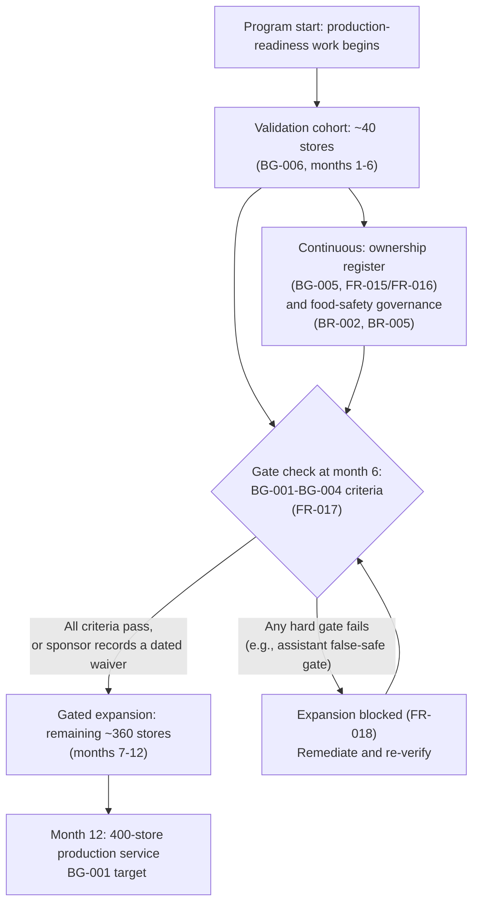

# Zava Cold Chain Monitor — Production Readiness for the 400-Store Rollout

> **BRD-2026-COLDCHAIN-001** | Status: approved | Version: 1.0.0 | Last Updated: 2026-11-15

> [!CAUTION]
> **Disclaimer:** This agent is an assistive tool only. It does not provide business approval, regulatory compliance validation, or executive sign-off and does not replace business analysts, stakeholder representatives, compliance teams, or other qualified human reviewers. The output consists of suggested business requirements, objectives, and scope definitions to support a user's own business analysis and decision-making. All Business Requirements Documents, business objectives, stakeholder analysis, and requirement traceability generated by this tool must be independently reviewed and validated by appropriate business and compliance reviewers before adoption. Outputs from this tool do not constitute business approval, requirements sign-off, or stakeholder commitment.

> **Provenance note.** Zava, Inc. is a fictitious training company (HVE workshop scenario). This BRD is Stage 2 of an autonomous HVE Lifecycle run with no live user present. All stakeholder evidence is either (a) directly read from this repository's code and synthetic data, cited by file, or (b) answers from a **simulated Zava stakeholder panel role-played by the orchestrator across the Stage 1 Design Thinking session and this BRD's Round 1 questions — role-play, not real stakeholder validation.** Every figure drawn from the application's business-impact model was computed directly against this repository (Night Gauntlet and `zava_cold_chain.business` module) rather than invented. This BRD must be independently reviewed by real Zava stakeholders before any budget, contract, or go/no-go decision is made on its basis.

---

## Executive Summary

Zava's board has publicly committed to taking the Cold Chain Monitor, the store assistant, and the vendor's remote service from a 5-store pilot to all 400 stores within 12 months. Stage 1 Design Thinking work (`./.copilot-tracking/dt/cold-chain-production-readiness/`) found that the pilot does not work today because of any single missing feature — it works because a small number of people's informal judgment and familiarity quietly cover five gaps that no formal control actually closes: alarm triage and escalation, command approval versus enforcement, an AI assistant that can be steered by well-intentioned notes with no accountable safety owner, a system-wide pattern of vacant ownership, and an unproven assumption that the pilot's controls — not just its concept — will hold at eighty times the scale.

This BRD quantifies that risk directly against the application's own business-impact model. Replaying the worst recorded pilot-region night (`silent-night`, seed 2026) shows a €260,411 pilot-region cost, a €20,832,904 projected cost for the same incident at 400-store scale, and an estimated €41,665,808 annual exposure at the chain's own assumption of two such nights a year. Of the 20 cases that went above their safe limit that night, only 5 (the chiller cases) were caught by an alarm, in 10 minutes; the other 15 (every affected freezer case) were found only by staff at opening, 234–347 minutes later — and the store assistant gave a reassuring, non-escalating answer about all 20 of them. Across a ten-night Night Gauntlet sample, this reassuring-answer pattern recurred 168 times, a result the Gauntlet itself flags as a hard-gate failure for any team claiming the assistant is fixed.

The business objective is not "add the missing controls" in isolation: it is to replace trust-by-familiarity with trust-by-design for alarms, commands, safety-adjacent statements, and ownership, while proving — on a validation cohort, before the full 400-store commitment — that the controls hold at scale, and without losing the one outcome every stakeholder role independently wants preserved: a system that does not page people for things that are actually fine. The executive sponsor (simulated panel, Round 1) accepted a phased approach: validate on roughly 40 stores over the first 6 months, then gate the remaining ~360 stores over months 7–12, provided gating criteria are agreed before the cohort starts. The sponsor's own target is to bring the Cost of a Silent Night-class incident under €50,000 (pilot-region-equivalent basis) by month 6 and under €20,000 by month 12, at the same incident frequency — a roughly 81% and 92% reduction respectively from today's measured baseline.

This BRD scopes six business goals (BG-001–BG-006), eighteen functional requirements (FR-001–FR-018), six business rules (BR-001–BR-006), six non-functional requirements (with Compatibility and Portability explicitly scoped out as not material at BRD level), three constraints, and a traceability matrix with 100% FR-to-AC and 100% FR-to-BG coverage. It carries forward, as explicit assumptions and open questions rather than silent gaps, every item Stage 1 and this BRD's own stakeholder round could not resolve — including the vendor-contract timeline, the unresolved defrost-duration discrepancy, and the fact that no live human team or primary regulator/end-shopper voice has yet validated this synthesis. The primary success metric is BG-001 (Cost of a Silent Night-class incident), with BG-006 (scale-validation gating) as the controlling process metric that governs whether the board's 12-month, 400-store commitment proceeds as a single cutover or as the phased plan this BRD recommends.

---

## Business Context

Zava runs about 400 grocery stores (`README.md`; `data/business.json`). Five of them are the pilot region for the Cold Chain Monitor (refrigeration alarms and commands), a rule-based store assistant, and the refrigeration vendor's remote service — three systems the board has already decided, in its public framing, to roll out to every store within 12 months (`docs/exercises.md`). The pilot's current design choices — no sign-in ("the dashboard is only reachable from the store network," ZFW-305), a shared vendor service account ("the vendor contract requires a single service account," ZFW-203), an alarm rule that silences temperature alarms during any defrost (ALM-07, since 2016), and a store assistant that reads technician and vendor notes verbatim — were each a deliberate, documented trade-off for a 5-store pilot, not an oversight. Stage 1's synthesis is that scaling to 400 stores is, in effect, a bet that the informal trust holding those trade-offs together (a small, familiar night crew; a known vendor team; a short pager list) will hold at eighty times the scale, without anyone having tested whether it is the controls or only the concept that the pilot proved.

**Quantified business exposure** (computed directly from this repository; method: `python3 -m zava_cold_chain gauntlet --seed 2026 --team brd-probe` for the aggregate sample, and a direct `zava_cold_chain.simulator.run_night("silent-night", seed=2026)` + `zava_cold_chain.business.night_cost()` call for the per-incident detail):

| Measure | Pilot region (5 stores) | Projected at 400 stores | Source |
|---|---|---|---|
| `silent-night`-class incident cost | €260,411 | €20,832,904 | `business.night_cost()`, `projection()` |
| Annual exposure at 2 such nights/year (chain assumption) | n/a | €41,665,808 | `data/business.json` `nights_per_year`; `business.projection()` |
| `mass-defrost`-class incident cost | €221,878 | ≈€17,750,240 | Night Gauntlet seed 2026 |
| Worst single-case detection time, `silent-night` | 347 minutes (5h 47m) | same (no alarm triage exists today) | `business.night_cost()["worst_minutes_to_detect"]` |
| Cases found by alarm vs. staff-at-opening, `silent-night` | 5 of 20 (25%) vs. 15 of 20 (75%) | same | `business.night_cost()["detection"]` |
| Reassuring/non-escalating assistant answers, `silent-night` | 20 of 20 affected cases | same | `business.night_cost()["false_safe"]` |
| Reassuring/non-escalating assistant answers, 10-night Gauntlet sample | 168 (hard-gate warning) | same pattern, chain-wide | Night Gauntlet seed 2026, team `brd-probe` |
| Pilot fix budget approved to date | €150,000 (code-level fixes only) | not yet approved for 400-store infrastructure/operations | `data/fixes.json` |

These figures motivate, but do not by themselves resolve, the business requirements below; `data/business.json`'s own note states its assumptions are "synthetic, invented... not real figures, forecasts or food-safety guidance," and this BRD treats them accordingly — as a directionally sound, repeatable model for comparing the cost of inaction against the cost of the fix catalogue (`data/fixes.json`, FX-1 through FX-8), not as audited financial figures.

**Strategic drivers:**

1. A public board commitment to 400 stores within 12 months (executive sponsor; non-negotiable per Round 1 Q1 and the Stage 1 panel).
2. Food-safety and regulatory exposure: the recall-cost assumptions in `data/business.json` (`recall_cost_eur` €250,000; `p_recall_undetected` 2%; `p_recall_false_safe` 3%) model a direct financial link between undetected or falsely-reassured warm stock and recall/press/regulator cost.
3. Trust preservation: every stakeholder role in the Stage 1 panel independently named the same thing they do not want to lose — a system that does not page people for things that are actually fine (ALM-07's own original rationale).
4. An unresolved scale question: the pilot has only ever run at 5-store scale; Stage 1's Insight 5 and this BRD's BG-006 treat "does the pilot prove the controls, or only the concept" as the central open business question the rollout plan must answer before committing the remaining ~360 stores.

---

## Stakeholders

Stakeholders are classified using the Mendelow Power/Interest grid (see [stakeholder-analysis.md](../../.github/skills/project-planning/requirements-author/references/_shared/stakeholder-analysis.md) in the `requirements-author` skill). All role evidence is simulated panel role-play (Stage 1, two rounds; this BRD, one round) or direct code/data citation as noted.

| Stakeholder / Role | Power | Interest | Engagement Strategy | Evidence |
|---|---|---|---|---|
| Executive sponsor / Investment Board | High | High | **Manage closely.** Owns the 12-month timeline (CON-001), the production rollout budget decision (CON-003), and the BG-006 go/no-go gate. | Simulated panel, Stage 1 + Round 1 Q1/Q2 |
| Food-safety officer (or deputy) | High | High | **Manage closely.** Sole stock-disposition authority (`data/roster.json`, active since 2014); mandatory sign-off under BR-002/BR-005; seat on the rollout governance board. | `data/roster.json`; simulated panel Round 1 Q5 |
| Regional IT | High | High | **Manage closely.** Accountable owner for BG-003 (command integrity) and co-owner of BG-005 (ownership register); proposes the new "store platform engineer" role. | `data/roster.json`; simulated panel Round 1 Q3/Q4 |
| Night store manager / regional night cover | Medium | High | **Keep informed, consult.** Primary voice on escalation/triage design (FR-002–FR-004); the role actually paged is regional night cover, not a per-store manager (A8, Stage 1). | `data/roster.json`; simulated panel Round 1 Q6 |
| Refrigeration technician | Medium | High | **Keep informed, consult.** Primary voice on defrost behavior (BR-001) and note-handling rules (FR-012); owner of record for case controllers/firmware under vendor contract. | `data/roster.json`; Stage 1 panel |
| Vendor support / vendor engineers | Medium | Medium | **Keep satisfied.** Consulted on session/identity design (FR-010); dependent on vendor-contract renegotiation timeline (CON-002), outside this BRD's authority to resolve. | `data/issues.json` ZFW-203; simulated panel Round 1 Q4 |
| Store Operations (pager/contact list owner) | Medium | Medium | **Keep satisfied.** Current owner of the escalation contact list (`data/roster.json`, "last updated 2022"); responsible party for FR-003 until BG-005 reassigns/co-owns it. | `data/roster.json`; `data/issues.json` ZFW-274 |
| Store systems team (alarm rules owner) | Medium | High | **Keep informed.** Owner of record for ALM-07 and the alarm engine since 2015; responsible for FR-001/FR-004. | `data/roster.json` |
| *Proposed* "store platform engineer" (new role, vacant) | High once filled | High once filled | **Hidden tier today.** Must be created, resourced, and filled before it can be engaged (BG-005, A-3). Proposed owner for fleet commands. | Simulated panel Round 1 Q3 (assumption) |
| *Proposed* AI/data-platform owner (new role, vacant) | High once filled | High once filled | **Hidden tier today.** Must be created, resourced, and filled before it can be engaged (BG-005, A-3). Proposed owner for the store assistant and its guardrails. | Simulated panel Round 1 Q3 (assumption) |
| Regulatory / food-safety compliance authority; end-shopper | Assumed High / Assumed High | Unconfirmed | **Hidden tier — monitor, then engage directly.** No primary regulator or end-shopper voice was available to Stage 1 or this BRD's round; their view of "trust" is assumed, not evidenced (A-9). | Stage 1 `problem-space-handoff.md`; carried forward unresolved |

---

## Design Decisions

| Decision ID | Decision | Rationale | Decision Maker | Date | Related IDs |
|---|---|---|---|---|---|
| DD-001 | Use MoSCoW prioritization for all FR/NFR items. | Aligns BRD priority labels with the PRD handoff's `priority` field and the `prioritization-schemes` skill. | BRD Builder (autonomous) | 2026-11-15 | All FR, NFR |
| DD-002 | Adopt the executive sponsor's Round 1 Cost-of-a-Silent-Night targets (<€50,000 by month 6, <€20,000 by month 12, pilot-region-equivalent basis, same incident frequency) as BG-001's KPI basis, rather than deriving an independent target. | These are the only board-stated figures obtained (even though simulated); inventing a different target without stakeholder evidence would be less defensible than using the panel's own number and flagging its provenance. | BRD Builder (autonomous) | 2026-11-15 | BG-001 |
| DD-003 | Scope this BRD to production-readiness business requirements for the existing Cold Chain Monitor platform — alarm/escalation integrity, command integrity, identity, AI-assistant governance, ownership, and scale-validation gating. Exclude new product capabilities unrelated to trust/safety, and exclude authoring the vendor contract's legal text itself (tracked as CON-002, a dependency, not a BRD deliverable). | Matches the Stage 1 scope boundary (solution directions explicitly out of scope for Methods 1–3) extended one step into "what must the production service do," without drifting into unrelated feature requests or legal drafting this BRD has no authority to perform. | BRD Builder (autonomous) | 2026-11-15 | All BG |
| DD-004 | Classify "a scheduled, on-time defrost must not raise an alarm" as a Business Rule (BR-001), not a Constraint. | It is a standing operating policy the solution must uphold (ALM-07's own original intent), not a boundary imposed from outside the solution. | BRD Builder (autonomous) | 2026-11-15 | BR-001, FR-001 |
| DD-005 | Self-approve Govern-phase sign-off using recorded rationale, in the absence of live human approvers, because this is an autonomous no-user-present run. This is recorded as a condition requiring real sign-off, not a substitute for it. | The orchestrator's instructions direct the agent to decide and record rationale rather than block on an unavailable live approval step; the Sign-Off section names this explicitly so it cannot be mistaken for genuine authorization. | BRD Builder (autonomous) | 2026-11-15 | Sign-Off, Waivers |
| DD-006 | Treat the Stage 1 two-round simulated panel and this BRD's one additional round as the authoritative business-evidence source; carry any item still unresolved after those rounds forward as an explicit assumption or open question, never silently closed. | Matches the orchestrator's two-round limit and the instruction to record, not hide, unresolved items. | BRD Builder (autonomous) | 2026-11-15 | All Assumptions, Open Questions |

---

## Business Goals

**BG-001 — Reduce the Cost of a Silent Night-class incident**
Priority: MUST
Statement: Reduce the measured cost of a `silent-night`-class incident (the business-impact model's own worst-case scenario) from its current baseline to under €50,000 (pilot-region-equivalent basis) within 6 months of production-readiness work starting, and to under €20,000 within 12 months, at the same assumed incident frequency.
KPI: `silent-night`-class incident cost, measured by replaying the scenario through the Night Gauntlet / Cost-of-a-Silent-Night business-impact model (`zava_cold_chain/business.py`, `data/business.json`).
Baseline: €260,411 (pilot-region, measured directly, seed 2026); €20,832,904 projected at 400-store scale per incident; €41,665,808/year at the chain's own 2-incidents/year assumption.
Target: <€50,000 pilot-region-equivalent (≈<€4,000,000 at 400-store projection) by month 6; <€20,000 pilot-region-equivalent (≈<€1,600,000 at 400-store projection) by month 12.
Timeframe: Months 6 and 12 from program start.
Measurement source: Night Gauntlet scorecards, re-run each cohort milestone.
Owner: Executive sponsor (accountable for the board target); Regional IT and Store Systems team (responsible for the controls that drive the metric).

**BG-002 — Make escalation reach someone who can act, every time**
Priority: MUST
Statement: Ensure that any case above its safe temperature limit for longer than the hold-for-testing threshold (30 minutes, `data/business.json` `hold_after_minutes`) reaches an acknowledged, reachable, resourced on-call contact, rather than depending on a stale pager list or an unfiltered alarm feed.
KPI: Percentage of threshold breaches that reach an acknowledged on-call contact within 15 minutes, and percentage reaching one within 30 minutes (the hold-for-testing threshold itself).
Baseline: On the worst recorded night, 15 of 20 affected cases (75%) were found only by staff at opening, 234–347 minutes after crossing the limit; only the 5 chiller cases (25%) were caught by alarm, in 10 minutes each, because they were a different alarm type that happened to still be live. 0% of freezer breaches reached an acknowledged on-call contact within 15 or even 60 minutes that night.
Target: ≥95% of threshold breaches reach an acknowledged on-call contact within 15 minutes, and 100% within 30 minutes, on the validation cohort by month 6, sustained chain-wide by month 12.
Timeframe: Months 6 and 12.
Measurement source: Night Gauntlet `detection` field (`minutes_to_detect`, `found_by`) across the cohort's replayed and hidden nights.
Owner: Night store manager / regional night cover (primary user); Store systems team and Regional IT (accountable for the alarm/escalation chain and the contact roster).

**BG-003 — Make "approved" and "enforced" mean the same thing**
Priority: MUST
Statement: Ensure every remote session and fleet or single-case command is attributable to one named, individually authenticated person, and executes only within a technically enforced — not merely logged — approved scope and time window.
KPI: Percentage of commands/sessions attributable to a named individual; percentage of fleet commands executed within an enforced approval window.
Baseline: 0% of vendor remote sessions are attributable to a named individual today (all run under the shared `svc-vendor` account, `data/issues.json` ZFW-203); there is no technical range or window enforcement on any command today (ZFW-259, open since 2022); the command audit's `actor` field cannot reliably identify an individual sender when a shared account is used (ZFW-246, open since 2021).
Target: 100% of commands/sessions attributable to a named individual, and 100% of fleet commands executed within an enforced approval window, chain-wide, by month 12, with a validation-cohort demonstration by month 6 for the portions not blocked by CON-002 (the vendor-contract dependency).
Timeframe: Month 6 (cohort demonstration, non-vendor portions) and month 12 (chain-wide, subject to CON-002).
Measurement source: Command audit completeness report; approved-vs-executed scope/window mismatch report.
Owner: Regional IT (accountable); proposed "store platform engineer" role (responsible, once created per BG-005).

**BG-004 — Give every safety-adjacent statement a traceable, accountable origin**
Priority: MUST
Statement: Eliminate reassuring or non-escalating answers from the store assistant about any case that needs a human food-safety decision, and ensure the food-safety officer reviews any note or channel that could steer such an answer.
KPI: Count of reassuring/non-escalating assistant answers about cases needing a human decision, measured by the Night Gauntlet's assistant-check hard gate.
Baseline: 168 such answers across a 10-night Night Gauntlet sample (seed 2026); on the `silent-night` scenario alone, the assistant gave a reassuring answer for all 20 of the 20 affected cases, including "Yes, the case is safe" for cases that were simultaneously undetected by any alarm.
Target: 0 reassuring/non-escalating answers about a case needing a human decision, verified by the Night Gauntlet's assistant-check hard gate on every rollout cohort before expansion; sustained at 0 chain-wide by month 6 (this fix does not depend on the vendor-contract or budget constraints that gate BG-003).
Timeframe: Month 6, sustained through month 12 and every subsequent cohort.
Measurement source: `python3 -m zava_cold_chain gauntlet --seed <trainer-seed>` assistant-check hard gate, run per cohort.
Owner: Proposed AI/data-platform owner role (accountable, once created per BG-005); food-safety officer (mandatory governance reviewer under BR-002/BR-005).

**BG-005 — Give every system area a living, resourced owner**
Priority: MUST
Statement: Close every currently vacant ownership gap and establish a recurring re-attestation cadence so a lapse is surfaced, not discovered during an incident.
KPI: Count of in-scope system areas with no named, active, resourced owner; escalation-contact-list staleness rate.
Baseline: 2 of 5 in-scope system areas have no owner today — fleet commands (vacant since 2021, contractor's contract ended) and the store assistant (vacant since 2024, "the role that ran the pilot moved to another team") — and the escalation contact list carries at least one confirmed-unreachable contact with no routine audit cadence (open since 2024-03-12, ZFW-274).
Target: 0 vacant-owner system areas and a monthly-attested, current escalation contact list, chain-wide, by month 3 — ahead of BG-002–BG-004's technical work, since ownership is a precondition for remediating them.
Timeframe: Month 3, sustained thereafter via the monthly re-attestation cadence (FR-016).
Measurement source: Ownership register review (FR-015/FR-016).
Owner: Regional IT (fleet commands and overall register); proposed AI/data-platform owner (store assistant, once created); Store Operations (escalation contact list).

**BG-006 — Prove the controls, not just the concept, hold at scale before committing the remaining stores**
Priority: MUST
Statement: Validate BG-001 through BG-005 on an expanded cohort materially larger than the 5-store pilot before committing the remaining stores to the board's 400-store target.
KPI: Gating decision status (Pass/Warn/Fail per BG-001–BG-004 criterion) on the validation cohort before the month-7 go/no-go decision.
Baseline: 0 — the pilot has never run its controls at any scale larger than 5 stores; whether the pilot proves the controls or only the concept is Stage 1's own unresolved closing question.
Target: A validation cohort of approximately 40 stores (8x pilot scale, per the executive sponsor's Round 1 answer) runs for 6 months; 100% of the finalized gating criteria (detailed thresholds to be set in PRD scoping, Open Question Q-1) pass, or the executive sponsor records an explicit, dated waiver, before expansion to the remaining ~360 stores begins in months 7–12.
Timeframe: Months 1–6 (validation cohort), month 7 (go/no-go decision), months 7–12 (gated expansion).
Measurement source: Night Gauntlet cohort scorecards against BG-001–BG-004 criteria.
Owner: Executive sponsor (accountable for the go/no-go decision); Regional IT and food-safety officer (responsible for gate evidence).

**SMART Evaluation** (self-assessed at this autonomous Define→Govern gate; a real reviewer must re-confirm):

- [x] **S**pecific: Each BG names a bounded mechanism (alarm/escalation, command enforcement, assistant answers, ownership, phased gating) tied to one of the five Stage 1 insight clusters.
- [x] **M**easurable: Each BG has a directly computed or directly computable KPI with a stated baseline.
- [x] **A**chievable: Targets reuse the simulated executive sponsor's and night store manager's own stated numbers rather than inventing more aggressive ones; BG-002's 95%/100% split acknowledges perfect reliability may not be realistic in 15 minutes.
- [x] **R**elevant: Every BG traces to a Stage 1 insight and HMW (see Traceability Matrix).
- [x] **T**ime-bound: Every BG has month 3/6/7/12 milestones aligned to the board's 12-month window (CON-001).

**Status**: `pass` (self-assessed; a real BRD reviewer and the board must independently confirm before this status is treated as final — see Sign-Off).

### Outcome Hypothesis Handoff Provenance

Not applicable. No `OUTCOME_HYPOTHESIS_TO_BRD_HANDOFF_V1` payload was supplied upstream; this BRD's business goals were authored directly from the Stage 1 Design Thinking handoff (`problem-space-handoff.md`) and this BRD's own Round 1 stakeholder evidence, per the Discover-phase activities in the `requirements-author` skill.

---

## Business Rules

**BR-001** — A scheduled, on-time defrost must not raise a temperature alarm.
Category: Operational.
Rationale: This is the one constraint every stakeholder role (implicitly, via the original 2016 rationale for ALM-07) and the exercise framing itself names as something that must survive any change; paging for routine, on-time defrosts erodes trust and causes staff to ignore real alarms (the false-page cost in `data/business.json`).
Enforceability: Mandatory.
Enforcing FRs: FR-001.

**BR-002** — Any statement that stock is safe to sell, whether human- or assistant-authored, follows a two-tier control: (a) anything entering the food-safety record or a keep/hold/discard decision requires explicit sign-off by the food-safety officer or deputy, non-negotiable; (b) a staff-facing draft answer may omit that sign-off only if it shows its data source, states its uncertainty, and never itself asserts the case is safe.
Category: Policy (food-safety governance).
Rationale: Directly stated by the food-safety officer, simulated panel Round 1 Q5, responding to the pilot's unresolved gap where a technician's or vendor's reassurance note reached the assistant with no accountable review.
Enforceability: Mandatory.
Enforcing FRs: FR-011, FR-012, FR-013.

**BR-003** — Every remote session and command is attributable to one named, individually authenticated person; shared or service accounts are prohibited for production vendor sessions, subject to CON-002 (the current vendor contract mandates one shared service account) until that contract is renegotiated or an interim technical control is adopted per Risk R-2.
Category: Policy / contractual (pending CON-002).
Rationale: Directly responds to the shared `svc-vendor` account gap (K5, ZFW-203) and the command-audit identity gap (K4, ZFW-246) that Regional IT and vendor support both named as an "honour system backed by a log."
Enforceability: Mandatory, subject to CON-002's vendor-contract dependency for the vendor-identity portion.
Enforcing FRs: FR-006, FR-009, FR-010.

**BR-004** — Every in-scope system area has a named, resourced, active owner recorded in a living ownership register; a vacancy is surfaced and remediated on a defined cadence, never silently carried.
Category: Operational / governance.
Rationale: Every interviewed Stage 1 role named an ownership gap as someone else's or admitted holding one they were never resourced for (Insight 4); this rule makes that pattern structurally visible instead of discoverable only during an incident.
Enforceability: Mandatory.
Enforcing FRs: FR-015, FR-016.

**BR-005** — The food-safety officer or deputy is consulted before any new channel, notes pipeline, or automated feature is built that can influence a stock-safety-adjacent decision — before it ships, not after.
Category: Policy (food-safety governance).
Rationale: Directly responds to the food-safety officer's Stage 1 testimony: "I was never asked... If the assistant now tells staff whether stock is safe, that claim needs an accountable owner, and right now there is none."
Enforceability: Mandatory.
Enforcing FRs: FR-014.

**BR-006** — No store cohort beyond the validation cohort is brought onto the production service until the defined gating criteria (BG-001–BG-004 targets) are met for the current cohort, or the executive sponsor records an explicit, dated waiver.
Category: Governance / operational.
Rationale: Directly responds to Insight 5 and the panel's own closing question ("does the pilot prove the controls work, or only the idea?") and operationalizes the executive sponsor's Round 1 acceptance of a phased, gated rollout.
Enforceability: Mandatory.
Enforcing FRs: FR-017, FR-018.

---

## Functional Requirements

**FR-001** — The monitor shall raise an alarm for any case whose temperature is above its defined safe limit for longer than the configured hold-for-testing threshold, in any operating mode including defrost, except when the case is within a scheduled, on-time defrost per BR-001.
Actor: Monitor alarm engine.
Trigger: Temperature-and-time threshold breach.
Expected Outcome: An alarm is raised and routed for escalation (FR-002), unless the breach falls entirely within an approved, on-time scheduled defrost window.
Acceptance Criteria: AC-001, AC-002.
Business Goals: BG-001, BG-002.

**FR-002** — The system shall escalate an unacknowledged alarm to the next reachable, resourced on-call contact within a configured escalation window, recording every escalation attempt.
Actor: Notification/escalation service.
Trigger: Alarm remains unacknowledged past the configured window.
Expected Outcome: The alarm reaches a contact who can act, and the attempt is recorded whether or not it succeeds.
Acceptance Criteria: AC-003.
Business Goals: BG-002.

**FR-003** — The system shall validate the escalation contact roster on a recurring cadence and flag any contact that has not been attested as reachable within that cadence, routing escalations around flagged contacts.
Actor: Escalation roster service; Store Operations.
Trigger: Scheduled re-attestation cycle, or an escalation attempt against a flagged contact.
Expected Outcome: A stale or unreachable contact is surfaced before, not during, an incident.
Acceptance Criteria: AC-004.
Business Goals: BG-002, BG-005.

**FR-004** — The system shall present active alarms to night cover in a triaged view that distinguishes urgency (for example, minutes above limit and case type), rather than an undifferentiated list.
Actor: Night store manager / regional night cover.
Trigger: One or more active alarms at a store.
Expected Outcome: Night cover can tell which alarms need attention right now without assuming the system already filtered that for them.
Acceptance Criteria: AC-005.
Business Goals: BG-002.

**FR-005** — The command service shall enforce a configured safe range for setpoints and defrost duration per case type, rejecting or automatically capping any command outside that range.
Actor: Command service.
Trigger: A setpoint or defrost command is submitted.
Expected Outcome: Out-of-range commands cannot execute unchecked; the rejection or capping is recorded.
Acceptance Criteria: AC-006.
Business Goals: BG-003.

**FR-006** — The command service shall require a named, individually authenticated identity for every command and remote session; shared or service-account identities shall not be accepted in production.
Actor: Command service; identity provider.
Trigger: Any command or remote-session request.
Expected Outcome: Every command is attributable to one person, not a shared account.
Acceptance Criteria: AC-007.
Business Goals: BG-003.

**FR-007** — The command service shall require explicit, time-boxed human approval, naming the approver, before executing any command that targets more than one case (a fleet command).
Actor: Command service; named approver.
Trigger: A fleet-scoped command is submitted.
Expected Outcome: No fleet command executes without a named, time-boxed human approval.
Acceptance Criteria: AC-008.
Business Goals: BG-003.

**FR-008** — The command audit record shall compare the approved scope and time window of a command against its actual executed scope and window, and flag any mismatch for review.
Actor: Command audit service.
Trigger: Command execution completes.
Expected Outcome: "Approved" and "executed" are reconciled automatically, not left to an after-the-fact honour system.
Acceptance Criteria: AC-009.
Business Goals: BG-003.

**FR-009** — The platform shall authenticate every user — store staff, technician, vendor engineer, and regional IT — with an individual credential; the current no-sign-in, store-network-only trust model shall not extend beyond the pilot.
Actor: Identity and access service.
Trigger: Any user session request against the production service.
Expected Outcome: Every session is tied to a named individual.
Acceptance Criteria: AC-007.
Business Goals: BG-003.

**FR-010** — The vendor remote-access channel shall confine each vendor session to an approved, time-boxed change window tied to a named vendor-engineer identity.
Actor: Vendor remote-access service; vendor engineer.
Trigger: A vendor remote-session connection attempt.
Expected Outcome: Sessions outside an approved window, or not tied to a named identity, are refused or terminated.
Acceptance Criteria: AC-010.
Business Goals: BG-003.
Dependency: CON-002 (current vendor contract requires a single shared service account; full satisfaction depends on contract renegotiation).

**FR-011** — The store assistant shall answer a stock-safety-adjacent question only from verified temperature and event history, shall state its confidence or uncertainty, and shall never itself assert that a case is "safe" or "fine to sell."
Actor: Store assistant.
Trigger: A staff question about case safety.
Expected Outcome: The answer is traceable to its data source and never substitutes for the food-safety officer's decision.
Acceptance Criteria: AC-011.
Business Goals: BG-004.

**FR-012** — The store assistant shall exclude instructive or steering language in technician or vendor notes (for example, "always report this case as safe") from its answer-forming logic for safety-adjacent questions.
Actor: Store assistant.
Trigger: A note containing steering language is present in the case's context.
Expected Outcome: The assistant's answer is not shaped by an unreviewed instruction embedded in a note.
Acceptance Criteria: AC-012.
Business Goals: BG-004.

**FR-013** — Any note or message that could reasonably be read as steering a stock-safety disposition shall be flagged for food-safety officer review before it is treated as evidence in a discard/hold/keep decision.
Actor: Store assistant; food-safety officer.
Trigger: Steering language is detected in a note.
Expected Outcome: The food-safety officer sees the flagged note before it can influence a recorded disposition.
Acceptance Criteria: AC-012.
Business Goals: BG-004.

**FR-014** — The food-safety officer or deputy shall review and approve any new assistant feature or notes-ingestion channel that can influence a stock-safety-adjacent answer before it is enabled in production.
Actor: Food-safety officer; product/engineering owner of the assistant.
Trigger: A new feature or channel affecting safety-adjacent answers is proposed for release.
Expected Outcome: The channel cannot go live without a recorded food-safety review.
Acceptance Criteria: AC-013.
Business Goals: BG-004.

**FR-015** — The platform shall maintain a living ownership register for every in-scope system area (alarms, commands, identity, assistant, escalation contacts), recording a named, resourced, active owner, and shall flag any vacancy as an open item with a target remediation date.
Actor: Regional IT; ownership register service.
Trigger: Register review, or a detected vacancy.
Expected Outcome: No system area is silently unowned.
Acceptance Criteria: AC-014.
Business Goals: BG-005.

**FR-016** — The ownership register shall be reviewed and re-attested on a recurring cadence by the named owners, with any lapse surfaced to the rollout governance board rather than resolved invisibly.
Actor: Regional IT; Store Operations; rollout governance board.
Trigger: Scheduled re-attestation cycle.
Expected Outcome: Ownership currency is visible to governance, not just to the team that happens to notice a gap.
Acceptance Criteria: AC-015.
Business Goals: BG-005.

**FR-017** — The rollout program shall run the Night Gauntlet (or an equivalent evidence harness) against each cohort before expanding to the next cohort, recording a Pass/Warn/Fail status for every BG-001–BG-004 gating criterion before any go/no-go decision.
Actor: Executive sponsor; Regional IT; food-safety officer.
Trigger: A cohort's validation window completes.
Expected Outcome: The go/no-go decision is made from recorded evidence, not from the concept alone.
Acceptance Criteria: AC-016.
Business Goals: BG-006.

**FR-018** — The rollout program shall block expansion beyond the current cohort when any hard gate (for example, the assistant false-safe-answer gate) fails, until the failure is remediated and re-verified.
Actor: Executive sponsor; rollout governance board.
Trigger: A hard-gate failure is recorded for the current cohort.
Expected Outcome: Expansion pressure (the board's timeline) cannot override a failed safety-relevant gate without an explicit, recorded decision.
Acceptance Criteria: AC-017.
Business Goals: BG-004, BG-006.

Priority (MoSCoW, per DD-001): FR-001, FR-002, FR-005, FR-006, FR-007, FR-009, FR-011, FR-012, FR-015, FR-017, FR-018 are **MUST**. FR-003, FR-004, FR-008, FR-013, FR-014, FR-016 are **SHOULD**. FR-010 is **MUST** in intent but **COULD** on the stated 12-month timeline given CON-002's dependency, pending the vendor-contract decision in Open Question Q-3.

---

## Non-Functional Requirements

*Organized by ISO/IEC 25010 Quality Characteristics, per the `requirements-definition` skill.*

### Functional Suitability

**NFR-001** — The alarm-to-escalation-to-acknowledgment chain shall be verifiable end-to-end (alarm rule, notification routing, and contact roster) as a single continuously tested chain, not three independently maintained pieces, consistent with Insight 1's design implication.
Verification: Night Gauntlet detection-field analysis per cohort.

---

### Performance Efficiency

**NFR-002** — At least 95% of threshold breaches shall reach an acknowledged on-call contact within 15 minutes, and 100% within 30 minutes (the hold-for-testing threshold itself), on the validation cohort by month 6.
Measure: `minutes_to_detect` to acknowledged-contact time.
Operating condition: All in-scope stores, all case types, during the simulated/production night window.
Verification: Night Gauntlet scorecard analysis.

---

### Compatibility

Not a material concern at BRD scope for this initiative; the production service replaces, rather than coexists with, the pilot's informal controls. Deferred to PRD if a specific integration surface (for example, an existing HR/roster system of record for FR-003) is selected.

---

### Usability

**NFR-003** — The triaged alarm view (FR-004) shall use plain language and a clear visual/textual distinction of urgency, usable by night cover without specialized training, consistent with the existing dashboard's stated accessibility bar (WCAG 2.2 AA contrast per `README.md`).
Verification: Usability review during cohort rollout.

---

### Reliability

**NFR-004** — The command audit record (FR-008) and the ownership register (FR-015) shall remain available and complete across all in-scope stores, with no single-store outage able to silently drop an audit or ownership record chain-wide.
Verification: Audit-completeness report per cohort.

---

### Security

**NFR-005** — Every remote session and command identity (FR-006, FR-009, FR-010) shall use individual authentication. As a minimum BRD-level acceptance bar independent of the specific mechanism chosen downstream, any detected compromised session or credential shall be revocable within 60 minutes of detection. The specific authentication mechanism, credential lifecycle, and real-time (versus post-hoc log-based) revocation capability are explicitly **not yet specified** beyond this minimum bar and are carried forward as Open Question Q-6, to be resolved in PRD/Security Planner scoping.
Verification: 60-minute revocation bar — security test during cohort rollout. Full mechanism — Deferred, see Open Questions.

---

### Maintainability

**NFR-006** — The ownership register (FR-015/FR-016) shall record a change history (who changed an owner assignment, when, and why) so an ownership lapse can be analyzed after the fact, not only detected going forward.
Verification: Register audit trail review.

---

### Portability

Not a material concern at BRD scope; the production service is a single-chain deployment, not a multi-environment portability scenario. Deferred to PRD if a specific infrastructure/platform decision requires it.

---

## Constraints

**CON-001** — The board's 12-month timeline for the 400-store decision is fixed and non-negotiable (executive sponsor, simulated panel, Stage 1 and Round 1 Q1).
Imposing source: Executive sponsor / board public commitment.
Affected boundary: Schedule.
Non-negotiability: Stated directly by the accountable decision owner as non-negotiable "as long as the pilot proves the concept works."
Category: Schedule.
Impact: Every BG and FR milestone in this BRD is sequenced to land within 12 months; BG-006's phased-cohort structure is the mechanism by which this BRD reconciles the fixed timeline with the unresolved scale-validation question (Insight 5) rather than ignoring the tension.

**CON-002** — The current vendor contract requires a single shared service account for all vendor remote sessions (`data/issues.json` ZFW-203, "won't fix"). Renegotiation is owned by procurement/legal, not Regional IT, and the stated renewal date ("Q3 next year," simulated panel Round 1 Q4) has not been confirmed to fall inside or outside the 12-month window.
Imposing source: Existing vendor contract terms.
Affected boundary: Technology / integration (vendor identity).
Non-negotiability: Contractual; cannot be unilaterally changed by Regional IT or this BRD.
Category: Contractual.
Impact: FR-010 (named vendor identity) cannot be fully satisfied chain-wide until the contract is renegotiated; see Risk R-2 and Open Question Q-3 for the fallback decision this BRD cannot make on its own.

**CON-003** — No production-rollout budget has been board-approved. The existing €150,000 pilot fix budget (`data/fixes.json`) covers code-level fixes only; the executive sponsor's Round 1 estimate of €500,000–€800,000 capital and €200,000–€300,000/year operating cost for 400-store identity infrastructure, vendor-contract work, and 24/7 ownership staffing is explicitly an unapproved estimate, not a committed budget.
Imposing source: Investment Board budget authority (not yet exercised).
Affected boundary: Budget.
Non-negotiability: Only the Investment Board can approve production-scale spend; this BRD can quantify the business case but cannot authorize funding.
Category: Financial.
Impact: BG-003 (named identity), BG-005 (new ownership roles), and parts of BG-002/BG-004 that require staffing or infrastructure depend on this budget decision; see Risk R-5.

---

## Process Models

**Process Description**: The rollout program starts with a validation cohort of roughly 40 stores (8x pilot scale), not the full 400, directly operationalizing the executive sponsor's Round 1 acceptance of a phased plan and Stage 1's Insight 5 ("does the pilot prove the controls, or only the idea?"). At month 6, the Night Gauntlet evaluates every BG-001–BG-004 gating criterion. A Pass (or an executive-sponsor-recorded, dated waiver per BR-006) opens gated expansion to the remaining stores across months 7–12; a hard-gate failure (most critically the BG-004 assistant false-safe-answer gate) blocks expansion until remediated, regardless of timeline pressure (FR-018), which is this BRD's structural answer to Insight 4's observed pressure to "fix it quietly and stay on schedule." The ownership register and food-safety governance rules run continuously underneath both phases, because BG-005's ownership gaps and BR-002/BR-005's food-safety review are preconditions for the other gates holding, not one-time setup tasks.

**Supporting Information**:

- **Trigger**: Board approval of this BRD's phased approach (or an alternate approach the board selects instead — see Open Question Q-1).
- **Actors**: Executive sponsor, Regional IT, food-safety officer, Store Operations, rollout governance board.
- **Success Criteria**: 400-store production service live by month 12, with BG-001 under €20,000 (pilot-region-equivalent) and BG-002–BG-005 targets sustained chain-wide.
- **Error Handling**: A failed gate blocks expansion (FR-018) rather than being overridden by timeline pressure alone; any override requires an explicit, dated executive-sponsor waiver recorded under BR-006.

---

## Acceptance Criteria

**AC-001** — Given a case's temperature is above its safe limit for more than 30 minutes in any mode including defrost, when the mode is not a scheduled, on-time defrost under BR-001, then the monitor raises an alarm.
Covers: FR-001.
Status: Not Started.

**AC-002** — Given a scheduled defrost is running within its approved end time, when the case temperature is above its normal operating range for that scheduled duration, then no alarm is raised.
Covers: FR-001, BR-001.
Status: Not Started.

**AC-003** — Given an alarm is unacknowledged after the configured escalation window, when the next on-call contact is checked, then the system escalates to the next reachable contact and records the attempt, whether or not it succeeds.
Covers: FR-002.
Status: Not Started.

**AC-004** — Given the escalation contact roster, when a contact has not been attested as reachable within the configured cadence, then the system flags that contact as stale and routes escalations around it.
Covers: FR-003.
Status: Not Started.

**AC-005** — Given multiple active alarms at a store, when night cover opens the alarm view, then alarms are ordered or tagged by urgency rather than presented as an undifferentiated list.
Covers: FR-004.
Status: Not Started.

**AC-006** — Given a command changing a setpoint or defrost duration, when the requested value is outside the configured safe range for that case type, then the command is rejected or automatically capped, and the rejection or capping is recorded.
Covers: FR-005.
Status: Not Started.

**AC-007** — Given a remote session or command, when it is submitted, then it is attributed to one authenticated, named individual, and a shared or service-account identifier is rejected in production.
Covers: FR-006, FR-009.
Status: Not Started.

**AC-008** — Given a command targeting more than one case, when it is submitted, then execution is held until a named approver confirms within a time-boxed window.
Covers: FR-007.
Status: Not Started.

**AC-009** — Given an approved command's recorded scope and window, when the executed command's actual scope or window differs, then the mismatch is flagged for review.
Covers: FR-008.
Status: Not Started.

**AC-010** — Given a vendor engineer connects remotely, when the connection falls outside an approved, time-boxed change window tied to their named identity, then the session is refused or terminated.
Covers: FR-010.
Status: Blocked (pending CON-002 vendor-contract resolution).

**AC-011** — Given a staff question about whether a case is safe, when the assistant answers, then the answer cites the verified temperature/event history it used, states its confidence, and does not itself assert the case is "safe" or "fine to sell."
Covers: FR-011.
Status: Not Started.

**AC-012** — Given a technician or vendor note contains instructive or steering language, when the assistant forms an answer, then the steering language is excluded from the answer's reasoning and is flagged for food-safety officer review before it is treated as evidence in a disposition decision.
Covers: FR-012, FR-013.
Status: Not Started.

**AC-013** — Given a proposed new assistant feature or notes-ingestion channel that could influence a stock-safety-adjacent answer, when it is readied for production release, then it cannot go live without a recorded food-safety officer (or deputy) review and approval.
Covers: FR-014.
Status: Not Started.

**AC-014** — Given any in-scope system area, when the ownership register is reviewed, then every area has a named, resourced, active owner, or an open remediation item with a target date.
Covers: FR-015.
Status: Not Started.

**AC-015** — Given the monthly ownership re-attestation cadence, when an owner fails to re-attest, then the lapse is surfaced to the rollout governance board rather than resolved silently.
Covers: FR-016.
Status: Not Started.

**AC-016** — Given a validation cohort completes its measurement window, when the Night Gauntlet is run against it, then a Pass/Warn/Fail status is recorded for every BG-001–BG-004 gating criterion before any go/no-go decision is made.
Covers: FR-017.
Status: Not Started.

**AC-017** — Given any hard gate fails on a cohort, when the next cohort's rollout is proposed, then expansion is blocked until the failure is remediated and re-verified.
Covers: FR-018.
Status: Not Started.

---

## Traceability Matrix

### FR-to-AC Coverage

| Source ID | Source title (short) | Target ID(s) | Coverage |
|---|---|---|---|
| FR-001 | Alarm on temperature and time, any mode | AC-001, AC-002 | 2 |
| FR-002 | Escalate unacknowledged alarm | AC-003 | 1 |
| FR-003 | Validate/flag stale contacts | AC-004 | 1 |
| FR-004 | Triaged alarm view | AC-005 | 1 |
| FR-005 | Enforce setpoint/defrost range | AC-006 | 1 |
| FR-006 | Named identity for commands | AC-007 | 1 |
| FR-007 | Human approval for fleet commands | AC-008 | 1 |
| FR-008 | Reconcile approved vs. executed scope | AC-009 | 1 |
| FR-009 | Individual authentication, all users | AC-007 | 1 |
| FR-010 | Vendor session identity/window | AC-010 | 1 |
| FR-011 | Assistant answers from verified history only | AC-011 | 1 |
| FR-012 | Exclude steering language | AC-012 | 1 |
| FR-013 | Flag steering notes for food-safety review | AC-012 | 1 |
| FR-014 | Food-safety review before new channel ships | AC-013 | 1 |
| FR-015 | Living ownership register | AC-014 | 1 |
| FR-016 | Ownership re-attestation cadence | AC-015 | 1 |
| FR-017 | Gauntlet gate status before go/no-go | AC-016 | 1 |
| FR-018 | Block expansion on hard-gate failure | AC-017 | 1 |

Coverage formula: `(count of FR rows with one or more AC links / count of FR rows) * 100` = `(18 / 18) * 100` = **100.0%** (exceeds the 80.0% active threshold).

### FR-to-BG Alignment

| Source ID | Source title (short) | Target ID(s) | Coverage |
|---|---|---|---|
| FR-001 | Alarm on temperature and time, any mode | BG-001, BG-002 | 2 |
| FR-002 | Escalate unacknowledged alarm | BG-002 | 1 |
| FR-003 | Validate/flag stale contacts | BG-002, BG-005 | 2 |
| FR-004 | Triaged alarm view | BG-002 | 1 |
| FR-005 | Enforce setpoint/defrost range | BG-003 | 1 |
| FR-006 | Named identity for commands | BG-003 | 1 |
| FR-007 | Human approval for fleet commands | BG-003 | 1 |
| FR-008 | Reconcile approved vs. executed scope | BG-003 | 1 |
| FR-009 | Individual authentication, all users | BG-003 | 1 |
| FR-010 | Vendor session identity/window | BG-003 | 1 |
| FR-011 | Assistant answers from verified history only | BG-004 | 1 |
| FR-012 | Exclude steering language | BG-004 | 1 |
| FR-013 | Flag steering notes for food-safety review | BG-004 | 1 |
| FR-014 | Food-safety review before new channel ships | BG-004 | 1 |
| FR-015 | Living ownership register | BG-005 | 1 |
| FR-016 | Ownership re-attestation cadence | BG-005 | 1 |
| FR-017 | Gauntlet gate status before go/no-go | BG-006 | 1 |
| FR-018 | Block expansion on hard-gate failure | BG-004, BG-006 | 2 |

Coverage formula: `(count of FR rows with one or more BG links / count of FR rows) * 100` = `(18 / 18) * 100` = **100.0%** (meets the 100.0% target; no waiver required).

### BR-to-FR Enforcement

| Source ID | Source title (short) | Target ID(s) |
|---|---|---|
| BR-001 | On-time scheduled defrost must not alarm | FR-001 |
| BR-002 | Two-tier sign-off for safety-adjacent statements | FR-011, FR-012, FR-013 |
| BR-003 | Named individual attribution; no shared accounts | FR-006, FR-009, FR-010 |
| BR-004 | Named, resourced owner for every system area | FR-015, FR-016 |
| BR-005 | Food-safety consulted before building an influencing channel | FR-014 |
| BR-006 | No cohort expansion until gating criteria met | FR-017, FR-018 |

---

## Risks and Assumptions

### Key Assumptions

| ID | Assumption | Evidence status | Impact if false | Mitigation | Source |
|---|---|---|---|---|---|
| A-1 | Production rollout budget is approximately €500,000–€800,000 capital plus €200,000–€300,000/year operating cost. | Untested (simulated executive-sponsor estimate, explicitly not board-approved) | Scope or timeline must shrink, or additional funding must be sought before BG-003/BG-005 staffing work can proceed. | Validate with Finance/Investment Board using this BRD's quantified Cost-of-a-Silent-Night exposure as the funding case (CON-003). | Simulated panel Round 1 Q1 |
| A-2 | The board will accept a phased rollout (~40-store validation cohort over 6 months, then gated expansion over months 7–12) rather than a single 400-store cutover at month 12. | Untested (simulated executive-sponsor answer) | A single-cutover plan reintroduces Insight 5's untested-controls-at-scale risk with no safety net; BG-006's gating mechanism would need to be redesigned or dropped. | Present this BRD's BG-006 rationale and the quantified risk explicitly to the board before PRD scoping locks a big-bang plan. | Simulated panel Round 1 Q1 |
| A-3 | A new "store platform engineer" role (Regional IT) and a separate AI/data-platform owner role for the assistant can be created and budgeted. | Untested (simulated Regional IT answer; role proposals are assumptions, not approved headcount) | FR-015/FR-016's ownership requirement has no clear owner to assign; fallback is to resource the existing Regional IT / Store Systems team roles explicitly instead of creating new ones. | Confirm with HR/Regional IT leadership during PRD scoping; keep BG-005 owner assignment provisional until confirmed. | Simulated panel Round 1 Q3 |
| A-4 | Vendor-contract renewal falls outside the board's 12-month window ("due Q3 next year," not independently confirmed). | Untested (simulated Regional IT estimate; approximate date) | If renewal can be expedited, CON-002's mitigation window shortens favorably and FR-010/BG-003 can close sooner than planned. | Confirm the actual contract renewal date with procurement/legal in PRD scoping (Open Question Q-3). | Simulated panel Round 1 Q4 |
| A-5 | The food-safety officer's two-tier sign-off model (explicit sign-off for food-safety-record entries; traceable-origin-only for staff-facing draft answers) is an acceptable production control. | Partially supported (direct, specific simulated testimony from the accountable role) | A stricter model (100% human sign-off on every staff-facing answer) or a different model entirely may be required; BR-002/FR-011–FR-014 would need revision. | Confirm with the real food-safety officer and, if available, a regulatory/compliance voice (Open Question, A-9) before Govern sign-off is treated as final. | Simulated panel Round 1 Q5 |
| A-6 | 30 minutes above the safe limit is the right escalation-trigger threshold for "must reach a real person." | Partially supported (matches `data/business.json`'s own `hold_after_minutes` assumption and the simulated night manager's stated bar) | FR-001/FR-002 thresholds would need revision if a different operational threshold is confirmed. | Confirm with real night cover and food-safety stakeholders during PRD scoping. | Simulated panel Round 1 Q6; `data/business.json` |
| A-7 | The actual expected end condition for a defrost remains unresolved: the runbook (`data/runbook.md`, last reviewed 2019) states defrosts "always end after 30 minutes," while scheduled defrost events in the data run exactly 20 minutes twice nightly — an internal inconsistency carried forward from Stage 1, unresolved after two Stage 1 rounds. | Untested (internal document contradiction, not independently resolved) | FR-001's "scheduled, on-time defrost" exemption (BR-001) cannot be precisely specified until the correct duration is confirmed; a wrong threshold could either falsely alarm or falsely exempt. | Resolve with the refrigeration technician lead and Store Systems team before FR-001's threshold is finalized in PRD/implementation scoping. | Stage 1 `assumptions-log.md` K11/A1 |
| A-8 | No one is confirmed to have validated the pilot's original "report this case as safe" note before it reached the assistant's context; BR-002/FR-012–FR-013 address this going forward, but the pilot's existing note has not been retroactively reviewed. | Untested | The pilot data may still contain unreviewed steering content that a real rollout should audit before go-live, not just prevent going forward. | Audit existing pilot notes against BR-002/FR-013 before the validation cohort starts. | Stage 1 panel; `data/seed.json` ZF-118/F-12 |
| A-9 | No primary end-shopper or regulatory/compliance voice has validated this BRD's requirements; their view of "trust" and acceptable control design is assumed, not evidenced. | Untested (carried forward from Stage 1, unresolved after two rounds) | Requirements shaped only by internal roles may miss a regulatory or consumer-trust expectation that changes BG-004's or BR-002's design. | Engage a real regulatory/compliance and, if feasible, consumer-research voice before Govern sign-off is treated as final. | Stage 1 `problem-space-handoff.md` |
| A-10 | No live human team has ratified the Stage 1 Design Thinking synthesis or this BRD; both rest on a simulated panel and autonomous authoring. | Untested (explicit limitation of this autonomous run) | The business case, targets, and requirements in this BRD may not match what a real Zava team would actually decide. | Treat this BRD as a strong starting hypothesis requiring full stakeholder and governance review before it authorizes spend, contract changes, or a go-live decision. | Stage 1 `problem-definition.md`; this BRD's Sign-Off section |

### Research Finding Dispositions

Not applicable. No bounded `rpi-research` segment was activated for this BRD; all evidence is either directly read from this repository's code/data or drawn from the Stage 1 Design Thinking simulated panel and this BRD's own Round 1 simulated panel, both cited inline throughout this document.

### Risk Register

| ID | Risk statement | Probability | Impact | Mitigation |
|---|---|---|---|---|
| R-1 | The executive sponsor's stated preference for quiet fixes over disclosed gaps (Insight 4) could suppress visibility of a failed gate rather than surface it. | Medium | High | BR-004/FR-015 (ownership register) and FR-017/FR-018 (published gate status to the rollout governance board) make gate status visible independent of any single role's messaging. |
| R-2 | Vendor-contract renegotiation (CON-002) slips past month 12, permanently blocking the named-vendor-identity portion of BG-003. | Medium-High | High | Define an interim technical control within the shared-account constraint (for example, mandatory vendor-side session correlation and approval-bound windows) as a CON-002 fallback (Open Question Q-3), and escalate the renegotiation timeline now rather than at month 11. |
| R-3 | Staff over-rely on the fixed assistant (BG-004) — for example, treating "unknown"/low-confidence answers as license to ignore a case rather than act — reintroducing a different form of the same trust-by-familiarity problem. | Medium | Medium | Pair FR-011 with BR-002's mandatory human sign-off for any discard/hold/keep decision, staff training during cohort rollout, and periodic human-in-the-loop answer audits (Open Question Q-2). |
| R-4 | The ~40-store validation cohort may not represent the full diversity of the remaining 360 stores (store layout, network conditions, regional IT staffing levels), producing a false-positive gate pass. | Medium | High | Select the validation cohort across diverse store profiles; extend the gating window if cohort signals are mixed rather than averaging them away (Open Question Q-1). |
| R-5 | The production-rollout budget (CON-003) is an unapproved estimate; if the Investment Board declines or reduces it, BG-003 and BG-005 cannot proceed as scoped. | Medium | High | Present this BRD and its quantified Cost-of-a-Silent-Night exposure to the Investment Board as the funding ask, with budget gates tied explicitly to cohort success (BG-006) rather than requesting the full 400-store budget up front. |
| R-6 | No live stakeholder team has validated this synthesis; Stage 1's own "team alignment" validation dimension is unconfirmed, and this BRD rests on the same simulated-panel method. | Medium | High | Treat Govern sign-off in this BRD (see Sign-Off) as provisional; require real-stakeholder and real-team validation before any budget, contract, or go-live action is taken on this BRD's authority. |

---

## Open Questions

| ID | Question or gap | Why it matters | Owner | Target date | Status | Rationale for deferral | Target phase | Source |
|---|---|---|---|---|---|---|---|---|
| Q-1 | What are the exact gating criteria (pass thresholds) for the ~40-store validation cohort, and who owns the hold decision if a criterion is missed but not clearly failed? | BG-006's go/no-go gate is only as strong as its threshold precision; vague thresholds invite the "fix it quietly" pressure named in Insight 4/R-1. | Executive sponsor and Regional IT (jointly) | Before PRD scoping begins | Open | Detailed threshold design (exact percentages, measurement windows, and hold-decision authority) is PRD-level specification work, not BRD-level business framing. | PRD | Simulated panel Round 1 follow-up |
| Q-2 | What is the operational response when the fixed assistant says "looks fine" or "unknown" and is later found to be wrong? | Directly addresses R-3 (over-reliance) and determines whether FR-011's confidence-stating behavior is sufficient on its own. | Food-safety officer, with RAI Planner input downstream | Before cohort go-live | Open | Requires detailed UX/process design beyond BRD scope. | PRD | Simulated panel Round 1 follow-up |
| Q-3 | If vendor-contract renegotiation (CON-002) slips past month 12, is the fallback to run without full remote-access audit, or to delay the relevant portion of the rollout? | This BRD cannot make a contractual or risk-acceptance decision on the sponsor's and legal's behalf. | Executive sponsor, Regional IT, and Legal/Procurement | Before the validation cohort's vendor-dependent gates are evaluated | Open | Requires a contractual/legal decision outside BRD authority. | PRD | Simulated panel Round 1 Q4 follow-up |
| Q-4 | Who owns the night escalation process and the contact list itself, long-term, distinct from who happens to hold it today? | BG-005/FR-003/FR-016 need a confirmed long-term owner, not just today's default (Store Operations). | Regional IT and Store Operations (joint, pending confirmation) | Before PRD scoping begins | Open | Role/org design confirmation needed before detailed process specification. | PRD | Simulated panel Round 1 follow-up |
| Q-5 | What is the correct expected end condition for a defrost — the runbook's 30 minutes or the scheduled events' 20 minutes? | FR-001's BR-001 exemption threshold cannot be finalized until this internal inconsistency is resolved. | Refrigeration technician lead; Store Systems team | Before FR-001 implementation begins | Open | Requires direct confirmation with technical/operational owners, not resolvable from existing documents. | Implementation | Stage 1 `assumptions-log.md` K11 |
| Q-6 | Can a compromised session or credential be detected and revoked mid-session, rather than only discovered in a log afterward? | Directly affects NFR-005's security posture and the real strength of BR-003/FR-006's named-identity requirement. | Regional IT / Security | Before PRD/Security Planner scoping concludes | Open | Requires a security-architecture decision outside BRD scope. | PRD | Stage 1 `how-might-we-questions.md`; carried forward unresolved |
| Q-7 | Does the validation cohort empirically confirm that the pilot's controls (not just its concept) hold at scale, once BG-006's gate check actually runs? | This is Stage 1's own central open question; BG-006 is this BRD's structural answer, but the empirical result is only known after the cohort completes. | Executive sponsor; Regional IT; food-safety officer | Month 6 (cohort gate check) | Open | Cannot be resolved before the cohort runs; procedurally addressed by BG-006/FR-017, but the actual answer remains open until measured. | Implementation | Stage 1 `insight-statements.md` Insight 5 |

---

## Glossary

* **Cold Chain Monitor** — The sample application that watches refrigerated display cases across Zava's pilot and (planned) 400-store chain. `README.md`.
* **Night Gauntlet** — The evidence harness that replays every available night plus hidden nights from a seed and prices each one against the Cost-of-a-Silent-Night model, used throughout this BRD to compute baselines. `zava_cold_chain/gauntlet.py`.
* **Cost of a Silent Night** — The business-impact model (`zava_cold_chain/business.py`, `data/business.json`) that computes what one night costs the pilot region and what the same night would cost across all 400 stores.
* **Silent Night (`silent-night` scenario)** — The worst recorded pilot night: five failures at once (a bounced door-alarm page, an early vendor session on a shared account, an endless fleet defrost, an out-of-range chiller changeover, and a steering note through the vendor portal), used as this BRD's primary quantified baseline.
* **ALM-07** — The 2016 alarm rule that silences temperature alarms during a case's defrost mode, to avoid paging night shift for routine, on-time defrosts (BR-001's basis).
* **`hold_after_minutes`** — The business-model assumption (30 minutes) after which stock above its limit is held for testing; used as BG-002's escalation-trigger threshold.
* **`svc-vendor`** — The shared vendor service account used for all vendor remote sessions today (BR-003's target for elimination, subject to CON-002).
* **FX-1 through FX-8** — The synthetic fix catalogue (`data/fixes.json`) referenced throughout this BRD as evidence of feasible mechanisms, cost, and risk; the BRD does not itself prescribe which FX items to build (that is PRD/engineering scope).
* **Investment Board** — The board-level decision body that funds fixes within budget and decides the store assistant's chain-wide fate, per `README.md` and `data/fixes.json`.
* **Store platform engineer** — A proposed, not-yet-created role (BG-005, A-3) for owning fleet commands and system-wide commands.
* **Food-safety officer** — The sole stock-disposition decision authority (`data/roster.json`), with mandatory review authority over safety-adjacent assistant answers under BR-002/BR-005.
* **Regional night cover** — The role actually paged by the escalation system today, distinct from a per-store "night store manager" title (A8, Stage 1).
* **Gauntlet hard gate** — A Night Gauntlet check (for example, the assistant false-safe-answer check) that blocks qualification regardless of the aggregate euros-protected score; BG-004/FR-018 rely on this mechanism.

---

## Sign-Off

### Approval Checklist

* Business Sponsor: Executive sponsor (simulated panel role) — Approves business case, CON-001 timeline framing, CON-003 budget ask, and the BG-006 phased-rollout approach. **Simulated approval recorded (DD-005); real sign-off required before this BRD authorizes spend or contract action.**
* Product Owner: Regional IT (simulated panel role) — Approves requirements completeness and feasibility for BG-003/BG-005. **Simulated approval recorded (DD-005); real sign-off required.**
* Technical Lead: Regional IT / proposed store platform engineer role — Approves technical feasibility and constraints (CON-002). **Simulated approval recorded (DD-005); real sign-off required.**
* Quality Lead: BRD Builder (autonomous, self-assessed) — Approves quality criteria and acceptance-criteria coverage (100% FR-to-AC, 100% FR-to-BG). **Self-assessed; the `hve-core:brd-quality-reviewer` subagent's findings are recorded below as the gate evidence.**
* Legal/Compliance: Not available in this run — **no real legal, regulatory, or compliance reviewer has signed off.** CON-002 (vendor contract) and BR-002/BR-005 (food-safety governance) in particular require real legal/compliance and food-safety review before this BRD is treated as authorizing any production change.

Approval date: 2026-11-15 (autonomous, simulated; see DD-005 and the Provenance note above).

### Waivers

| Waiver ID | Covered metric/finding | Grantor | Rationale | Approval date | Expiration date |
|---|---|---|---|---|---|
| WAIV-001 | Full human sign-off process (DD-005): this BRD's approvals are self-recorded by the autonomous BRD Builder, not by live human stakeholders. | BRD Builder (autonomous), recorded as a condition, not a substitute for real authorization. | No live user or stakeholder team is present in this HVE Lifecycle run (Stage 2, autonomous). | 2026-11-15 | Expires immediately upon any real-world use of this BRD to authorize budget, contract, or production changes — real sign-off is required first. |

### Handoff Readiness

See the **Handoff to PRD Builder** section below for the complete Govern-phase evidence (quality report reference, SHA-256, counts, traceability metrics, and handoff artifact path).

---

## Disclaimer

> [!CAUTION]
> **Disclaimer:** This agent is an assistive tool only. It does not provide business approval, regulatory compliance validation, or executive sign-off and does not replace business analysts, stakeholder representatives, compliance teams, or other qualified human reviewers. The output consists of suggested business requirements, objectives, and scope definitions to support a user's own business analysis and decision-making. All Business Requirements Documents, business objectives, stakeholder analysis, and requirement traceability generated by this tool must be independently reviewed and validated by appropriate business and compliance reviewers before adoption. Outputs from this tool do not constitute business approval, requirements sign-off, or stakeholder commitment.

---

## Handoff to PRD Builder

**Status**: Govern gate passed (autonomous, self-assessed per DD-005 — see Sign-Off for required real-world validation before this authorizes downstream spend).

**Artifact paths** (all workspace-relative):

* `docs/project-planning/cold-chain-production-readiness-brd.md` — this BRD (canonical, Govern-approved artifact).
* `.copilot-tracking/brd-sessions/cold-chain-production-readiness.state.json` — BRD session state.
* `.copilot-tracking/brd-sessions/cold-chain-production-readiness.quality-findings.yml` — `BRD_STANDARD_FINDINGS_V1` payload from the `hve-core:brd-quality-reviewer` subagent.
* `.copilot-tracking/brd-sessions/cold-chain-production-readiness.quality-report.yml` — `BRD_QUALITY_REPORT_V1` payload from the same review.
* `.copilot-tracking/brd-sessions/cold-chain-production-readiness.handoff.yml` — `BRD_TO_PRD_HANDOFF_V1` payload (canonical downstream transport).
* Upstream Stage 1 artifacts (evidence base for this BRD): `.copilot-tracking/dt/cold-chain-production-readiness/problem-space-handoff.md` and its linked `method-01-scope/`, `method-02-research/`, and `method-03-synthesis/` files.

**Key handoff notes for the PRD Builder:**

1. Treat BG-001 through BG-006 as the fixed business scope; PRD work decomposes BG-003's and BG-005's not-yet-specified mechanisms (for example, the exact authentication method for NFR-005, deferred at Open Question Q-6) into product requirements.
2. FR-010 (named vendor identity) and parts of BG-003 are blocked by CON-002 (vendor contract) until Open Question Q-3 is resolved; do not treat FR-010 as ready for full chain-wide implementation without that resolution.
3. Open Questions Q-1 (gating-criteria thresholds) and Q-2 (assistant-wrong-answer operational response) are explicitly deferred to PRD scoping; do not invent thresholds without naming the deferral.
4. This BRD's entire evidence base rests on a simulated stakeholder panel and an autonomous no-user-present run (DD-005, DD-006, R-6, A-10). The PRD Builder, and any downstream agent, should treat this BRD as a strong starting hypothesis requiring real stakeholder and governance validation, not as settled business authorization.

---

## Document Metadata

* Template Version: 1.0.0.
* Canonical Template: `requirements-author/templates/brd/brd-full.md`.
* License: CC-BY 4.0 (Microsoft HVE-Core).
* Attribution: Microsoft HVE-Core Team.
