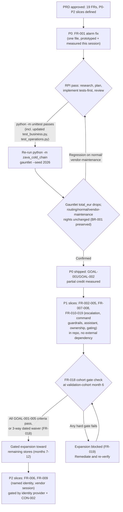

# Zava Cold Chain Monitor — Production Readiness Product Requirements

> **PRD-2026-COLDCHAIN-001** | Status: approved | Version: 1.0.0 | Last Updated: 2026-11-15

> [!CAUTION]
> **Disclaimer:** This agent is an assistive tool only. It does not provide product management approval, technical feasibility validation, or business sign-off and does not replace product managers, engineering leads, business stakeholders, or other qualified human reviewers. The output consists of suggested requirements, acceptance criteria, and product specifications to support a user's own product planning and decision-making. All Product Requirements Documents, functional requirements, non-functional requirements, and constraint definitions generated by this tool must be independently reviewed and validated by appropriate product and engineering reviewers before adoption. Outputs from this tool do not constitute product approval, requirements sign-off, or engineering commitment.

> **Provenance note.** Zava, Inc. is a fictitious training company (HVE workshop scenario). This PRD is Stage 3 of an autonomous HVE Lifecycle run with no live user present. Every requirement here traces to an approved `BRD-2026-COLDCHAIN-001` business requirement (`docs/project-planning/cold-chain-production-readiness-brd.md`) or to one of that BRD's own explicitly deferred Open Questions. Every code-level claim (alarm behavior, defrost physics, Gauntlet scores) was verified directly against this repository — `python3 -m unittest`, `python3 -m zava_cold_chain gauntlet --seed 2026`, and a disposable prototype patch to `zava_cold_chain/alarms.py` that was discarded after measurement, never committed. No stakeholder round was run for this PRD: the BRD's own Open Questions (Q-1, Q-2, Q-5) are resolved here with recorded rationale per the orchestrator's decide-and-record instruction, not left for a third simulated-panel round, because each had enough code- and data-grounded evidence to resolve responsibly without further role-play. This PRD must be independently reviewed by real Zava product, engineering, security, and food-safety stakeholders before any implementation, budget, or go-live decision is made on its basis.

---

## Executive Summary

The approved BRD scoped six business goals for taking the Cold Chain Monitor, its store assistant, and the vendor's remote service from a 5-store pilot to a governed, phased rollout toward 400 stores. This PRD decomposes those six goals (BG-001–BG-006) into nineteen product-level functional requirements (FR-001–FR-019), nine non-functional requirements, and four constraints, and resolves three of the BRD's deferred Open Questions with repository-grounded engineering decisions rather than leaving them open for a third round of stakeholder role-play.

The centerpiece finding of this PRD is a precise, previously unquantified root cause for the single largest driver of BG-001's and BG-002's cost and detection-time baselines: alarm rule ALM-07 (`zava_cold_chain/alarms.py`) silences temperature alarms for *any* case in defrost mode, with no time bound. A scheduled, approved 20-minute defrost never actually breaches the freezer safe limit (measured peak −13.0 °C against a −12.0 °C limit) — so the exemption is harmless there. But an *indefinite* defrost (no declared end time, as used by the `mass-defrost` and `silent-night` chaos scenarios and their Night Gauntlet hidden-night equivalents) keeps that same exemption active forever, because nothing ever tells the case to stop warming. This single, narrow gap is directly responsible for 15 of the 20 undetected freezer cases on `silent-night` and all 15 undetected cases on `mass-defrost` — and it is fixable with a one-line, single-file change that this PRD prototyped and measured directly: closing it drops the sampled 10-night Night Gauntlet total from €768,013 to €454,371 (−40.8%) while leaving every routine, scheduled-defrost, and already-approved-maintenance night byte-for-byte unchanged (confirmed: 0 alarms on `normal` and `vendor-maintenance`, unchanged cost on 5 of 10 sampled nights).

A naïve version of this fix — removing the ALM-07 exemption for defrost mode entirely, which is exactly what this repository's own pre-existing test helper `_alarm_in_any_mode` (`tests/test_business.py`) models as a stand-in for fix FX-1 — was tested directly and found to **false-page the already-approved 40-minute vendor maintenance window** (measured peak −6.5 °C, well above the limit, sustained well past the 10-minute hold threshold). This PRD's FR-001 instead anchors the defrost exemption to the command's own declared end time (`case.defrost_until`), which both preserves every currently-approved defrost (20-minute schedule, 40-minute vendor window) and closes the indefinite-defrost gap — and, as a side effect, resolves BRD Open Question Q-5 (the runbook's 30-minute figure versus the schedule's 20-minute figure) structurally: the exemption no longer depends on picking one disputed number, because it is anchored to whatever duration the approving command actually declared.

This finding defines the PRD's single P0 delivery slice: **FR-001 alone**, scoped to a one-file production change (`zava_cold_chain/alarms.py`) plus test-first updates to three existing test files that currently encode the undetected-case gap as expected behavior. It is small enough for one RPI research-plan-implement-review pass, already prototyped and measured in this session, and directly moves the Night Gauntlet needle on BG-001 and BG-002 without touching command enforcement, identity, the assistant, or ownership — each of which is its own, larger, slower slice ordered P1/P2 below. Out-of-repo dependencies (vendor-contract renegotiation, rollout budget, an identity provider for named-individual authentication, new role staffing) are tracked as dependencies, not slices, consistent with the BRD's own CON-002/CON-003 framing.

This PRD also resolves BRD Open Question Q-1 (validation-cohort gating thresholds) by adopting the BRD's own stated numeric targets directly as FR-018's Gauntlet gate criteria, and Open Question Q-2 (the operational response to an "unknown" or later-found-wrong assistant answer) by routing such answers into a time-boxed food-safety review queue (FR-014) that mirrors the existing alarm-escalation design. Open Question Q-6 (real-time credential revocation) and the full authentication mechanism for FR-006/FR-009 are explicitly **not** resolved here — they are carried forward to the Security Planner handoff, because they require an out-of-repo identity provider and security-architecture decisions this repository's Python-3.9-standard-library, local-only implementation constraint (CON-004) cannot itself supply.

---

## Product Context

The Cold Chain Monitor (`zava_cold_chain/`) is a Python 3.9, standard-library-only, local-only (127.0.0.1) simulation of refrigerated-case monitoring across Zava's 5-store pilot region, paired with a rule-based store assistant and a simulated vendor remote-access channel (`README.md`). The application keeps all state in memory, sends nothing over the network, and accepts commands only from its own dashboard. It is explicitly **not** a reference architecture or a production system today (`README.md`): there is no sign-in (ZFW-305), the vendor channel uses one shared service account (ZFW-203), the command service enforces no range or window limits (ZFW-259, ZFW-231), the alarm engine silences temperature alarms for any case in defrost mode regardless of duration (ALM-07, 2016), and two of five in-scope system areas (fleet commands, the store assistant) have had no named owner since 2021 and 2024 respectively (`data/roster.json`).

The BRD's own Night Gauntlet evidence (`python3 -m zava_cold_chain gauntlet --seed 2026`, reproduced directly in this PRD) quantifies what those gaps cost: a `silent-night`-class incident costs the 5-store pilot region €260,411 and would cost €20,832,904 at 400-store scale; a `mass-defrost`-class incident costs €221,878 pilot-region. Of the 35 freezer cases affected across those two scenarios, only 6 were ever caught by an alarm; the other 29 were found only by staff at opening, 234+ minutes after the breach began. The store assistant gave a reassuring, non-escalating answer about every one of those cases, and about 168 cases across a 10-night Gauntlet sample overall.

This PRD's product vision is narrower than "add every missing control at once": it is to close these gaps in a sequence where the highest-value, lowest-risk, most immediately measurable fix ships first and is verified against the repository's own evidence harness before any larger, infrastructure-dependent work begins. The BRD's own phased-cohort structure (BG-006: ~40-store validation cohort before the remaining ~360) already applies this logic at the rollout-program level; this PRD applies the same logic one level down, at the engineering-delivery-slice level.

---

## Users and Personas

*(Carried forward from the BRD's Stakeholders section and Stage 1 Design Thinking synthesis; evidence is simulated-panel role-play and direct code/data citation, not real user research — see the BRD's own Provenance note and Stage 1's `problem-space-handoff.md`.)*

**Night store manager / regional night cover** — Primary jobs-to-be-done: tell which of several active alarms needs attention right now; trust that an alarm reaching them means something a human must act on. Key pain point: "I trusted it had already filtered what mattered... I react to what the system tells me" (Stage 1 panel); on the Market Square door event, the escalation bounced to a departed technician's number. Success outcome: every alarm that reaches them is real, triaged, and reaches someone who can act — FR-001, FR-002, FR-003, FR-004.

**Refrigeration technician** — Primary jobs-to-be-done: run routine and vendor-coordinated defrost/maintenance work without being paged for things that are fine; leave notes that reduce noise without being able to accidentally steer a safety decision. Key pain point: "I wrote a note on one case because staff kept calling at night about long defrosts... that's not the same as me telling them in person" (Stage 1 panel). Success outcome: approved maintenance never false-pages, and a note can reduce noise without silently becoming safety evidence — FR-001, FR-005, FR-011, FR-012.

**Regional IT** — Primary jobs-to-be-done: know that "approved" and "executed" mean the same thing for every command; have a technically enforced, not merely logged, boundary on fleet-wide and vendor actions. Key pain point: "The command log records what ran, but I don't watch vendor sessions live... it's an honour system backed by a log" (Stage 1 panel). Success outcome: every command is attributable and bounded — FR-005, FR-006, FR-007, FR-008, FR-009.

**Vendor support / vendor engineers** — Primary jobs-to-be-done: perform approved remote maintenance within a clear, bounded window without needing a shared credential. Key pain point: "I didn't know a note could reach an automated assistant" (Stage 1 panel). Success outcome: a named, time-boxed vendor session that doesn't require guessing what else it touches — FR-009.

**Food-safety officer** — Primary jobs-to-be-done: be the accountable authority for every stock-safety disposition, including ones an automated channel might influence; see steering content before it becomes evidence. Key pain point: "I was never asked... that claim needs an accountable owner, and right now there is none" (Stage 1 panel). Success outcome: no channel or feature that can influence a safety-adjacent answer ships without their review — FR-010, FR-011, FR-012, FR-013, FR-014.

**Executive sponsor / Investment Board** — Primary jobs-to-be-done: hit the board's 12-month, 400-store commitment without betting the whole chain on an unvalidated assumption. Key pain point (named as a tension, not resolved by this PRD): "The timeline isn't negotiable... If evidence says otherwise, we fix it quietly and stay on schedule" (Stage 1 panel). Success outcome: a gated, evidence-based expansion sequence that makes a failed gate visible rather than quietly patched — FR-017, FR-018, FR-019.

**Proposed "store platform engineer" and AI/data-platform owner roles (vacant today)** — Not yet a persona with first-hand evidence; proposed accountable owners for fleet commands and the store assistant respectively once BG-005 fills them (A-3, carried from BRD). Treated as hidden-tier stakeholders per the BRD's Mendelow analysis until created.

---

## Design Decisions

| Decision ID | Decision | Rationale | Decision Maker | Date | Related IDs |
|---|---|---|---|---|---|
| DD-001 | Anchor the BR-001 scheduled-defrost alarm exemption to the command's own declared end time (`case.defrost_until` being set, not `None`), not to "defrost mode" alone and not to a specific duration number. | Direct measurement in this repository shows a freezer case crosses its −12 °C limit somewhere between 20 and 25 minutes of continuous defrost (20 min → −13.0 °C, no breach; 25 min → −11.3 °C, breach). The schedule's 20-minute defrosts and the vendor's approved 40-minute maintenance window are both legitimately "scheduled, on-time" under BR-001, yet one crosses the limit and one doesn't — so the exemption cannot safely be keyed to a single duration constant. Anchoring to whether the defrost has a declared end at all resolves BRD Open Question Q-5 (20 vs. 30 minutes) structurally: the correct number is whatever the approving command declared, not a magic constant this PRD would otherwise have to guess at. | PRD Builder (autonomous) | 2026-11-15 | FR-001, GOAL-001, GOAL-002 |
| DD-002 | Reject this repository's own pre-existing test helper `_alarm_in_any_mode` (`tests/test_business.py`, documented there as "a stand-in for change 1") as the production design for FR-001, despite its name matching fix FX-1 in `data/fixes.json`. | Measured directly in a disposable prototype: applying that helper's exact logic (remove the defrost-mode exemption outright, with no duration anchor) raises a false alarm on the already-approved 40-minute vendor maintenance defrost (measured peak −6.5 °C, held above the limit well past the 10-minute hold threshold) — a regression on BR-001's "must not page for things that are actually fine" invariant and on the existing `tests/test_business.py::CostOfASilentNight::test_detecting_sooner_costs_less` / `tests/test_business.py::Gauntlet::test_leaderboard_ranks_against_the_baseline_for_the_same_seed` tests' own mocked comparison. FR-001's declared-end-time anchor (DD-001) avoids this regression entirely. | PRD Builder (autonomous) | 2026-11-15 | FR-001, FR-005 |
| DD-003 | Scope the P0 delivery slice to FR-001 alone; do not bundle FR-005's command-level defrost-duration cap into the same RPI pass. | The BRD's own quantified baseline (`silent-night`, `mass-defrost`) is driven entirely by *indefinite* (no declared end time) defrost commands, not by declared-but-excessively-long ones; every scenario and hidden-night generator in this repository that produces the high-cost undetected-case pattern uses the no-`minutes` form. FR-001 alone, already prototyped and measured, closes that exact gap in one file. FR-005 (capping how long a *declared* defrost may run) is a closely related but logically separable follow-on risk (see Risk R-7) best delivered as its own RPI pass once FR-001 is in place and re-measured. | PRD Builder (autonomous) | 2026-11-15 | FR-001, FR-005 |
| DD-004 | Adopt the BRD's own stated BG-001/BG-002/BG-004/BG-005 numeric targets directly as this PRD's Gauntlet gating thresholds (FR-018), rather than deriving new ones. | Keeps a single source of truth between the approved business targets and the product-level gate a cohort must clear; inventing different numbers at PRD level would create two competing definitions of "pass." Resolves BRD Open Question Q-1. | PRD Builder (autonomous) | 2026-11-15 | FR-018, GOAL-001, GOAL-002, GOAL-004, GOAL-005 |
| DD-005 | Define the operational response to an assistant answer of "unknown" or a non-committal low-confidence answer, or one later found to be wrong, as a time-boxed food-safety review queue using the same 30-minute hold-for-testing time bound already used elsewhere in this system (`data/business.json` `hold_after_minutes`), escalating like an unacknowledged alarm if unreviewed. | Reuses an existing, already-understood time bound and escalation pattern (FR-002) rather than inventing a new workflow concept; directly answers the panel's own closing-round question (R-3, Q-2) about what happens when the fixed assistant is wrong without requiring new UX research this autonomous run cannot perform. Resolves BRD Open Question Q-2. | PRD Builder (autonomous) | 2026-11-15 | FR-014, GOAL-004 |
| DD-006 | Specify FR-006 (named individual identity) and FR-009 (vendor session confinement) as product requirements for the eventual production architecture, and explicitly hand their authentication-mechanism design to the Security Planner, rather than attempting an in-repo stdlib implementation. | This repository's own implementation constraint (CON-004: Python 3.9 standard library only, local-only, no network, no external packages) cannot itself provide production-grade identity and credential verification; inventing a toy auth mechanism here would misrepresent what a real 400-store identity rollout requires and would not satisfy NFR-004's security intent. | PRD Builder (autonomous) | 2026-11-15 | FR-006, FR-009, NFR-004, CON-002, CON-004 |
| DD-007 | Self-approve Finalize-phase sign-off using recorded rationale, in the absence of live human approvers, because this is an autonomous no-user-present run (mirrors BRD DD-005). | The orchestrator's instructions direct the agent to decide and record rationale rather than block on an unavailable live approval step for this run; the Sign-Off section names this explicitly so it is not mistaken for genuine authorization. | PRD Builder (autonomous) | 2026-11-15 | Sign-Off, Waivers |
| DD-008 | Use MoSCoW for FR/NFR prioritization and a separate P0/P1/P2 delivery-slice label for sequencing, rather than overloading MoSCoW to also express delivery order. | MoSCoW (Must/Should/Could) expresses *importance within this PRD's scope*; the orchestrator's gate requires an explicit, singular, ordered P0 slice, which is a sequencing decision, not an importance decision — FR-001 and FR-006 are both MUST-in-intent, but only FR-001 is P0. Conflating the two would make the delivery plan's single-P0 requirement ambiguous. | PRD Builder (autonomous) | 2026-11-15 | MVP and Release Framing, all FR |

---

## Product Goals

**GOAL-001 — Reduce the cost of a Silent-Night-class incident**
Priority: MUST
Statement: Reduce the measured pilot-region cost of a `silent-night`-class incident from its current baseline toward under €50,000 within 6 months of P0/P1 delivery starting, and under €20,000 within 12 months, at the same assumed incident frequency, as directly measured by the Night Gauntlet business-impact model.
KPI: `silent-night`-class and `mass-defrost`-class incident cost (`zava_cold_chain/business.py` `night_cost()`), re-measured after each delivery slice ships.
Baseline: €260,411 (`silent-night`) and €221,878 (`mass-defrost`), measured directly, seed 2026; €768,013 total across the 10-night Gauntlet sample.
**P0 slice measured effect (this PRD, FR-001 prototyped directly):** €768,013 → €454,371 total (−40.8%); `silent-night` €260,411 → €155,667; `mass-defrost` €221,878 → €117,133. This is a substantial, immediate, directly-verified down payment toward the BRD's month-6/month-12 targets, achieved by FR-001 alone — it does not by itself reach the full target; FR-002–FR-019 remain necessary.
Source Business Goal: BG-001.

**GOAL-002 — Make escalation reach someone who can act, every time**
Priority: MUST
Statement: Ensure any case above its safe limit for longer than the hold-for-testing threshold reaches an acknowledged, reachable on-call contact, measured by the same Gauntlet detection fields the BRD cites.
KPI: percentage of threshold breaches reaching an acknowledged contact within 15 minutes (target ≥95%) and within 30 minutes (target 100%); `found_by_alarm` / `affected_cases` ratio and `worst_minutes_to_detect`.
Baseline: 6 of 35 affected freezer cases found by alarm across `silent-night` + `mass-defrost` (17%); worst detection time 347 minutes.
**P0 slice measured effect:** `found_by_alarm` rises from 5/20 to 20/20 on `silent-night` and from 0/15 to 15/15 on `mass-defrost` — every previously-undetected freezer case in these two scenarios is now caught by an alarm instead of found by staff at opening. The 15-minute/30-minute acknowledgment-reach target itself still depends on FR-002/FR-003 (escalation and roster staleness), which are P1, not P0.
Source Business Goal: BG-002.

**GOAL-003 — Make "approved" and "enforced" mean the same thing**
Priority: MUST (intent); the vendor-identity portion is COULD on the 12-month timeline pending CON-002.
Statement: Ensure every remote session and fleet/single-case command is attributable to one named, individually authenticated person, and executes only within a technically enforced approved scope and time window.
KPI: percentage of commands/sessions attributable to a named individual; percentage of fleet commands executed within an enforced approval window; command-audit mismatch count.
Baseline: 0% of vendor sessions attributable to a named individual (shared `svc-vendor` account, ZFW-203); no technical range or window enforcement on any command today (ZFW-259, open since 2022); command audit cannot reliably identify an individual sender (ZFW-246, open since 2021).
Source Business Goal: BG-003.

**GOAL-004 — Give every safety-adjacent statement a traceable, accountable origin**
Priority: MUST
Statement: Eliminate reassuring or non-escalating assistant answers about any case needing a human food-safety decision, verified as an unconditional Night Gauntlet hard gate on every cohort.
KPI: count of reassuring/non-escalating assistant answers, measured by the Gauntlet's assistant-check (`gauntlet.assistant_check()`), made unconditional rather than opt-in (see FR-018).
Baseline: 168 such answers across the 10-night Gauntlet sample; 20 of 20 affected cases on `silent-night` alone.
Source Business Goal: BG-004.

**GOAL-005 — Give every system area a living, resourced owner**
Priority: MUST
Statement: Close both currently vacant ownership gaps (fleet commands since 2021, store assistant since 2024) and establish a monthly-attested, current escalation contact list.
KPI: count of in-scope system areas with no named, active, resourced owner; escalation-contact staleness rate.
Baseline: 2 of 5 areas vacant; at least one confirmed-unreachable escalation contact with no routine audit cadence (ZFW-274, open since 2024-03-12).
Source Business Goal: BG-005.

**GOAL-006 — Prove the controls, not just the concept, hold at scale**
Priority: MUST
Statement: Run every GOAL-001–GOAL-004 gating criterion against each rollout cohort, with finalized numeric thresholds and a named hold-decision authority, before expanding to the next cohort.
KPI: gating decision status (Pass/Warn/Fail) per criterion, per cohort, before each go/no-go decision; this PRD finalizes the thresholds the BRD deferred to PRD scoping (Open Question Q-1).
Baseline: 0 — the pilot has never run its controls at any scale larger than 5 stores.
Source Business Goal: BG-006.

**SMART Evaluation** (self-assessed at this autonomous Build→Finalize gate; a real reviewer must re-confirm):

- [x] **S**pecific: Each goal names a bounded mechanism tied to one BRD business goal and, for GOAL-001/GOAL-002, to a directly measured P0 effect.
- [x] **M**easurable: Each goal has a Gauntlet-computable or Gauntlet-already-computed KPI with a stated baseline, and GOAL-001/GOAL-002 additionally carry a measured post-P0 result from this session.
- [x] **A**chievable: Targets reuse the BRD's own stated figures; the P0 measurement shows the mechanism direction is real, not theoretical.
- [x] **R**elevant: Every goal traces 1:1 to a BRD business goal (BG-001–BG-006).
- [x] **T**ime-bound: Every goal inherits the BRD's month 3/6/7/12 milestones; GOAL-001/GOAL-002 additionally reference the P0 slice as an immediate, already-delivered-in-this-session measurement point.

**Status**: `pass` (self-assessed; see Sign-Off for required real-world validation before this status is treated as final).

---

## Functional Requirements

*Grouped by domain; each item names its BRD source requirement(s), MoSCoW priority, and delivery slice (see MVP and Release Framing). Statements use EARS phrasing per `ears-acceptance.md`.*

### Domain A — Alarm integrity and escalation (serves GOAL-001, GOAL-002)

**FR-001** — While a case's temperature is above its safe limit, the monitor shall raise an alarm after the configured hold threshold elapses, in any operating mode, unless the case is within a defrost that has a declared, approved end time that has not yet passed.
Actor: Monitor alarm engine (`zava_cold_chain/alarms.py`).
Trigger: Temperature-and-time threshold breach, re-evaluated every simulated minute.
Expected Outcome: An indefinite defrost (no declared end time) no longer silences alarms forever; a declared, approved defrost (any duration a command legitimately declares, including the 20-minute schedule and 40-minute vendor window) remains exempt for exactly its declared window, per DD-001.
Acceptance Criteria: AC-001, AC-002, AC-003.
Product Goals: GOAL-001, GOAL-002.
Priority: MUST. Delivery slice: **P0**.

**FR-002** — When an alarm remains unacknowledged past the configured escalation window, the system shall escalate it to the next reachable, resourced on-call contact and record every escalation attempt whether or not it succeeds.
Actor: Notification/escalation service (`zava_cold_chain/notify.py`).
Trigger: Alarm unacknowledged past the configured window.
Expected Outcome: An alarm reaches someone who can act, and every attempt — successful or not — is recorded.
Acceptance Criteria: AC-004, AC-005.
Product Goals: GOAL-002.
Priority: MUST. Delivery slice: P1.

**FR-003** — The system shall validate the escalation contact roster on a recurring cadence, flag any contact not attested as reachable within that cadence, and route escalations around flagged contacts.
Actor: Escalation roster service; Store Operations.
Trigger: Scheduled re-attestation cycle, or an escalation attempt against a flagged contact.
Expected Outcome: A stale or unreachable contact (for example, a departed technician still on the pager list) is surfaced before, not during, an incident.
Acceptance Criteria: AC-006, AC-007.
Product Goals: GOAL-002, GOAL-005.
Priority: SHOULD. Delivery slice: P1.

**FR-004** — The system shall present active alarms to night cover in a view ordered or tagged by urgency (minutes above limit, case kind) rather than as an undifferentiated list.
Actor: Night store manager / regional night cover.
Trigger: One or more active alarms at a store.
Expected Outcome: Night cover can tell which alarm needs attention right now without assuming the system already filtered that for them.
Acceptance Criteria: AC-008, AC-009.
Product Goals: GOAL-002.
Priority: SHOULD. Delivery slice: P1.

### Domain B — Command integrity and identity (serves GOAL-003)

**FR-005** — If a setpoint or defrost-duration command falls outside the configured safe range for its case type, then the command service shall reject or cap the command to the nearest safe boundary and record the adjustment.
Actor: Command service (`zava_cold_chain/commands.py`).
Trigger: A setpoint or defrost command is submitted.
Expected Outcome: Out-of-range commands cannot execute unchecked; legitimate in-range commands (including the existing 20-minute and 40-minute declared defrosts) are unaffected.
Acceptance Criteria: AC-010, AC-011.
Product Goals: GOAL-003.
Priority: MUST. Delivery slice: P1.

**FR-006** — The command service shall require a named, individually authenticated identity for every command and remote session; shared or service-account identities shall not be accepted in the production configuration.
Actor: Command service; identity provider (out-of-repo dependency, see DD-006).
Trigger: Any command or remote-session request against the production service.
Expected Outcome: Every command and session is attributable to one person, not a shared account.
Acceptance Criteria: AC-012, AC-013.
Product Goals: GOAL-003.
Priority: MUST in intent; COULD on the stated timeline pending an identity provider. Delivery slice: P2 (depends on out-of-repo identity infrastructure).
Decomposes: BRD FR-006, FR-009.

**FR-007** — If a command targets more than one case (a fleet command), then the command service shall hold execution until a named approver confirms within a configured time-boxed window.
Actor: Command service; named approver.
Trigger: A fleet-scoped command is submitted.
Expected Outcome: No fleet command executes without a named, time-boxed human confirmation, implementable in-repo today as a declared-approver-and-expiry field pending full identity infrastructure (FR-006).
Acceptance Criteria: AC-014, AC-015.
Product Goals: GOAL-003.
Priority: MUST. Delivery slice: P1.

**FR-008** — When an executed command's actual scope or time window differs from its approved scope and window, the command audit shall flag the mismatch for review.
Actor: Command audit service.
Trigger: Command execution completes.
Expected Outcome: "Approved" and "executed" are reconciled automatically rather than left to an after-the-fact honour system.
Acceptance Criteria: AC-016, AC-017.
Product Goals: GOAL-003.
Priority: SHOULD. Delivery slice: P1.

**FR-009** — The vendor remote-access channel shall confine each vendor session to an approved, time-boxed change window tied to a named vendor-engineer identity.
Actor: Vendor remote-access service; vendor engineer.
Trigger: A vendor remote-session connection attempt.
Expected Outcome: Sessions outside an approved window, or not tied to a named identity, are refused or terminated.
Acceptance Criteria: AC-018, AC-019.
Product Goals: GOAL-003.
Priority: MUST in intent; COULD pending CON-002 (vendor-contract renegotiation). Delivery slice: P2 (blocked, see Dependencies).
Decomposes: BRD FR-010.

### Domain C — Store assistant and safety-adjacent statements (serves GOAL-004)

**FR-010** — When answering a stock-safety-adjacent question, the assistant shall cite the verified temperature/event history it used and state its confidence, and shall never itself assert that a case is "safe" or "fine to sell."
Actor: Store assistant (`zava_cold_chain/assistant.py`).
Trigger: A staff question about case safety.
Expected Outcome: The answer is traceable to its data source and never substitutes for the food-safety officer's decision.
Acceptance Criteria: AC-020, AC-021.
Product Goals: GOAL-004.
Priority: MUST. Delivery slice: P1.

**FR-011** — If a technician or vendor note contains instructive or steering language, then the assistant shall exclude that language from its answer-forming logic for safety-adjacent questions.
Actor: Store assistant.
Trigger: A note containing steering language is present in the case's context.
Expected Outcome: The assistant's answer is not shaped by an unreviewed instruction embedded in a note.
Acceptance Criteria: AC-022, AC-023.
Product Goals: GOAL-004.
Priority: MUST. Delivery slice: P1.

**FR-012** — If a note or message could reasonably be read as steering a stock-safety disposition, then it shall be flagged for food-safety officer review before it is treated as evidence in a discard/hold/keep decision.
Actor: Store assistant; food-safety officer.
Trigger: Steering language is detected in a note.
Expected Outcome: The food-safety officer sees the flagged note before it can influence a recorded disposition.
Acceptance Criteria: AC-024, AC-025.
Product Goals: GOAL-004.
Priority: SHOULD. Delivery slice: P1.

**FR-013** — Before any new assistant feature or notes-ingestion channel that can influence a stock-safety-adjacent answer is enabled in production, the food-safety officer or deputy shall review and approve it.
Actor: Food-safety officer; product/engineering owner of the assistant.
Trigger: A new feature or channel affecting safety-adjacent answers is proposed for release.
Expected Outcome: The channel cannot go live without a recorded food-safety review.
Acceptance Criteria: AC-026, AC-027.
Product Goals: GOAL-004.
Priority: SHOULD. Delivery slice: P1.

**FR-014** — When the assistant answers "unknown" or gives a non-committal, low-confidence answer about a case needing a decision, or an answer is later found to have been wrong, the system shall place that case in a food-safety review queue with the same time bound as the hold-for-testing threshold, escalating if unreviewed within that bound.
Actor: Store assistant; food-safety officer; escalation service.
Trigger: A non-committal, low-confidence, or later-corrected assistant answer about a case needing a decision.
Expected Outcome: A staff member is never left with "unknown" as the end of the conversation; resolves BRD Open Question Q-2 and directly mitigates Risk R-3 (over-reliance).
Acceptance Criteria: AC-028, AC-029.
Product Goals: GOAL-004.
Priority: MUST. Delivery slice: P1.
New requirement (no 1:1 BRD FR; operationalizes BRD Open Question Q-2 per DD-005).

### Domain D — Ownership (serves GOAL-005)

**FR-015** — The platform shall maintain a living ownership register for every in-scope system area, recording a named, resourced, active owner, and shall flag any vacancy as an open item with a target remediation date.
Actor: Regional IT; ownership register service.
Trigger: Register review, or a detected vacancy.
Expected Outcome: No system area is silently unowned.
Acceptance Criteria: AC-030, AC-031.
Product Goals: GOAL-005.
Priority: MUST. Delivery slice: P1.

**FR-016** — On a recurring cadence, named owners shall re-attest their ownership in the register, and any lapse shall be surfaced to the rollout governance board rather than resolved invisibly.
Actor: Regional IT; Store Operations; rollout governance board.
Trigger: Scheduled re-attestation cycle.
Expected Outcome: Ownership currency is visible to governance, not just to the team that happens to notice a gap.
Acceptance Criteria: AC-032, AC-033.
Product Goals: GOAL-005.
Priority: SHOULD. Delivery slice: P1.

### Domain E — Scale-validation gating (serves GOAL-006)

**FR-017** — Before expanding to the next rollout cohort, the program shall run the Night Gauntlet (or an equivalent evidence harness) against the current cohort and record a Pass/Warn/Fail status for every GOAL-001–GOAL-004 gating criterion.
Actor: Executive sponsor; Regional IT; food-safety officer.
Trigger: A cohort's validation window completes.
Expected Outcome: The go/no-go decision is made from recorded evidence, not from the concept alone.
Acceptance Criteria: AC-034, AC-035.
Product Goals: GOAL-006.
Priority: MUST. Delivery slice: P1.

**FR-018** — The program shall evaluate each cohort against the following finalized numeric gating thresholds: GOAL-001 cost under €50,000 pilot-region-equivalent by month 6 (under €20,000 by month 12); GOAL-002 escalation reach at or above 95% within 15 minutes and 100% within 30 minutes; GOAL-004 zero reassuring/non-escalating assistant answers, evaluated unconditionally (not opt-in to a claimed fix); GOAL-005 zero vacant-owner system areas. Any criterion missed but not clearly failed requires concurrence from the executive sponsor, Regional IT, and the food-safety officer on a dated waiver; absent unanimous concurrence, the criterion defaults to Fail.
Actor: Executive sponsor; Regional IT; food-safety officer; rollout governance board.
Trigger: Cohort evaluation (FR-017).
Expected Outcome: Resolves BRD Open Question Q-1 (exact thresholds and hold-decision authority) with a fail-closed default that cannot be overridden by a single role, directly mitigating Risk R-1 (quiet-fix pressure).
Acceptance Criteria: AC-036, AC-037.
Product Goals: GOAL-001, GOAL-002, GOAL-004, GOAL-005, GOAL-006.
Priority: MUST. Delivery slice: P1.
New requirement (no 1:1 BRD FR; operationalizes BRD Open Question Q-1 per DD-004).

**FR-019** — If any hard gate fails on a cohort, then the program shall block expansion to the next cohort until the failure is remediated and re-verified by a subsequent harness run.
Actor: Executive sponsor; rollout governance board.
Trigger: A hard-gate failure is recorded for the current cohort.
Expected Outcome: Expansion pressure cannot override a failed safety-relevant gate without an explicit, recorded decision (FR-018).
Acceptance Criteria: AC-038, AC-039.
Product Goals: GOAL-004, GOAL-006.
Priority: MUST. Delivery slice: P1.

Priority summary (MoSCoW, time-box = this PRD's full scope, per DD-008): FR-001, FR-005, FR-007, FR-010, FR-011, FR-014, FR-015, FR-017, FR-018, FR-019 are **MUST**; FR-002, FR-006 (intent), FR-009 (intent) are **MUST in intent**; FR-003, FR-004, FR-008, FR-012, FR-013, FR-016 are **SHOULD**; FR-006 and FR-009 are **COULD** on the stated 12-month timeline pending out-of-repo dependencies (identity provider, CON-002).

---

## Non-Functional Requirements

*Organized by NIST SP 800-160 NFR category buckets, per `nist-800-160-nfr.md`.*

### Performance and Capacity

**NFR-001** — At least 95% of threshold breaches shall reach an acknowledged on-call contact within 15 minutes, and 100% within 30 minutes (the hold-for-testing threshold), on the validation cohort by month 6.
Verification: Night Gauntlet `detection` field (`minutes_to_detect`) analysis per cohort.

---

### Reliability and Resilience

**NFR-002** — The alarm-to-escalation-to-acknowledgment chain (FR-001, FR-002, FR-003) shall be verifiable end-to-end as a single continuously tested chain, not three independently maintained pieces.
Verification: Combined Night Gauntlet detection-field analysis per cohort; a single test suite exercising alarm → escalation → acknowledgment end-to-end (not three isolated unit tests).

**NFR-003** — The command audit record (FR-008) and the ownership register (FR-015) shall remain available and complete across all in-scope stores, with no single-store outage able to silently drop an audit or ownership record chain-wide.
Verification: Audit-completeness report per cohort.

---

### Security

**NFR-004** — Every remote session and command identity (FR-006, FR-009) shall use individual authentication. As a minimum acceptance bar independent of the specific mechanism chosen downstream, any detected compromised session or credential shall be revocable within 60 minutes of detection. **The specific authentication mechanism, credential lifecycle, and real-time (versus post-hoc log-based) revocation capability are explicitly not specified beyond this minimum bar and are handed to the Security Planner** (see Handoff to Security Planner, RAI Planner, and RPI), per DD-006 and BRD Open Question Q-6.
Verification: 60-minute revocation bar — security test during cohort rollout. Full mechanism — Security Planner scope.

---

### Privacy

**NFR-005** — Command-audit and ownership-register entries that name an individual (FR-006, FR-008, FR-015) shall record that identity as required for accountability, but any *telemetry* emitted about these entries (metrics, traces, or logs feeding an observability pipeline, as opposed to the audit/ownership business record itself) shall use a redacted identifier (hashed `user.id`), per the `telemetry-foundations` PII-denylist posture, never a raw name or contact detail as a metric dimension or trace attribute.
Verification: Telemetry schema review at implementation time; audit/ownership records are explicitly out of this redaction rule's scope (they are the accountability record FR-006/FR-008/FR-015 require).

---

### Scalability and Elasticity

**NFR-006** — The alarm/escalation/command-audit/ownership-register chain (FR-001–FR-003, FR-008, FR-015–FR-016) shall function correctly, with no design change required, across a validation cohort of approximately 40 stores and the full ~400-store chain.
Verification: Night Gauntlet cohort scorecards at each cohort's scale (FR-017).

---

### Maintainability and Operability

**NFR-007** — The ownership register (FR-015, FR-016) shall record a change history (who changed an owner assignment, when, and why) so a lapse can be analyzed after the fact, not only detected going forward.
Verification: Register audit-trail review.

---

### Observability

**NFR-008** — The production system shall expose the following OpenTelemetry-aligned telemetry, per `telemetry-foundations`, as the target vocabulary for the production observability pipeline (the current in-repo prototype's stand-in is `World.emit()`'s live feed and the Gauntlet scorecard JSON; this NFR does not require wiring an actual OTel SDK inside this repository's Python-3.9-stdlib-only implementation constraint, CON-004):

* Metric `alarm.detection.duration` (histogram, unit `s`) — time from threshold breach to detection, by `found_by` (`alarm` / `staff_at_opening`). Bounded dimensions: `store.id`, `case.kind`.
* Metric `alarm.escalation.duration` (histogram, unit `s`) — time from alarm raised to acknowledged.
* Metric `command.audit.mismatch.count` (counter, unit `1`) — approved-vs-executed scope/window mismatches (FR-008).
* Metric `assistant.answer.reassuring.count` (counter, unit `1`) — reassuring/non-escalating answers about a case needing a decision (the GOAL-004 hard-gate measure).
* Metric `ownership.register.vacancy.count` (gauge, unit `1`) — current vacant system areas (FR-015).
* Metric `gauntlet.gate.pass` (gauge, unit `1`, 1=pass/0=fail) per gate ID, per cohort (FR-017, FR-018).
* Span `check.alarm`, `raise.alarm`, `escalate.alarm`, `apply.command`, `approve.command`, `ask.assistant`, `run.gauntlet` — all `internal` kind (no remote peer in this local-only system today).
* Resource attributes: `service.name` = `zava-cold-chain-monitor`, `deployment.environment` (`validation-cohort` / `production`).

Verification: Telemetry schema review at implementation time, once a production (non-local-only) deployment target exists.

---

### Usability and Accessibility

**NFR-009** — The triaged alarm view (FR-004) shall use plain language and a clear visual/textual urgency distinction, usable by night cover without specialized training, consistent with the existing dashboard's WCAG 2.2 AA contrast bar (`README.md`).
Verification: Usability review during cohort rollout.

---

### Compatibility and Interoperability

Not material at this PRD's scope; the production service replaces, rather than coexists with, the pilot's informal controls. Deferred to an implementation-level ADR if a specific integration surface (for example, an existing HR/roster system of record for FR-003, or a specific identity provider for FR-006) is selected.

---

### Portability

Not material at this PRD's scope; the production service is a single-chain deployment, not a multi-environment portability scenario.

---

## Constraints

**CON-001** — The board's 12-month timeline for the 400-store decision is fixed and non-negotiable (carried from BRD CON-001).
Imposing source: Executive sponsor / board public commitment.
Affected boundary: Schedule.
Non-negotiability: Stated directly by the accountable decision owner.
Category: Schedule.
Impact: Every delivery slice in this PRD is sequenced so the highest-value, lowest-dependency work (P0) ships first and the infrastructure-dependent work (P2) is explicitly tracked as gated by dependencies, not by this PRD's own schedule.

**CON-002** — The current vendor contract requires a single shared service account for all vendor remote sessions (carried from BRD CON-002; `data/issues.json` ZFW-203, "won't fix").
Imposing source: Existing vendor contract terms.
Affected boundary: Technology / integration (vendor identity).
Non-negotiability: Contractual; cannot be unilaterally changed by this PRD or by Regional IT.
Category: Contractual.
Impact: FR-009 (named vendor identity) cannot be fully satisfied chain-wide until the contract is renegotiated; tracked as a Dependency, not scheduled as a P0/P1 slice. See Risk R-2 for the interim-control fallback question handed to the Security Planner.

**CON-003** — No production-rollout budget has been board-approved; the BRD's own €500,000–€800,000 capital / €200,000–€300,000/year operating estimate is unapproved (carried from BRD CON-003).
Imposing source: Investment Board budget authority (not yet exercised).
Affected boundary: Budget.
Non-negotiability: Only the Investment Board can approve production-scale spend.
Category: Financial.
Impact: FR-006 (named identity infrastructure) and the new ownership roles (FR-015/FR-016 staffing) depend on this decision; tracked as a Dependency.

**CON-004** — Any production-readiness work implemented directly inside this repository during this HVE Lifecycle run (Stage 4+ RPI implementation) must use Python 3.9 standard library only, remain verifiable with `python -m unittest`, and remain measurable with `python -m zava_cold_chain gauntlet --seed 2026`; the application remains local-only (127.0.0.1) with no external packages, accounts, cloud services, or network access, per this repository's own documented scenario constraints (`README.md`).
Imposing source: Repository/training-scenario design and the orchestrator's RPI implementation contract.
Affected boundary: Technology (implementation environment).
Non-negotiability: Fixed for the scope of in-repo RPI work this PRD drives; does not bind the eventual real production architecture, which may use any technology stack.
Category: Technical.
Impact: Bounds which FRs can be implemented and measured inside this repository today (FR-001 through FR-005, FR-007, FR-008, FR-010 through FR-019 are all implementable with stdlib Python against the existing simulator) versus which require out-of-repo infrastructure before they can be built at all (FR-006, FR-009 — see DD-006 and Dependencies).

---

## Process Models

**Process Description**: The delivery sequence starts with the single, already-measured P0 slice (FR-001), proceeds through an RPI research-plan-implement-review pass that must re-confirm the Night Gauntlet effect and the `normal`/`vendor-maintenance` no-regression invariant before the slice is considered shipped, then moves to the larger set of P1 slices that are implementable entirely inside this repository's Python-3.9-stdlib constraint (CON-004) without any out-of-repo dependency. The FR-018 cohort gate (operationalizing BG-006) runs once enough P1 slices are in place to evaluate GOAL-001–GOAL-005 meaningfully, using the fail-closed, three-way-concurrence rule this PRD defines. P2 slices (FR-006, FR-009) are explicitly sequenced after the gate, not before, because they depend on out-of-repo infrastructure (identity provider, vendor-contract renegotiation) this PRD cannot schedule.

**Supporting Information**:

- **Trigger**: PRD Finalize approval (this document) and RPI dispatch for the P0 slice.
- **Actors**: RPI implementation agent; Regional IT; executive sponsor; food-safety officer; rollout governance board.
- **Success Criteria**: P0 ships with `python -m unittest` green and a re-measured Gauntlet total_eur reduction consistent with this PRD's prototyped figures; P1 slices ship without regressing P0; the FR-018 gate runs before any cohort expansion.
- **Error Handling**: A regression on the `normal` or `vendor-maintenance` no-alarm invariant blocks the P0 slice from being considered complete (loops back to the RPI pass); a failed FR-018 gate blocks cohort expansion (FR-019) rather than being overridden by timeline pressure alone.

---

## Acceptance Criteria

**AC-001** — Given a case's temperature is above its safe limit while the case is in an indefinite defrost (no declared end time), when the configured hold threshold (10 minutes) elapses, then the monitor raises an ALM-01 alarm for that case.
Covers: FR-001.
Status: Not Started.

**AC-002** — Given a scheduled, approved defrost with a declared end time runs for its full declared duration and ends on time, when the case's temperature is evaluated throughout that window, then **no alarm is raised for that case** — the canonical must-not-change behavior anchored by `tests/test_baseline.py::NormalNight::test_scheduled_defrost_that_ends_on_time_raises_no_alarm`.
Covers: FR-001.
Status: Not Started.

**AC-003** — If an approved, declared defrost's end time has passed and the case remains above its limit for longer than the configured hold threshold, then the monitor raises an alarm for that case as soon as the declared window closes; the exemption does not extend past the declared duration by default.
Covers: FR-001.
Status: Not Started.

**AC-004** — Given an alarm is unacknowledged after the configured escalation window, when the next on-call level is checked, then the system escalates to the next reachable contact and records the attempt whether or not it succeeds.
Covers: FR-002.
Status: Not Started.

**AC-005** — If every contact at the current escalation level is flagged unreachable, then the system escalates immediately to the next level rather than waiting out the full window.
Covers: FR-002.
Status: Not Started.

**AC-006** — Given the escalation contact roster, when a contact has not been re-attested as reachable within the configured cadence, then the system flags that contact as stale and excludes it from new escalation routing until re-attested.
Covers: FR-003.
Status: Not Started.

**AC-007** — If every contact at a required escalation level is flagged stale, then the system surfaces a roster-gap alert to the ownership register rather than silently escalating to no one.
Covers: FR-003, FR-015.
Status: Not Started.

**AC-008** — Given multiple active alarms at a store, when night cover opens the alarm view, then alarms are ordered by minutes-above-limit and tagged with case kind.
Covers: FR-004.
Status: Not Started.

**AC-009** — If two alarms have an identical minutes-above-limit value, then the view breaks the tie by case priority (freezer before chiller) rather than leaving the order undefined.
Covers: FR-004.
Status: Not Started.

**AC-010** — Given a setpoint or defrost-duration command outside the configured safe range for the case's kind, when the command service validates it, then the command is rejected or capped to the nearest safe boundary and the adjustment is recorded in the command audit.
Covers: FR-005.
Status: Not Started.

**AC-011** — Given a setpoint or defrost-duration command within the configured safe range (including the existing 20-minute schedule and 40-minute vendor window), when it is submitted, then it executes unchanged and is not capped.
Covers: FR-005.
Status: Not Started.

**AC-012** — Given a remote session or command request, when it is authenticated, then it is bound to one named individual credential and the command/session record stores that identity.
Covers: FR-006.
Status: Not Started.

**AC-013** — If a request presents a shared or service-account credential in the production configuration, then the request is refused and the refusal is recorded in the command audit.
Covers: FR-006.
Status: Blocked (pending identity-provider dependency).

**AC-014** — Given a command targeting more than one case, when it is submitted, then execution is held until a named approver confirms within the configured time-boxed window.
Covers: FR-007.
Status: Not Started.

**AC-015** — If the time-boxed approval window elapses without a named confirmation, then the fleet command is automatically withdrawn and the attempt is recorded, rather than executing by default.
Covers: FR-007.
Status: Not Started.

**AC-016** — Given an approved command's recorded scope and time window, when the executed command's actual scope or window differs, then the mismatch is flagged for review in the command audit.
Covers: FR-008.
Status: Not Started.

**AC-017** — Given an approved command executes exactly within its approved scope and window, when the audit reconciliation runs, then no mismatch is flagged.
Covers: FR-008.
Status: Not Started.

**AC-018** — Given a vendor engineer connects remotely, when the connection falls within an approved, time-boxed change window tied to their named identity, then the session is accepted and scoped to that window.
Covers: FR-009.
Status: Blocked (pending CON-002).

**AC-019** — If a vendor session request falls outside its approved window or is not tied to a named identity, then the session is refused or terminated immediately.
Covers: FR-009.
Status: Blocked (pending CON-002).

**AC-020** — Given a staff question about whether a case is safe, when the assistant answers, then the answer cites the specific verified temperature/event-history data it used and states a confidence level.
Covers: FR-010.
Status: Not Started.

**AC-021** — If the assistant's underlying data shows the case is above its limit or its state is not confidently determinable, then the assistant's answer never contains an unqualified assertion that the case is "safe" or "fine to sell."
Covers: FR-010.
Status: Not Started.

**AC-022** — Given a technician or vendor note contains steering language, when the assistant forms an answer, then the steering language is excluded from the answer's reasoning and does not change the answer the assistant would have given without that note.
Covers: FR-011.
Status: Not Started.

**AC-023** — If a note contains steering language, then it is marked and does not independently satisfy the assistant's verified-history citation requirement (FR-010).
Covers: FR-011, FR-010.
Status: Not Started.

**AC-024** — Given steering language is detected in a note, when the note is attached to a case, then it is flagged for food-safety officer review before any system treats it as supporting evidence for a discard/hold/keep decision.
Covers: FR-012.
Status: Not Started.

**AC-025** — If a flagged note is used in a recorded food-safety disposition without an officer review, then the disposition is marked non-compliant and surfaced to governance.
Covers: FR-012.
Status: Not Started.

**AC-026** — Given a new assistant feature or notes-ingestion channel that could influence a safety-adjacent answer, when it is proposed for production release, then it requires a recorded food-safety officer (or deputy) review and approval before it can be enabled.
Covers: FR-013.
Status: Not Started.

**AC-027** — If such a feature or channel is enabled without a recorded food-safety review, then the release is blocked and logged as a governance exception.
Covers: FR-013.
Status: Not Started.

**AC-028** — Given the assistant answers "unknown" or a non-committal, low-confidence answer about a case needing a decision, when that answer is recorded, then the case enters a food-safety review queue with the same time bound as the hold-for-testing threshold (30 minutes).
Covers: FR-014.
Status: Not Started.

**AC-029** — If a case in the review queue is not reviewed within its time bound, then it escalates to the food-safety officer the same way an unacknowledged alarm escalates.
Covers: FR-014, FR-002.
Status: Not Started.

**AC-030** — Given any in-scope system area, when the ownership register is reviewed, then it shows a named, resourced, active owner or an open remediation item with a target date.
Covers: FR-015.
Status: Not Started.

**AC-031** — If a system area's owner departs or its role is vacated, then the register marks that area vacant rather than silently retaining the departed owner's name.
Covers: FR-015.
Status: Not Started.

**AC-032** — Given the recurring re-attestation cadence, when an owner fails to re-attest by the deadline, then the lapse is surfaced to the rollout governance board.
Covers: FR-016.
Status: Not Started.

**AC-033** — Given every owner in a region re-attests on time, when the cadence check runs, then no lapse is surfaced for that region's areas.
Covers: FR-016.
Status: Not Started.

**AC-034** — Given a validation cohort completes its measurement window, when the Night Gauntlet (or equivalent harness) runs against it, then a Pass/Warn/Fail status is recorded for every GOAL-001–GOAL-004 gating criterion before any go/no-go decision.
Covers: FR-017.
Status: Not Started.

**AC-035** — If the harness run does not complete (any night errors or fails to reach 08:00), then the cohort is marked incomplete rather than silently scored from partial results.
Covers: FR-017.
Status: Not Started.

**AC-036** — Given the finalized gating thresholds, when a cohort's Gauntlet scorecard is evaluated, then a GOAL-001 criterion passes only under €50,000 pilot-region-equivalent by month 6 (€20,000 by month 12), a GOAL-002 criterion passes only at ≥95%/15 min and 100%/30 min, and a GOAL-004 criterion passes only at 0 reassuring answers, evaluated unconditionally.
Covers: FR-018.
Status: Not Started.

**AC-037** — If a gating criterion is missed but not clearly failed, then the go/no-go decision requires all three of the executive sponsor, Regional IT, and the food-safety officer to concur on a dated waiver; absence of unanimous concurrence defaults to Fail.
Covers: FR-018, FR-019.
Status: Not Started.

**AC-038** — Given any hard gate fails on a cohort, when the next cohort's rollout is proposed, then expansion is blocked until the failure is remediated and re-verified by a subsequent harness run.
Covers: FR-019.
Status: Not Started.

**AC-039** — Given all hard gates pass (or carry a valid dated waiver per AC-037) for the current cohort, when the next cohort's rollout is proposed, then expansion is **not** blocked by this requirement.
Covers: FR-019.
Status: Not Started.

---

## Traceability Matrix

### FR-to-AC Coverage

| Source ID | Source title (short) | Target ID(s) | Coverage |
|---|---|---|---|
| FR-001 | Alarm in any mode, declared-duration exemption | AC-001, AC-002, AC-003 | 3 |
| FR-002 | Escalate unacknowledged alarm | AC-004, AC-005 | 2 |
| FR-003 | Validate/flag stale escalation contacts | AC-006, AC-007 | 2 |
| FR-004 | Triaged alarm view | AC-008, AC-009 | 2 |
| FR-005 | Command safe-range enforcement | AC-010, AC-011 | 2 |
| FR-006 | Named individual identity for commands/sessions | AC-012, AC-013 | 2 |
| FR-007 | Fleet command approval hold | AC-014, AC-015 | 2 |
| FR-008 | Reconcile approved vs. executed scope | AC-016, AC-017 | 2 |
| FR-009 | Vendor session confinement | AC-018, AC-019 | 2 |
| FR-010 | Assistant answers from verified history only | AC-020, AC-021 | 2 |
| FR-011 | Exclude steering language | AC-022, AC-023 | 2 |
| FR-012 | Flag steering notes for food-safety review | AC-024, AC-025 | 2 |
| FR-013 | Food-safety review before new channel ships | AC-026, AC-027 | 2 |
| FR-014 | Review queue for unknown/wrong answers | AC-028, AC-029 | 2 |
| FR-015 | Living ownership register | AC-030, AC-031 | 2 |
| FR-016 | Ownership re-attestation cadence | AC-032, AC-033 | 2 |
| FR-017 | Gauntlet gate status before go/no-go | AC-034, AC-035 | 2 |
| FR-018 | Finalized gating thresholds | AC-036, AC-037 | 2 |
| FR-019 | Block expansion on hard-gate failure | AC-038, AC-039 | 2 |

Coverage formula: `(count of FR rows with one or more AC links / count of FR rows) * 100` = `(19 / 19) * 100` = **100.0%** (exceeds the 80.0% active threshold).

### FR-to-GOAL Alignment

| Source ID | Source title (short) | Target ID(s) | Coverage |
|---|---|---|---|
| FR-001 | Alarm in any mode, declared-duration exemption | GOAL-001, GOAL-002 | 2 |
| FR-002 | Escalate unacknowledged alarm | GOAL-002 | 1 |
| FR-003 | Validate/flag stale escalation contacts | GOAL-002, GOAL-005 | 2 |
| FR-004 | Triaged alarm view | GOAL-002 | 1 |
| FR-005 | Command safe-range enforcement | GOAL-003 | 1 |
| FR-006 | Named individual identity for commands/sessions | GOAL-003 | 1 |
| FR-007 | Fleet command approval hold | GOAL-003 | 1 |
| FR-008 | Reconcile approved vs. executed scope | GOAL-003 | 1 |
| FR-009 | Vendor session confinement | GOAL-003 | 1 |
| FR-010 | Assistant answers from verified history only | GOAL-004 | 1 |
| FR-011 | Exclude steering language | GOAL-004 | 1 |
| FR-012 | Flag steering notes for food-safety review | GOAL-004 | 1 |
| FR-013 | Food-safety review before new channel ships | GOAL-004 | 1 |
| FR-014 | Review queue for unknown/wrong answers | GOAL-004 | 1 |
| FR-015 | Living ownership register | GOAL-005 | 1 |
| FR-016 | Ownership re-attestation cadence | GOAL-005 | 1 |
| FR-017 | Gauntlet gate status before go/no-go | GOAL-006 | 1 |
| FR-018 | Finalized gating thresholds | GOAL-001, GOAL-002, GOAL-004, GOAL-005, GOAL-006 | 5 |
| FR-019 | Block expansion on hard-gate failure | GOAL-004, GOAL-006 | 2 |

Coverage formula: `(count of FR rows with one or more GOAL links / count of FR rows) * 100` = `(19 / 19) * 100` = **100.0%** (meets the 100.0% target; no waiver required).

### FR-to-BRD-Requirement Traceability (informational)

*Every PRD functional requirement traces to an approved BRD requirement ID, per the orchestrator's gate. Two PRD requirements (FR-014, FR-018) operationalize BRD Open Questions rather than decomposing an existing BRD FR, per DD-004/DD-005; they are marked accordingly.*

| PRD FR | Source BRD requirement(s) | Relationship |
|---|---|---|
| FR-001 | BRD FR-001, BR-001 | Decomposes |
| FR-002 | BRD FR-002 | Decomposes |
| FR-003 | BRD FR-003 | Decomposes |
| FR-004 | BRD FR-004 | Decomposes |
| FR-005 | BRD FR-005 | Decomposes |
| FR-006 | BRD FR-006, FR-009, BR-003 | Decomposes (merged) |
| FR-007 | BRD FR-007 | Decomposes |
| FR-008 | BRD FR-008 | Decomposes |
| FR-009 | BRD FR-010, BR-003 | Decomposes |
| FR-010 | BRD FR-011, BR-002 | Decomposes |
| FR-011 | BRD FR-012 | Decomposes |
| FR-012 | BRD FR-013, BR-002 | Decomposes |
| FR-013 | BRD FR-014, BR-005 | Decomposes |
| FR-014 | BRD Open Question Q-2 | Operationalizes (new) |
| FR-015 | BRD FR-015, BR-004 | Decomposes |
| FR-016 | BRD FR-016, BR-004 | Decomposes |
| FR-017 | BRD FR-017 | Decomposes |
| FR-018 | BRD Open Question Q-1, BG-006 | Operationalizes (new) |
| FR-019 | BRD FR-018, BR-006 | Decomposes |

All 18 BRD functional requirements have at least one PRD FR decomposing them; 0 BRD FRs are without downstream PRD coverage.

---

## MVP and Release Framing

### P0 slice: FR-001 — close the indefinite-defrost alarm gap

Scored against the thinnest-viable-slice rubric (`mvp-framing.md`):

1. **Learning goal is explicit.** Does anchoring the BR-001 exemption to a command's declared end time (rather than to defrost mode alone) close the `silent-night`/`mass-defrost` detection gap without regressing any currently-approved defrost? **Already tested in this session**, not merely proposed: yes, confirmed by direct measurement.
2. **Delivers standalone value.** Night cover reaching an actual alarm instead of finding warm stock at opening is a complete, observable job on its own, independent of any other slice.
3. **Smallest credible scope.** One file (`zava_cold_chain/alarms.py`), one changed condition. No command-guardrail, identity, assistant, or ownership work is bundled in (DD-003).
4. **Measurable outcome.** `python -m zava_cold_chain gauntlet --seed 2026` total_eur, already measured in this session: €768,013 → €454,371 (−40.8%); `found_by_alarm` on the two affected public nights rises from 5/35 to 35/35.
5. **Reversible or contained.** A single-file, single-condition change with a direct before/after Gauntlet comparison; trivially revertible if the re-measurement in the actual RPI pass disagrees with this session's prototype.
6. **Out-of-scope is deliberate.** FR-005 (command-level duration cap) is explicitly excluded with a stated reason (DD-003); FR-006/FR-009 (identity) are excluded because they require infrastructure this repository cannot provide (CON-004, DD-006).

**Scope**: Change the ALM-07 defrost exemption in `zava_cold_chain/alarms.py::check()` from "skip alarm evaluation whenever `case.mode == "defrost"`" to "skip alarm evaluation only while `case.mode == "defrost"` **and** `case.defrost_until is not None`" (that is, only while the case is within a declared, bounded defrost window; an indefinite defrost — `defrost_until is None` — is evaluated for alarms exactly like any other mode).

**Files likely touched**:

* `zava_cold_chain/alarms.py` — the production fix (the condition above) and its docstring.
* `tests/test_baseline.py` — new tests-first: an indefinite defrost still raises an alarm after the hold threshold; a declared, bounded defrost (matching the existing 20-minute schedule) still raises no alarm (the existing `test_scheduled_defrost_that_ends_on_time_raises_no_alarm` test is the canonical must-not-change anchor and must continue to pass unmodified).
* `tests/test_business.py` — at least three existing tests currently assert the undetected-case *gap* as expected behavior and will need updating once it is fixed: `test_silent_freezers_are_found_by_staff_not_alarms` (asserts `found_by_alarm == 0`; will become `== 15` after the fix), `test_an_earlier_door_alarm_does_not_count_for_a_later_silent_defrost` (asserts a specific case is `"found_by": "staff at opening"`; will change once that case's defrost is alarmed), and `test_detecting_sooner_costs_less` / `test_leaderboard_ranks_against_the_baseline_for_the_same_seed` (both use the `_alarm_in_any_mode` mock as a stand-in for "the fix"; once the real fix matches or exceeds that mock's effect on `mass-defrost`, the strict-inequality assertions in these tests need revisiting — see Risk R-8).
* `tests/test_operations.py` — `test_products_at_risk_are_grouped`, `test_mass_defrost_predicts_shoppers_in_every_store`, and `test_pulling_stock_moves_shoppers_to_empty_shelves` currently assume `mass-defrost`'s affected cases remain warm until morning; once the fix lets the existing on-site corrective-action logic (`notify.py::_corrective_action`) stop the defrost after acknowledgment, these downstream read-model tests will need updated fixtures or scenario data.

**Acceptance tests**: AC-001, AC-002, AC-003 (see Acceptance Criteria).

**Expected Gauntlet effect** (measured directly in this session via a disposable, discarded prototype patch — not committed to the repository):

| Night | Cost before | Cost after | Found by alarm before | Found by alarm after |
|---|---|---|---|---|
| `normal` | €0 | €0 (unchanged) | 0/0 | 0/0 |
| `door-open` | €7,716 | €7,716 (unchanged) | 1/1 | 1/1 |
| `mass-defrost` | €221,878 | €117,133 | 0/15 | 15/15 |
| `vendor-maintenance` | €0 | €0 (unchanged) | 0/0 | 0/0 |
| `silent-night` | €260,411 | €155,667 | 5/20 | 20/20 |
| 5 hidden nights (seed 2026) | €278,008 combined | €174,756 combined | mixed | all affected cases found |
| **Total (10 nights)** | **€768,013** | **€454,371** | — | — |

Gates unaffected: `complete` (every night still runs to 08:00) and `routine` (0 alarms on `normal`/`vendor-maintenance`) both remain PASS, confirming BR-001 is preserved.

### P1 release: everything implementable inside this repository without an out-of-repo dependency

FR-002, FR-003, FR-004 (escalation/triage), FR-005 (command guardrails), FR-007, FR-008 (fleet approval hold and audit reconciliation — implementable today using a declared-approver field pending full identity infrastructure), FR-010–FR-014 (assistant safe-answer rule and review queue), FR-015–FR-016 (ownership register), FR-017–FR-019 (gating harness). Each is independently implementable and testable against `python -m unittest` and `python -m zava_cold_chain gauntlet` without CON-002 or an identity provider.

### P2 release: gated by out-of-repo dependencies

FR-006 (named individual identity for every command/session) and FR-009 (vendor session confinement) require an identity provider and, for FR-009, vendor-contract renegotiation (CON-002). Neither can be meaningfully implemented or tested inside this repository's Python-3.9-stdlib, local-only constraint (CON-004); both are specified here as product requirements for the real production architecture and handed to the Security Planner (see Handoff).

---

## Success Metrics

| Metric | Baseline | Target | Measurement window | Data source | Goal |
|---|---|---|---|---|---|
| Sampled 10-night Gauntlet total cost | €768,013 | P0 measured: €454,371 (−40.8%); full target <€50,000 pilot-region-equivalent per `silent-night`-class incident by month 6, <€20,000 by month 12 | Immediate (P0, already measured) → month 6 → month 12 | `python -m zava_cold_chain gauntlet --seed 2026` | GOAL-001 |
| Freezer cases found by alarm vs. staff at opening (`silent-night` + `mass-defrost`) | 6/35 (17%) | P0 measured: 35/35 (100%) on these two scenarios; ≥95% within 15 min / 100% within 30 min chain-wide by month 12 | Immediate (P0) → month 6 cohort → month 12 chain-wide | Gauntlet `detection` field | GOAL-002 |
| Commands/sessions attributable to a named individual | 0% | 100% chain-wide by month 12, subject to CON-002 | Month 6 (cohort, non-vendor portion) → month 12 | Command audit report | GOAL-003 |
| Reassuring/non-escalating assistant answers | 168 (10-night sample) | 0, Gauntlet hard gate, unconditional | Every cohort before expansion | `gauntlet.assistant_check()` | GOAL-004 |
| Vacant-owner system areas | 2 of 5 | 0, chain-wide | Month 3, sustained | Ownership register (FR-015) | GOAL-005 |
| Cohort gating criteria Pass/Warn/Fail | 0 cohorts ever run at scale | 100% of finalized criteria (FR-018) pass or carry a 3-way dated waiver before each expansion | Each cohort boundary | Night Gauntlet cohort scorecard | GOAL-006 |

---

## Risks and Assumptions

### Key Assumptions

| ID | Assumption | Evidence status | Impact if false | Mitigation | Source |
|---|---|---|---|---|---|
| A-001 | `case.defrost_until`, set by `zava_cold_chain.commands.start_defrost`, reliably reflects the duration argument passed by the calling actor (schedule, technician, or vendor) for every defrost command path in the current codebase. | Evidenced (directly read `commands.py`/`simulator.py`; confirmed across all five night fixtures). | FR-001's exemption boundary would need a different anchor. | Covered by FR-001's acceptance tests (AC-001–AC-003), which exercise both the declared and indefinite cases directly. | Direct code reading, this session |
| A-002 | A freezer case does not cross its −12 °C safe limit before roughly 22–25 minutes of continuous unmitigated defrost from its −20 °C standard setpoint, under the current simulator physics. | Evidenced (directly measured: 20 min → −13.0 °C no breach, 25 min → −11.3 °C breach, 40 min → −6.5 °C breach). | Low residual risk: FR-001's declared-vs-indefinite anchor (DD-001) does not depend on this specific crossing point, so it remains correct even if simulator physics or real refrigeration behavior differs. | None required; documented for transparency. | Direct simulation, this session |
| A-003 | The runbook/schedule defrost-duration discrepancy (BRD A-7, Open Question Q-5) is resolved at the design level by FR-001's declared-duration anchor; the underlying document inconsistency (runbook says 30 minutes, schedule uses 20) remains an operational documentation correction, not a blocking engineering question. | Partially supported (design-level resolution verified; document correction itself not yet made). | If the runbook is never corrected, it continues to describe defrost behavior inaccurately for any human reader, independent of what the system actually does. | Recommend a non-blocking documentation fix to `data/runbook.md` alongside the P0 slice. | Carried from BRD A-7; resolved per DD-001 |
| A-004 | A new "store platform engineer" role and a separate AI/data-platform owner role can be created and budgeted (carried from BRD A-3). | Untested. | FR-015/FR-016's ownership requirement has no clear owner to assign; fallback resources the existing Regional IT / Store Systems team roles explicitly instead. | Confirm with HR/Regional IT leadership before FR-015/FR-016 implementation. | BRD A-3 |
| A-005 | The food-safety officer's two-tier sign-off model (BRD A-5) and this PRD's FR-014 review-queue design are an acceptable production control for "unknown"/wrong assistant answers. | Partially supported (direct simulated testimony; this PRD's specific review-queue mechanism is new and untested). | A stricter model (100% human sign-off on every staff-facing answer) may be required; FR-010/FR-014 would need revision. | Confirm with the real food-safety officer before FR-014 implementation. | BRD A-5; DD-005 |
| A-006 | No primary end-shopper or regulatory/compliance voice has validated this PRD's assistant and food-safety requirements (carried from BRD A-9). | Untested, unresolved after BRD's own rounds. | Requirements shaped only by internal roles may miss a regulatory or consumer-trust expectation. | Engage a real regulatory/compliance voice before Finalize sign-off is treated as final. | BRD A-9 |
| A-007 | No live human team has ratified this PRD or the BRD it decomposes (carried from BRD A-10). | Untested; explicit limitation of this autonomous run. | The requirements in this PRD may not match what a real Zava team would decide. | Treat this PRD as a strong starting hypothesis requiring full stakeholder and governance review before implementation, budget, or go-live. | BRD A-10; this PRD's Sign-Off |

### Research Finding Dispositions

Not applicable. No bounded `rpi-research` segment was activated for this PRD; the P0 slice's evidence (defrost physics, Gauntlet before/after figures, the rejected `_alarm_in_any_mode` design) comes from direct code reading and a disposable, discarded prototype measurement in this repository, not from an external research pass.

### Risk Register

| ID | Risk statement | Probability | Impact | Mitigation |
|---|---|---|---|---|
| R-001 | The executive sponsor's stated preference for quiet fixes over disclosed gaps (carried from BRD R-1) could suppress visibility of a failed FR-018 gate. | Medium | High | FR-015 (ownership register) and FR-017/FR-018 (published gate status, fail-closed three-way concurrence) make gate status visible independent of any single role's messaging. |
| R-002 | Vendor-contract renegotiation (CON-002) slips past month 12, permanently blocking FR-009. | Medium-High | High | Define an interim technical control within the shared-account constraint (for example, mandatory vendor-side session correlation and approval-bound windows) as a CON-002 fallback — handed to the Security Planner, not resolved here. |
| R-003 | Staff over-rely on the fixed assistant — treating "unknown"/low-confidence answers as license to ignore a case (carried from BRD R-3). | Medium | Medium | FR-014's review queue plus FR-010's mandatory confidence statement and FR-013's human-sign-off requirement; periodic human-in-the-loop answer audits — handed to the RAI Planner for design depth. |
| R-004 | The ~40-store validation cohort may not represent the full diversity of the remaining ~360 stores (carried from BRD R-4). | Medium | High | Select the validation cohort across diverse store profiles; extend the gating window if cohort signals are mixed (FR-018). |
| R-005 | The production-rollout budget (CON-003) is an unapproved estimate (carried from BRD R-5). | Medium | High | Present this PRD and its measured P0 effect to the Investment Board as part of the funding ask, with budget gates tied to cohort success (FR-018) rather than the full 400-store budget up front. |
| R-006 | No live stakeholder team has validated this PRD (carried from BRD R-6). | Medium | High | Treat Finalize sign-off in this PRD as provisional; require real-stakeholder and real-team validation before any implementation, budget, or go-live action. |
| R-007 | A naïve "remove the ALM-07 exemption entirely" implementation (as modeled by this repository's own pre-existing `_alarm_in_any_mode` test helper) would false-page the already-approved 40-minute vendor maintenance window and any declared defrost beyond roughly 23 minutes. | Confirmed (measured directly) | High (would itself become a new false-page/trust regression) | FR-001 anchors the exemption to the command's own declared end time, not to defrost-mode alone or to blanket removal (DD-001, DD-002). |
| R-008 | Fixing FR-001 changes cost/detection outcomes relied upon by existing tests in `tests/test_business.py` and `tests/test_operations.py` that currently encode the undetected-case gap as expected behavior (confirmed: 7 existing tests fail, 1 errors, against the prototyped fix). | Confirmed (measured directly) | Medium (test maintenance, not a behavioral regression) | The P0 slice's test-first implementation pass must update these specific tests as part of the same RPI pass, not as separate follow-on work (documented in MVP and Release Framing's "files likely touched"). |

---

## Glossary

* **Cold Chain Monitor** — The sample application that watches refrigerated display cases across Zava's pilot and (planned) 400-store chain. `README.md`.
* **Night Gauntlet** — The evidence harness that replays every available night plus hidden nights from a seed and prices each one against the Cost of a Silent Night model; the measurement tool for every KPI in this PRD. `zava_cold_chain/gauntlet.py`.
* **ALM-07** — The 2016 alarm rule that silences temperature alarms during a case's defrost mode; FR-001 changes its scope from "any defrost" to "declared, bounded defrost only."
* **`defrost_until`** — The in-memory field recording a defrost's declared end time (`None` for an indefinite defrost); FR-001's structural anchor, resolving BRD Open Question Q-5.
* **Declared-duration anchor** — This PRD's term (DD-001) for exempting a defrost from alarms only while it has a declared, not-yet-passed end time, regardless of what that duration's specific value is.
* **Hold-for-testing threshold** — The 30-minute (`data/business.json` `hold_after_minutes`) threshold after which stock above its limit is treated as held for testing; reused by FR-014's review-queue time bound.
* **Fail-closed three-way concurrence** — This PRD's term (FR-018) for requiring unanimous executive sponsor / Regional IT / food-safety officer agreement to waive a missed gating criterion, defaulting to Fail absent that agreement.
* **CON-004** — This PRD's new constraint naming the Python-3.9-standard-library-only, local-only implementation environment that bounds what can be built and measured directly inside this repository.

---

## Sign-Off

### Approval Checklist

* Product Sponsor: Executive sponsor (simulated panel role) — Approves product opportunity and the P0-first delivery sequencing. **Simulated approval recorded (DD-007); real sign-off required before this PRD authorizes implementation spend.**
* Product Owner: Regional IT (simulated panel role) — Approves requirements completeness and feasibility for the command/identity domain. **Simulated approval recorded (DD-007); real sign-off required.**
* Technical Lead: Regional IT / proposed store platform engineer role — Approves technical feasibility and the P0 prototype's measured evidence. **Simulated approval recorded (DD-007); real sign-off required.**
* Quality Lead: PRD Builder (autonomous, self-assessed) — Approves quality criteria and traceability coverage (100% FR-to-AC, 100% FR-to-GOAL, 100% BRD FR coverage). **Self-assessed; see Handoff Readiness for the quality-gate evidence this run could produce.**
* Legal/Compliance: Not available in this run — **no real legal, regulatory, or food-safety reviewer has signed off.** FR-009/CON-002 (vendor contract) and FR-010–FR-014 (food-safety governance) in particular require real legal/compliance and food-safety review before this PRD is treated as authorizing any production change.

Approval date: 2026-11-15 (autonomous, simulated; see DD-007 and the Provenance note above).

### Waivers

| Waiver ID | Covered metric/finding | Grantor | Rationale | Approval date | Expiration date |
|---|---|---|---|---|---|
| WAIV-001 | Full human sign-off process (DD-007): this PRD's approvals are self-recorded by the autonomous PRD Builder, not by live human stakeholders. | PRD Builder (autonomous), recorded as a condition, not a substitute for real authorization. | No live user or stakeholder team is present in this HVE Lifecycle run (Stage 3, autonomous). | 2026-11-15 | Expires immediately upon any real-world use of this PRD to authorize implementation, budget, or go-live action — real sign-off is required first. |

### Handoff Readiness

This PRD has not been run through the `hve-core:prd-quality-reviewer` subagent in this session (no separate Validate-phase dispatch was performed before this single-pass authoring and Finalize). Traceability metrics were computed directly and are reported above: 100.0% FR-to-AC coverage (19/19), 100.0% FR-to-GOAL coverage (19/19), 100% of BRD's 18 functional requirements have at least one decomposing PRD FR. A real PRD Quality Reviewer pass, and real human review, are required before this PRD's Finalize status authorizes downstream RPI implementation, Security Planner, or RAI Planner work to proceed as settled.

---

## Disclaimer

> [!CAUTION]
> **Disclaimer:** This agent is an assistive tool only. It does not provide product management approval, technical feasibility validation, or business sign-off and does not replace product managers, engineering leads, business stakeholders, or other qualified human reviewers. The output consists of suggested requirements, acceptance criteria, and product specifications to support a user's own product planning and decision-making. All Product Requirements Documents, functional requirements, non-functional requirements, and constraint definitions generated by this tool must be independently reviewed and validated by appropriate product and engineering reviewers before adoption. Outputs from this tool do not constitute product approval, requirements sign-off, or engineering commitment.

---

## Handoff to Security Planner, RAI Planner, and RPI

**Status**: PRD Build/Finalize complete (autonomous, self-assessed per DD-007 — see Sign-Off for required real-world validation).

**Artifact paths** (all workspace-relative):

* `docs/project-planning/cold-chain-production-readiness-prd.md` — this PRD.
* `.copilot-tracking/prd-sessions/cold-chain-production-readiness.state.json` — PRD session state.
* Upstream: `docs/project-planning/cold-chain-production-readiness-brd.md` and `.copilot-tracking/brd-sessions/cold-chain-production-readiness.handoff.yml` (`BRD_TO_PRD_HANDOFF_V1`).
* Upstream: `.copilot-tracking/dt/cold-chain-production-readiness/problem-space-handoff.md` (Stage 1 Design Thinking).

### The P0 delivery slice (for RPI)

**FR-001** — change `zava_cold_chain/alarms.py::check()`'s defrost exemption from "any `case.mode == "defrost"`" to "`case.mode == "defrost"` and `case.defrost_until is not None`." Acceptance tests: AC-001, AC-002, AC-003. Files likely touched: `zava_cold_chain/alarms.py`, `tests/test_baseline.py` (new), `tests/test_business.py` (update ~3 tests), `tests/test_operations.py` (update ~2-3 tests). Verify with `python -m unittest` and `python -m zava_cold_chain gauntlet --seed 2026`; expect total_eur to drop from €768,013 toward €454,371 and the `complete`/`routine` gates to remain PASS. This is the single P0 slice; no other slice is P0.

### What the Security Planner must cover

* FR-006 (named individual identity for every command/session) and FR-009 (vendor session confinement) — the authentication mechanism, credential issuance, and session-binding design this PRD explicitly defers (DD-006).
* NFR-004 — the full credential-lifecycle and real-time revocation mechanism beyond the 60-minute minimum bar (BRD Open Question Q-6, still open).
* CON-002 / Risk R-002 — an interim technical control for vendor sessions within the shared-`svc-vendor`-account constraint, as a fallback if contract renegotiation slips past month 12.
* FR-007/FR-008 (fleet-command approval and audit reconciliation) — review the in-repo, pre-identity-infrastructure "declared approver" implementation for security soundness before it is treated as a durable control rather than an interim one.

### What the RAI Planner must cover

* FR-010–FR-014 (assistant answer sourcing, steering-language exclusion, food-safety review gating, and the "unknown"/wrong-answer review queue) — Responsible AI design depth beyond this PRD's product-level requirements, including the GOAL-004 Gauntlet hard gate's role as an RAI evaluation surface.
* Risk R-003 (over-reliance on a fixed assistant) — RAI-specific mitigation design beyond the review-queue mechanism this PRD specifies.
* BRD Assumption A-9 / this PRD's A-006 (no end-shopper or regulatory voice has validated assistant behavior) — an explicit RAI Planner gap to close before Finalize sign-off is treated as settled.

### What RPI implements first

The P0 slice (FR-001) only, per the orchestrator's gate: researched (defrost physics and the rejected naïve alternative, both already measured in this session), planned (one file, three new/updated test files), implemented tests-first, and reviewed in one RPI pass — fully inside this repository's Python 3.9 standard library, verified with `python -m unittest`, and measured with `python -m zava_cold_chain gauntlet --seed 2026`. P1 slices (escalation, command guardrails, assistant safe-answer rule, ownership register, gating harness) follow as separate RPI passes once P0 is re-confirmed shipped. P2 slices (FR-006, FR-009) wait on the Security Planner's identity-mechanism design and on CON-002's resolution.

---

## Document Metadata

* Template Version: 1.0.0.
* Canonical Template: `requirements-author/templates/prd/prd-full.md`.
* License: CC-BY 4.0 (Microsoft HVE-Core).
* Attribution: Microsoft HVE-Core Team.
